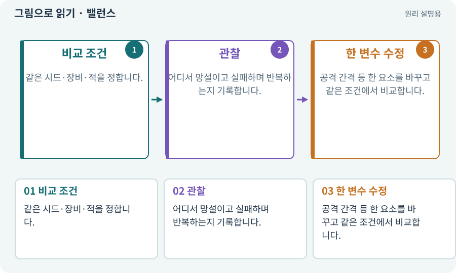

# 밸런스·위험과 보상·플레이테스트

**분야:** 지도·적 AI·전투 규칙

밸런스는 수치뿐 아니라 선택지의 가치와 위험·보상 관계를 조정하는 일입니다. 플레이테스트는 실제 사람이 조작하며 이해·재미·공정성을 관찰하는 과정입니다.

**찾아오는 이름:** 밸런스·위험과 보상·플레이테스트, 밸런스, 튜닝, 위험·보상, 플레이테스트, 밸런싱, 손맛

## 익숙한 것에 비유하면

매운맛 숫자만 같다고 모든 음식이 맛있는 것은 아닙니다. 재료 조합과 먹는 순서도 경험을 바꿉니다.



개념도입니다. 실제 Unity 화면이나 검사 결과가 아닙니다. 그림의 순서·색은 역할을 구분하며 실제 설정값은 프로젝트에서 확인합니다.

## 이렇게 작동합니다

### 1. 비교 조건

같은 시드·장비·적을 정합니다.

### 2. 관찰

어디서 망설이고 실패하며 반복하는지 기록합니다.

### 3. 한 변수 수정

공격 간격 등 한 요소를 바꾸고 같은 조건에서 비교합니다.

## 우리 RPG에서는 이렇게 만나요

회전 공격이 항상 최선이면 단일 강적·여러 약한 적·원거리 위험에서 서로 다른 선택이 유효한지 봅니다. 불편한 조작을 높은 난이도로 오해하지 않습니다.

## 이것과 혼동하지 마세요

자동 테스트는 피해 공식은 검사하지만 재미를 대신 확정하지 못합니다. AI의 점수만으로 통과시키지 않습니다.

## 이해했는지 한 번 생각해 보기

적 체력을 늘리면 무조건 더 어렵고 재미있나요?

<details><summary>답과 이유</summary>

반드시 그렇지 않습니다. 같은 행동을 오래 반복하게 만들 수 있으므로 선택과 피드백을 관찰합니다.

</details>

## 내 프로젝트에서 확인하고 싶다면

아래 요청은 읽기 전용으로 실제 대상을 확인하는 선택 요청입니다. 코드나 설정을 직접 편집할 필요는 없습니다.

```text
현재 프로젝트에서 밸런스·위험과 보상·플레이테스트 관련 요소가 어떻게 사용되는지 읽기 전용으로 확인해 줘. 실제 대상과 설정을 찾아 쉬운 말과 작은 예로 설명해 줘. 특히 다음 혼동을 구분해 줘: 자동 테스트는 피해 공식은 검사하지만 재미를 대신 확정하지 못합니다. AI의 점수만으로 통과시키지 않습니다. 아직 코드·설정·파일은 바꾸지 말고, 확인할 수 없는 내용은 따로 알려 줘.
```

## 이어지는 개념

[조우·전투 감독·페이즈](encounter.md) · [공격 예고·선행동작·회복](telegraph.md) · [로컬 전투 기록·텔레메트리](telemetry.md) · [난이도·접근성·공정성](difficulty.md)

## 이 개념을 사용하는 실습

[54 · 느낌을 근거로 밸런스 고치기](../index.html#lesson-054) · [68 · 피격 불꽃과 먼지 만들기](../index.html#lesson-068) · [80 · 나만의 2D RPG 완성하기](../index.html#lesson-080) · [103 · 같은 전투를 2D와 3D로 플레이하기](../index.html#lesson-103) · [134 · 화상·냉기·표식으로 전투 확장하기](../index.html#lesson-134) · [136 · 방패병과 화염술사 정예 추가하기](../index.html#lesson-136) · [144 · 이번 탐험에만 남는 유물 고르기](../index.html#lesson-144) · [149 · 상태와 보스 효과를 같은 데이터로 맞추기](../index.html#lesson-149) · [155 · 기록을 보고 제작 경제와 전투 조정하기](../index.html#lesson-155)

## 참고와 설명의 범위

이 항목의 비유·그림·RPG 수치·운영 규칙은 개념을 이해하기 위한 자체 설계 예제입니다. 특정 도구가 이 규칙을 자동으로 구현한다는 뜻은 아닙니다.


그림·계산 예제·조작 모형은 자체 제작한 설명입니다. 실제 Unity 화면, 서비스 생성 결과, 성능 실측 또는 게임 테스트 결과가 아닙니다. 자료 확인: 2026년 9월 26일.
