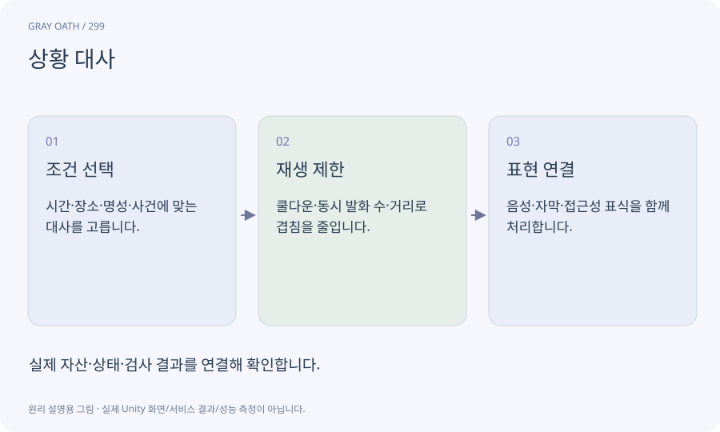

# 상황 대사

주요 대화창을 열지 않고 NPC가 상황에 맞게 짧게 말하는 대사입니다. 반복 제한·거리·우선순위·세계 상태를 갖춰야 소음이나 스포일러가 되지 않습니다.

## 익숙한 비유

시장 사람들이 지나가며 던지는 짧은 인사나 소문입니다.



## 작동 원리

### 1. 조건 선택

시간·장소·명성·사건에 맞는 대사를 고릅니다.

### 2. 재생 제한

쿨다운·동시 발화 수·거리로 겹침을 줄입니다.

### 3. 표현 연결

음성·자막·접근성 표식을 함께 처리합니다.

## 게임 속 예

촌장이 구조되기 전 소문과 이후 감사 인사가 다릅니다. 아직 모르는 엔딩 결과를 미리 말하지 않게 지식 조건을 둡니다.

## 혼동하지 않기

NPC마다 매 프레임 대사를 선택하거나 같은 소리를 겹쳐 재생하지 않습니다.

## 확인 질문

소리를 끈 사람도 내용을 알 수 있나요?

자막과 중요한 세계 상태 표시를 제공해 음성만 필수 단서가 되지 않게 합니다.

## 내 프로젝트에서 확인하기

```text
현재 GrayOathRPG3D에서 상황 대사을 사용하는 실제 대상과 동작을 읽기 전용으로 확인해 줘. 쉬운 말과 작은 사례로 설명하고 NPC마다 매 프레임 대사를 선택하거나 같은 소리를 겹쳐 재생하지 않습니다. 이 문제를 어떻게 막는지 보여 줘. 코드·데이터·설정은 아직 수정하지 마.
```

## 관련 해설

[npc-schedule](npc-schedule.md) · [audio](audio.md) · [localization](localization.md)

## 공식 참고

- [Unity · Timeline](https://docs.unity3d.com/Packages/com.unity.timeline@1.8/manual/index.html)
