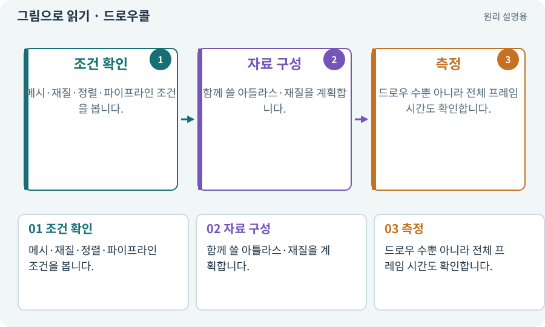

# 드로우콜·배칭·인스턴싱

**분야:** 입력·UI·소리·성능

드로우콜은 그릴 대상을 GPU에 요청하는 작업 단위입니다. 배칭·인스턴싱은 호환되는 객체를 묶어 제출 비용을 줄이는 방식이지만 조건이 있습니다.

**찾아오는 이름:** 드로우콜·배칭·인스턴싱, 드로우콜, Draw Call, 배칭, Batching, 인스턴싱, Instancing

## 익숙한 것에 비유하면

택배 하나마다 차를 보내기보다 함께 운송할 수 있는 것을 묶는 것입니다. 냉장·상온처럼 조건이 다르면 못 묶을 수 있습니다.



개념도입니다. 실제 Unity 화면이나 검사 결과가 아닙니다. 그림의 순서·색은 역할을 구분하며 실제 설정값은 프로젝트에서 확인합니다.

## 이렇게 작동합니다

### 1. 조건 확인

메시·재질·정렬·파이프라인 조건을 봅니다.

### 2. 자료 구성

함께 쓸 아틀라스·재질을 계획합니다.

### 3. 측정

드로우 수뿐 아니라 전체 프레임 시간도 확인합니다.

## 우리 RPG에서는 이렇게 만나요

같은 Sprite Atlas라도 재질·마스크·정렬이 다르면 여러 그리기 요청이 생길 수 있습니다. 숫자를 줄이려고 가림 순서를 깨뜨리지 않습니다.

## 이것과 혼동하지 마세요

드로우콜이 적으면 반드시 빠르다는 뜻은 아닙니다. 한 번의 매우 무거운 효과도 느릴 수 있습니다.

## 이해했는지 한 번 생각해 보기

아틀라스 하나인데 드로우콜이 여럿인 게 오류인가요?

<details><summary>답과 이유</summary>

반드시 그렇지 않습니다. 실제 분리 이유를 확인합니다.

</details>

## 내 프로젝트에서 확인하고 싶다면

아래 요청은 읽기 전용으로 실제 대상을 확인하는 선택 요청입니다. 코드나 설정을 직접 편집할 필요는 없습니다.

```text
현재 프로젝트에서 드로우콜·배칭·인스턴싱 관련 요소가 어떻게 사용되는지 읽기 전용으로 확인해 줘. 실제 대상과 설정을 찾아 쉬운 말과 작은 예로 설명해 줘. 특히 다음 혼동을 구분해 줘: 드로우콜이 적으면 반드시 빠르다는 뜻은 아닙니다. 한 번의 매우 무거운 효과도 느릴 수 있습니다. 아직 코드·설정·파일은 바꾸지 말고, 확인할 수 없는 내용은 따로 알려 줘.
```

## 이어지는 개념

[Sprite Atlas와 패킹](atlas.md) · [Material과 Shader](material.md) · [Profiler·병목·실기기 측정](profiler.md) · [CPU·GPU·RAM·VRAM](cpu-gpu.md)

## 이 개념을 사용하는 실습

[37 · 느려지는 원인을 측정해 고치기](../index.html#lesson-037) · [70 · 피격 강조와 보스 예고 셰이더 만들기](../index.html#lesson-070)

## 참고와 설명의 범위

기본 도구 동작은 아래 공식 자료를 참고했습니다. 비유·그림·RPG의 예시 수치와 정책은 이해를 위한 자체 예제입니다. 실제 API·지원 기능은 설치 버전과 계정에서 확인합니다.

- [Unity · 타깃 기기 프로파일링](https://docs.unity3d.com/6000.3/Documentation/Manual/profiling-target-device.html)

그림·계산 예제·조작 모형은 자체 제작한 설명입니다. 실제 Unity 화면, 서비스 생성 결과, 성능 실측 또는 게임 테스트 결과가 아닙니다. 자료 확인: 2026년 9월 26일.
