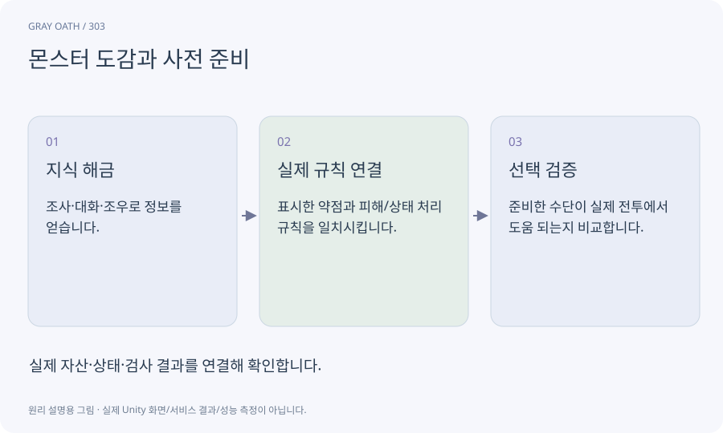

# 몬스터 도감과 사전 준비

발견한 적의 성질·행동·약점·관련 의뢰를 모아 보는 정보입니다. 사전에 얻은 정보가 장비·기름·마법 선택과 연결되어야 준비의 의미가 생깁니다.

## 익숙한 비유

산행 전에 날씨와 지형을 읽고 맞는 장비를 챙기는 안내서입니다.



## 작동 원리

### 1. 지식 해금

조사·대화·조우로 정보를 얻습니다.

### 2. 실제 규칙 연결

표시한 약점과 피해/상태 처리 규칙을 일치시킵니다.

### 3. 선택 검증

준비한 수단이 실제 전투에서 도움 되는지 비교합니다.

## 게임 속 예

망령 계약의 해제 조건과 표식 약점을 조사로 알 수 있습니다. 도감에 없는 약점을 개발자가 알고 쓰는 테스트만 하지 않습니다.

## 혼동하지 않기

표시 문구가 오래되면 실제 수치와 다른 정보를 주게 됩니다.

## 확인 질문

도감이 그냥 적 사진 목록이면 충분한가요?

장식은 가능하지만 준비형 전투를 목표로 한다면 행동 정보와 실제 선택을 연결해야 합니다.

## 내 프로젝트에서 확인하기

```text
현재 GrayOathRPG3D에서 몬스터 도감과 사전 준비을 사용하는 실제 대상과 동작을 읽기 전용으로 확인해 줘. 쉬운 말과 작은 사례로 설명하고 표시 문구가 오래되면 실제 수치와 다른 정보를 주게 됩니다. 이 문제를 어떻게 막는지 보여 줘. 코드·데이터·설정은 아직 수정하지 마.
```

## 관련 해설

[investigation](investigation.md) · [alchemy](alchemy.md) · [damage](damage.md)

## 공식 참고

- [Unity · AssetDatabase](https://docs.unity3d.com/6000.3/Documentation/ScriptReference/AssetDatabase.html)
