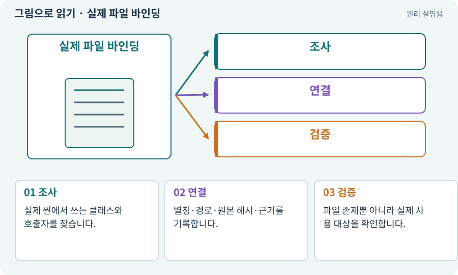

# 실제 파일 바인딩·앵커·심볼

**분야:** AI·스킬·훅·하네스 운영

여기서 바인딩은 작업표의 의미 있는 별칭을 실제 프로젝트 파일·메서드와 연결하는 과정입니다. 앵커는 파일 안에서 확인할 문자열이고 심볼은 클래스·함수 같은 코드 이름입니다. 입력 장치 Binding과 다릅니다.

**찾아오는 이름:** 실제 파일 바인딩·앵커·심볼, 파일 바인딩, 바인딩된 파일, binding, symbol, 심볼, anchor, anchor 문자열, UNBOUND, 바인딩, SYMBOL_MAP

## 익숙한 것에 비유하면

도면의 “전등 회로”가 실제 배선함의 어느 선인지 표시하는 작업입니다. 이름이 비슷하다고 같은 선은 아닙니다.



개념도입니다. 실제 Unity 화면이나 검사 결과가 아닙니다. 그림의 순서·색은 역할을 구분하며 실제 설정값은 프로젝트에서 확인합니다.

## 이렇게 작동합니다

### 1. 조사

실제 씬에서 쓰는 클래스와 호출자를 찾습니다.

### 2. 연결

별칭·경로·원본 해시·근거를 기록합니다.

### 3. 검증

파일 존재뿐 아니라 실제 사용 대상을 확인합니다.

## 우리 RPG에서는 이렇게 만나요

loot_model이라는 별칭을 실제 ItemInstance 파일로 연결합니다. 예시 PlayerController가 없다고 같은 이름의 빈 파일을 만들면 실제 게임에는 효과가 없을 수 있습니다.

## 이것과 혼동하지 마세요

앵커 문자열이 있다는 것만으로 코드의 의미와 실행 주체를 완전히 증명하지는 못합니다.

## 이해했는지 한 번 생각해 보기

UNBOUND 작업표가 거부되면 고장인가요?

<details><summary>답과 이유</summary>

실제 파일을 연결하기 전 실행하지 않도록 한 정상 경계일 수 있습니다.

</details>

## 내 프로젝트에서 확인하고 싶다면

아래 요청은 읽기 전용으로 실제 대상을 확인하는 선택 요청입니다. 코드나 설정을 직접 편집할 필요는 없습니다.

```text
현재 프로젝트에서 실제 파일 바인딩·앵커·심볼 관련 요소가 어떻게 사용되는지 읽기 전용으로 확인해 줘. 실제 대상과 설정을 찾아 쉬운 말과 작은 예로 설명해 줘. 특히 다음 혼동을 구분해 줘: 앵커 문자열이 있다는 것만으로 코드의 의미와 실행 주체를 완전히 증명하지는 못합니다. 아직 코드·설정·파일은 바꾸지 말고, 확인할 수 없는 내용은 따로 알려 줘.
```

## 이어지는 개념

[파일 경로·절대 경로·상대 경로](path.md) · [ID·고유 식별자·버전](identifier.md) · [해시·SHA-256·체크섬](hash.md) · [Input System·Action·Binding](input-system.md)

## 이 개념을 사용하는 실습

[107 · 원본을 보호하고 허용 경로 정하기](../index.html#lesson-107) · [120 · 자연어 요청을 계획으로 바꾸기](../index.html#lesson-120) · [123 · 기존 게임의 실제 파일 찾아 연결하기](../index.html#lesson-123) · [130 · 첫 확장 작업을 하네스에 연결하기](../index.html#lesson-130)

## 참고와 설명의 범위

이 항목의 비유·그림·RPG 수치·운영 규칙은 개념을 이해하기 위한 자체 설계 예제입니다. 특정 도구가 이 규칙을 자동으로 구현한다는 뜻은 아닙니다.


그림·계산 예제·조작 모형은 자체 제작한 설명입니다. 실제 Unity 화면, 서비스 생성 결과, 성능 실측 또는 게임 테스트 결과가 아닙니다. 자료 확인: 2026년 9월 26일.
