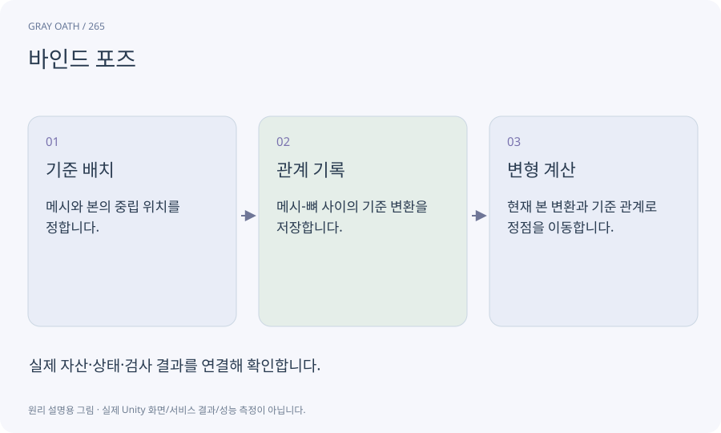

# 바인드 포즈

메시가 뼈에 연결될 때 기준이 된 뼈와 메시의 상대 변환입니다. 현재 뼈 위치만으로는 원래 어떤 위치의 정점을 움직여야 하는지 알 수 없습니다.

## 익숙한 비유

옷을 처음 마네킹에 입혔을 때의 기준 치수와 위치를 기록한 것입니다.



## 작동 원리

### 1. 기준 배치

메시와 본의 중립 위치를 정합니다.

### 2. 관계 기록

메시-뼈 사이의 기준 변환을 저장합니다.

### 3. 변형 계산

현재 본 변환과 기준 관계로 정점을 이동합니다.

## 게임 속 예

캐릭터 루트를 이동했을 때 팔이 원점으로 튀면 bindpose와 bone transform의 좌표계를 점검합니다.

## 혼동하지 않기

잘못된 바인드 포즈는 웨이트를 조절하는 것만으로 해결되지 않을 수 있습니다.

## 확인 질문

가만히 있을 때 정상이고 움직일 때만 늘어나면?

본 계층·스케일·바인드 포즈·가중치를 함께 확인해야 합니다.

## 내 프로젝트에서 확인하기

```text
현재 GrayOathRPG3D에서 바인드 포즈을 사용하는 실제 대상과 동작을 읽기 전용으로 확인해 줘. 쉬운 말과 작은 사례로 설명하고 잘못된 바인드 포즈는 웨이트를 조절하는 것만으로 해결되지 않을 수 있습니다. 이 문제를 어떻게 막는지 보여 줘. 코드·데이터·설정은 아직 수정하지 마.
```

## 관련 해설

[skinning](skinning.md) · [transform](transform.md) · [local-world](local-world.md)

## 공식 참고

- [Unity · Animation Rigging](https://docs.unity3d.com/Packages/com.unity.animation.rigging@1.3/manual/index.html)
