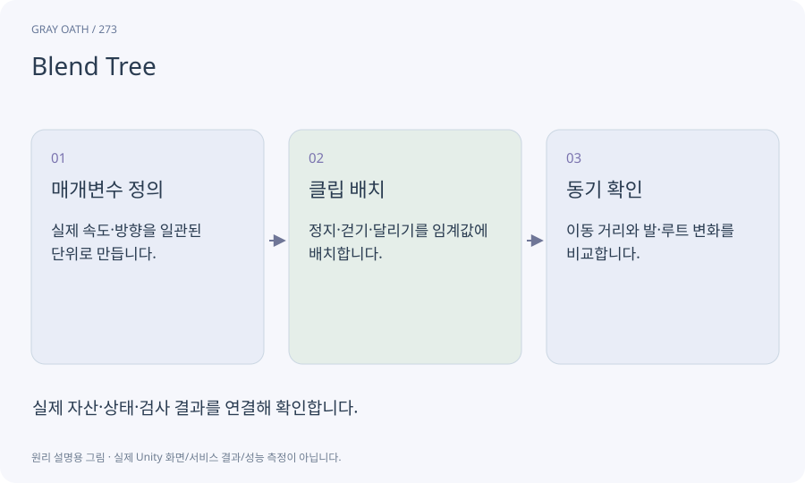

# Blend Tree

속도·방향 같은 매개변수에 따라 여러 애니메이션을 섞는 구조입니다. 섞인 그림과 실제 이동·공격 규칙의 주체를 분리해야 합니다.

## 익숙한 비유

걷기와 달리기의 안무를 속도에 맞게 부드럽게 이어 주는 믹서입니다.



## 작동 원리

### 1. 매개변수 정의

실제 속도·방향을 일관된 단위로 만듭니다.

### 2. 클립 배치

정지·걷기·달리기를 임계값에 배치합니다.

### 3. 동기 확인

이동 거리와 발·루트 변화를 비교합니다.

## 게임 속 예

이동 요청 속도가 아니라 실제 CharacterController 이동 속도를 기준으로 표시하면 벽에 막힌 채 달리는 문제를 줄일 수 있습니다.

## 혼동하지 않기

블렌드 비율이 타격 판정을 직접 여러 번 실행하게 만들면 안 됩니다.

## 확인 질문

걷기 모션은 자연스러운데 발이 미끄러지면?

실제 속도·클립 보폭·루트 모션 주체를 함께 맞춥니다.

## 내 프로젝트에서 확인하기

```text
현재 GrayOathRPG3D에서 Blend Tree을 사용하는 실제 대상과 동작을 읽기 전용으로 확인해 줘. 쉬운 말과 작은 사례로 설명하고 블렌드 비율이 타격 판정을 직접 여러 번 실행하게 만들면 안 됩니다. 이 문제를 어떻게 막는지 보여 줘. 코드·데이터·설정은 아직 수정하지 마.
```

## 관련 해설

[animator](animator.md) · [root-motion](root-motion.md) · [motor](motor.md)

## 공식 참고

- [Unity · Animation Rigging](https://docs.unity3d.com/Packages/com.unity.animation.rigging@1.3/manual/index.html)
