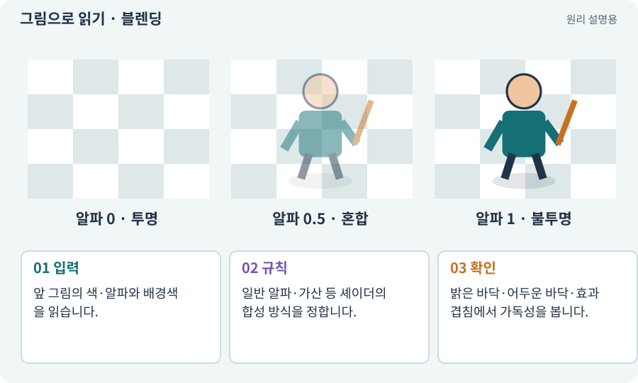

# 블렌딩·알파 혼합·가산 합성

**분야:** 자산 제작·렌더링 보충

블렌딩은 새로 그리는 색을 이미 그려진 배경과 섞는 규칙입니다. 알파 혼합은 투명도를 사용하고, 가산 합성은 빛처럼 값을 더하는 표현에 자주 사용합니다.

**찾아오는 이름:** 블렌딩·알파 혼합·가산 합성, 블렌딩, Blending, blend, 가산 합성, Additive, 알파 블렌드

## 익숙한 것에 비유하면

색종이를 반투명하게 겹치는 것과 손전등 빛을 더 비추는 것을 비교해 볼 수 있습니다.



개념도입니다. 실제 Unity 화면이나 검사 결과가 아닙니다. 그림의 순서·색은 역할을 구분하며 실제 설정값은 프로젝트에서 확인합니다.

## 이렇게 작동합니다

### 1. 입력

앞 그림의 색·알파와 배경색을 읽습니다.

### 2. 규칙

일반 알파·가산 등 셰이더의 합성 방식을 정합니다.

### 3. 확인

밝은 바닥·어두운 바닥·효과 겹침에서 가독성을 봅니다.

## 우리 RPG에서는 이렇게 만나요

붉은 공격 예고를 가산으로만 만들면 밝은 바닥에서 사라져 보일 수 있습니다. 불꽃의 빛은 가산, 위험 영역의 테두리는 별도 대비로 유지하는 방법을 비교합니다.

## 이것과 혼동하지 마세요

알파 값을 낮추는 것과 발광·가산 강도를 낮추는 것은 항상 같은 결과가 아닙니다.

## 이해했는지 한 번 생각해 보기

검은 배경에서 예쁜 마법이 흰 바닥에서 안 보이면?

<details><summary>답과 이유</summary>

합성 방식·대비·테두리를 실제 배경 조합에서 확인합니다.

</details>

## 내 프로젝트에서 확인하고 싶다면

아래 요청은 읽기 전용으로 실제 대상을 확인하는 선택 요청입니다. 코드나 설정을 직접 편집할 필요는 없습니다.

```text
현재 프로젝트에서 블렌딩·알파 혼합·가산 합성 관련 요소가 어떻게 사용되는지 읽기 전용으로 확인해 줘. 실제 대상과 설정을 찾아 쉬운 말과 작은 예로 설명해 줘. 특히 다음 혼동을 구분해 줘: 알파 값을 낮추는 것과 발광·가산 강도를 낮추는 것은 항상 같은 결과가 아닙니다. 아직 코드·설정·파일은 바꾸지 말고, 확인할 수 없는 내용은 따로 알려 줘.
```

## 이어지는 개념

[알파·RGBA·투명 배경](alpha.md) · [Shader Graph·노드·마스크](shader-graph.md) · [Material과 Shader](material.md) · [오버드로·투명 효과 비용](overdraw.md)

## 이 개념을 사용하는 실습

[88 · 3D 모델에 걷기와 공격 연결하기](../index.html#lesson-088)

## 참고와 설명의 범위

기본 도구 동작은 아래 공식 자료를 참고했습니다. 비유·그림·RPG의 예시 수치와 정책은 이해를 위한 자체 예제입니다. 실제 API·지원 기능은 설치 버전과 계정에서 확인합니다.

- [Unity Shader Graph · 시작](https://docs.unity3d.com/Packages/com.unity.shadergraph@17.3/manual/Getting-Started.html)

그림·계산 예제·조작 모형은 자체 제작한 설명입니다. 실제 Unity 화면, 서비스 생성 결과, 성능 실측 또는 게임 테스트 결과가 아닙니다. 자료 확인: 2026년 9월 26일.
