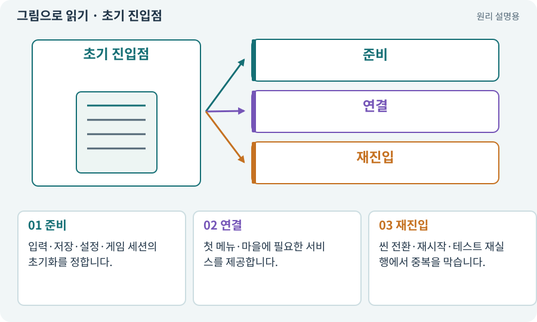

# 초기 진입점·Bootstrap·AppRoot

**분야:** 설명을 읽기 위한 기초 언어

초기 진입점은 앱이 시작할 때 필요한 공통 서비스와 첫 씬 흐름을 준비하는 곳입니다. 싱글턴은 하나의 공유 인스턴스에 접근하는 설계이고, 씬을 넘어 생존하는 오브젝트와 관련될 수 있지만 같은 말은 아닙니다.

**찾아오는 이름:** 초기 진입점·Bootstrap·AppRoot, Bootstrap, bootstrap, Boot, 부트스트랩, AppRoot, GameManager, 싱글턴, Singleton, DontDestroyOnLoad

## 익숙한 것에 비유하면

가게를 열 때 전기·계산대·재고를 준비하는 순서입니다. 문을 다시 열 때 계산대를 두 개씩 추가하면 안 됩니다.



개념도입니다. 실제 Unity 화면이나 검사 결과가 아닙니다. 그림의 순서·색은 역할을 구분하며 실제 설정값은 프로젝트에서 확인합니다.

## 이렇게 작동합니다

### 1. 준비

입력·저장·설정·게임 세션의 초기화를 정합니다.

### 2. 연결

첫 메뉴·마을에 필요한 서비스를 제공합니다.

### 3. 재진입

씬 전환·재시작·테스트 재실행에서 중복을 막습니다.

## 우리 RPG에서는 이렇게 만나요

마을로 돌아올 때 AppRoot가 다시 생성돼 같은 피해 이벤트를 두 번 구독하면 보상이 중복될 수 있습니다. 오브젝트 수와 구독 수를 실제로 확인합니다.

## 이것과 혼동하지 마세요

모든 기능을 거대한 GameManager 하나에 넣어야 한다는 뜻은 아닙니다.

## 이해했는지 한 번 생각해 보기

씬을 세 번 오가니 BGM이 세 겹으로 나면?

<details><summary>답과 이유</summary>

살아남은 관리자·AudioSource·중복 생성과 수명 정리를 확인합니다.

</details>

## 내 프로젝트에서 확인하고 싶다면

아래 요청은 읽기 전용으로 실제 대상을 확인하는 선택 요청입니다. 코드나 설정을 직접 편집할 필요는 없습니다.

```text
현재 프로젝트에서 초기 진입점·Bootstrap·AppRoot 관련 요소가 어떻게 사용되는지 읽기 전용으로 확인해 줘. 실제 대상과 설정을 찾아 쉬운 말과 작은 예로 설명해 줘. 특히 다음 혼동을 구분해 줘: 모든 기능을 거대한 GameManager 하나에 넣어야 한다는 뜻은 아닙니다. 아직 코드·설정·파일은 바꾸지 말고, 확인할 수 없는 내용은 따로 알려 줘.
```

## 이어지는 개념

[씬과 씬 전환](scene.md) · [수명주기·초기화·정리](lifecycle.md) · [이벤트·콜백·구독·이벤트 버스](event.md) · [참조·null·Missing Reference](reference.md)

## 이 개념을 사용하는 실습

[06 · 시작 메뉴와 테스트 공간 연결하기](../index.html#lesson-006) · [11 · PC와 휴대폰에서 처음 실행하기](../index.html#lesson-011) · [15 · 다른 방식으로 싸우는 적 추가하기](../index.html#lesson-015) · [26 · 새 게임·이어하기·마을 연결하기](../index.html#lesson-026) · [39 · 다른 PC와 Android 에서 실행할 파일 만들기](../index.html#lesson-039) · [73 · 주소로 에셋 불러오기](../index.html#lesson-073) · [79 · 추가 기능을 하나의 게임으로 합치기](../index.html#lesson-079) · [93 · 3D 마을과 퀘스트 연결하기](../index.html#lesson-093)

## 참고와 설명의 범위

기본 도구 동작은 아래 공식 자료를 참고했습니다. 비유·그림·RPG의 예시 수치와 정책은 이해를 위한 자체 예제입니다. 실제 API·지원 기능은 설치 버전과 계정에서 확인합니다.

- [Unity · 컴포넌트](https://docs.unity3d.com/6000.3/Documentation/Manual/Components.html)

그림·계산 예제·조작 모형은 자체 제작한 설명입니다. 실제 Unity 화면, 서비스 생성 결과, 성능 실측 또는 게임 테스트 결과가 아닙니다. 자료 확인: 2026년 9월 26일.
