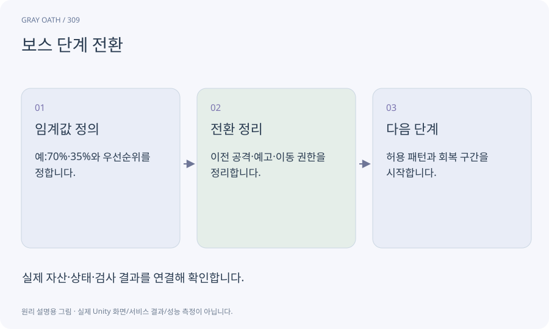

# 보스 단계 전환

체력·사건·시간 등에 따라 보스의 행동 후보와 규칙이 바뀌는 상태입니다. 단계 경계를 한 번에 넘는 큰 피해도 처리해야 합니다.

## 익숙한 비유

공연의1막·2막 전환처럼 이전 막을 정리한 뒤 다음 막을 시작합니다.



## 작동 원리

### 1. 임계값 정의

예:70%·35%와 우선순위를 정합니다.

### 2. 전환 정리

이전 공격·예고·이동 권한을 정리합니다.

### 3. 다음 단계

허용 패턴과 회복 구간을 시작합니다.

## 게임 속 예

체력이80%에서20%로 떨어져도2단계·3단계 공격을 동시에 실행하지 않습니다. 필요한 전환 사건을 순서대로 확정합니다.

## 혼동하지 않기

모든 단계의 코루틴을 켜둔 채 flag만 바꾸면 공격이 겹칠 수 있습니다.

## 확인 질문

보스가 전환 중 죽으면?

사망 상태가 우선하며 공격·예고·보상 수명주기를 한 번만 마무리합니다.

## 내 프로젝트에서 확인하기

```text
현재 GrayOathRPG3D에서 보스 단계 전환을 사용하는 실제 대상과 동작을 읽기 전용으로 확인해 줘. 쉬운 말과 작은 사례로 설명하고 모든 단계의 코루틴을 켜둔 채 flag만 바꾸면 공격이 겹칠 수 있습니다. 이 문제를 어떻게 막는지 보여 줘. 코드·데이터·설정은 아직 수정하지 마.
```

## 관련 해설

[state-machine](state-machine.md) · [telegraph](telegraph.md) · [lifecycle](lifecycle.md)

## 공식 참고

- [Unity · UI Toolkit EditorWindow](https://docs.unity3d.com/6000.3/Documentation/Manual/UIE-HowTo-CreateEditorWindow.html)
