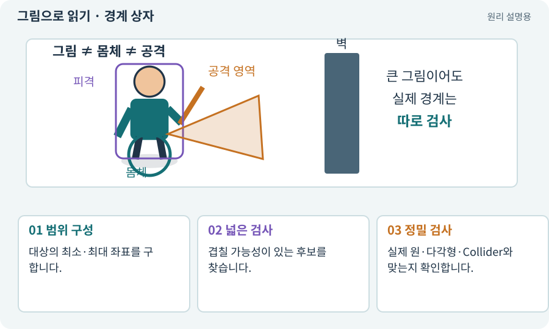

# 경계 상자·AABB·반경

**분야:** 설명을 읽기 위한 기초 언어

Bounds는 대상을 감싸는 범위이며 AABB는 좌표축에 맞춘 경계 상자입니다. 넓은 후보를 빠르게 찾는 데 유용하지만 실제 모양과 같지는 않습니다.

**찾아오는 이름:** 경계 상자·AABB·반경, Bounds, bounds, AABB, 경계 상자, 반경, Radius, radius, bodyRadius

## 익숙한 것에 비유하면

복잡한 물건이 들어간 직사각형 포장 상자입니다. 상자 안이 모두 물건으로 꽉 찬 것은 아닙니다.



개념도입니다. 실제 Unity 화면이나 검사 결과가 아닙니다. 그림의 순서·색은 역할을 구분하며 실제 설정값은 프로젝트에서 확인합니다.

## 이렇게 작동합니다

### 1. 범위 구성

대상의 최소·최대 좌표를 구합니다.

### 2. 넓은 검사

겹칠 가능성이 있는 후보를 찾습니다.

### 3. 정밀 검사

실제 원·다각형·Collider와 맞는지 확인합니다.

## 우리 RPG에서는 이렇게 만나요

원형 회전 공격의 AABB 모서리에 있는 적은 상자 안에는 있어도 원 밖일 수 있습니다. 최종 거리와 적의 몸체를 검사해야 합니다.

## 이것과 혼동하지 마세요

텍스처의 투명 여백까지 포함한 그림 Bounds를 실제 충돌 몸체로 곧바로 쓰지 않습니다.

## 이해했는지 한 번 생각해 보기

큰 나무 그림의 빈 모서리도 벽이 되나요?

<details><summary>답과 이유</summary>

그림 경계와 Collider를 분리하면 빈 곳을 이동 가능하게 만들 수 있습니다.

</details>

## 내 프로젝트에서 확인하고 싶다면

아래 요청은 읽기 전용으로 실제 대상을 확인하는 선택 요청입니다. 코드나 설정을 직접 편집할 필요는 없습니다.

```text
현재 프로젝트에서 경계 상자·AABB·반경 관련 요소가 어떻게 사용되는지 읽기 전용으로 확인해 줘. 실제 대상과 설정을 찾아 쉬운 말과 작은 예로 설명해 줘. 특히 다음 혼동을 구분해 줘: 텍스처의 투명 여백까지 포함한 그림 Bounds를 실제 충돌 몸체로 곧바로 쓰지 않습니다. 아직 코드·설정·파일은 바꾸지 말고, 확인할 수 없는 내용은 따로 알려 줘.
```

## 이어지는 개념

[Collider와 몸체 경계](collider.md) · [Hitbox·Hurtbox·Body](hitbox.md) · [몸체 여유·모서리 통과](clearance.md) · [벡터·방향·정규화](vector.md)

## 이 개념을 사용하는 실습

[07 · 캐릭터와 벽이 있는 공간 만들기](../index.html#lesson-007) · [09 · 클릭한 곳까지 벽을 돌아가기](../index.html#lesson-009) · [13 · 적을 클릭해 접근하고 공격하기](../index.html#lesson-013) · [15 · 다른 방식으로 싸우는 적 추가하기](../index.html#lesson-015) · [18 · 베기·마력탄·회전 공격 만들기](../index.html#lesson-018) · [28 · 여덟 구역의 첫 던전 만들기](../index.html#lesson-028) · [29 · 방마다 적과 상자 배치하기](../index.html#lesson-029) · [30 · 예고를 보고 피하는 보스 만들기](../index.html#lesson-030) · [33 · 기본 캐릭터·몬스터·타일 아트 만들기](../index.html#lesson-033) · [37 · 느려지는 원인을 측정해 고치기](../index.html#lesson-037) · [46 · 랜덤 지도 위를 실제로 걷기](../index.html#lesson-046) · [47 · 실패하는 시드를 찾고 복구하기](../index.html#lesson-047) · [48 · 적이 나를 보고 놓치게 만들기](../index.html#lesson-048) · [49 · 여러 근접 적의 공격 나누기](../index.html#lesson-049) · [55 · 어떤 그림도 맞춰 넣는 아트 규격 정하기](../index.html#lesson-055) · [66 · 타일 경계와 랜덤맵 외형 연결하기](../index.html#lesson-066) · [69 · 베기와 폭발을 시트 애니메이션으로 만들기](../index.html#lesson-069) · [70 · 피격 강조와 보스 예고 셰이더 만들기](../index.html#lesson-070) · [82 · 게임 규칙은 재사용하고 공간만 바꾸기](../index.html#lesson-082) · [83 · 3D 카메라와 재질로 공간 보기](../index.html#lesson-083) · [85 · 3D 캐릭터를 한 모터로 움직이기](../index.html#lesson-085) · [86 · 3D에서도 클릭한 곳까지 돌아가기](../index.html#lesson-086) · [87 · 같은 캐릭터를 실제 3D 모델로 만들기](../index.html#lesson-087) · [91 · 보스 예고를 3D 바닥에 맞추기](../index.html#lesson-091) · [95 · 3D 조명과 환경을 읽기 좋게 만들기](../index.html#lesson-095) · [97 · 선택: 3D 모델에서 2D 시트 만들기](../index.html#lesson-097) · [142 · 배운 스킬의 변형 선택하기](../index.html#lesson-142) · [143 · 새 랜덤 지역 봉인된 대장간 만들기](../index.html#lesson-143) · [148 · 아트 역할로 새 지역 외형 완성하기](../index.html#lesson-148) · [149 · 상태와 보스 효과를 같은 데이터로 맞추기](../index.html#lesson-149)

## 참고와 설명의 범위

기본 도구 동작은 아래 공식 자료를 참고했습니다. 비유·그림·RPG의 예시 수치와 정책은 이해를 위한 자체 예제입니다. 실제 API·지원 기능은 설치 버전과 계정에서 확인합니다.

- [Unity · Physics2D.CircleCast](https://docs.unity3d.com/6000.3/Documentation/ScriptReference/Physics2D.CircleCast.html)

그림·계산 예제·조작 모형은 자체 제작한 설명입니다. 실제 Unity 화면, 서비스 생성 결과, 성능 실측 또는 게임 테스트 결과가 아닙니다. 자료 확인: 2026년 9월 26일.
