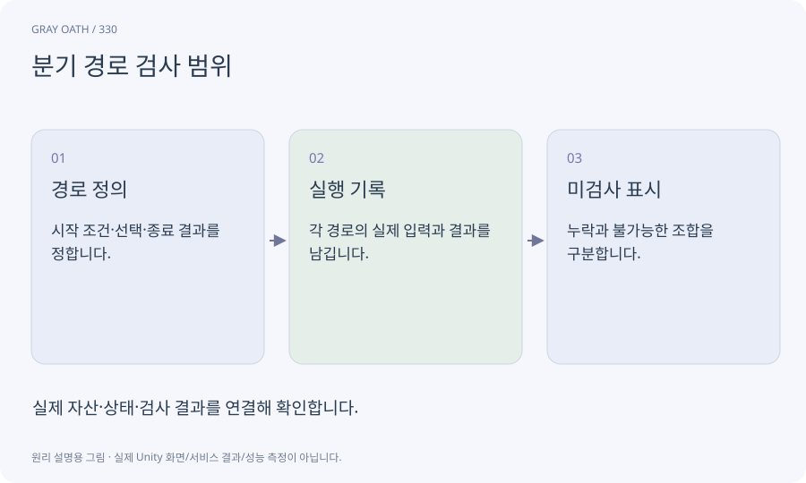

# 분기 경로 검사 범위

조건과 선택이 있는 기능에서 어떤 경로를 실제로 검사했는지 나타내는 범위입니다. 테스트 개수와 가능한 모든 세계 상태의 수는 다릅니다.

## 익숙한 비유

갈림길 지도에서 실제로 걸어 본 길을 색칠하는 것입니다.



## 작동 원리

### 1. 경로 정의

시작 조건·선택·종료 결과를 정합니다.

### 2. 실행 기록

각 경로의 실제 입력과 결과를 남깁니다.

### 3. 미검사 표시

누락과 불가능한 조합을 구분합니다.

## 게임 속 예

공존 엔딩 가능/불가, 동료 있음/없음, 단서 선행 발견 등을 조합합니다.28개 제목을 찾는 검사는28개 퀘스트 완주와 다릅니다.

## 혼동하지 않기

구조적 선을 모두 방문해도 조건·저장·앱 중단의 모든 조합이 검증되지는 않습니다.

## 확인 질문

모든 분기를 한 사람이 처음부터 플레이해야 하나요?

순수 논리 fixture와 실제 대표 플레이를 나눌 수 있지만 어떤 경로를 어떻게 검사했는지 정직하게 표시합니다.

## 내 프로젝트에서 확인하기

```text
현재 GrayOathRPG3D에서 분기 경로 검사 범위을 사용하는 실제 대상과 동작을 읽기 전용으로 확인해 줘. 쉬운 말과 작은 사례로 설명하고 구조적 선을 모두 방문해도 조건·저장·앱 중단의 모든 조합이 검증되지는 않습니다. 이 문제를 어떻게 막는지 보여 줘. 코드·데이터·설정은 아직 수정하지 마.
```

## 관련 해설

[graph-validation](graph-validation.md) · [ending-state](ending-state.md) · [replay](replay.md)

## 공식 참고

- [Unity · AssetDatabase](https://docs.unity3d.com/6000.3/Documentation/ScriptReference/AssetDatabase.html)
