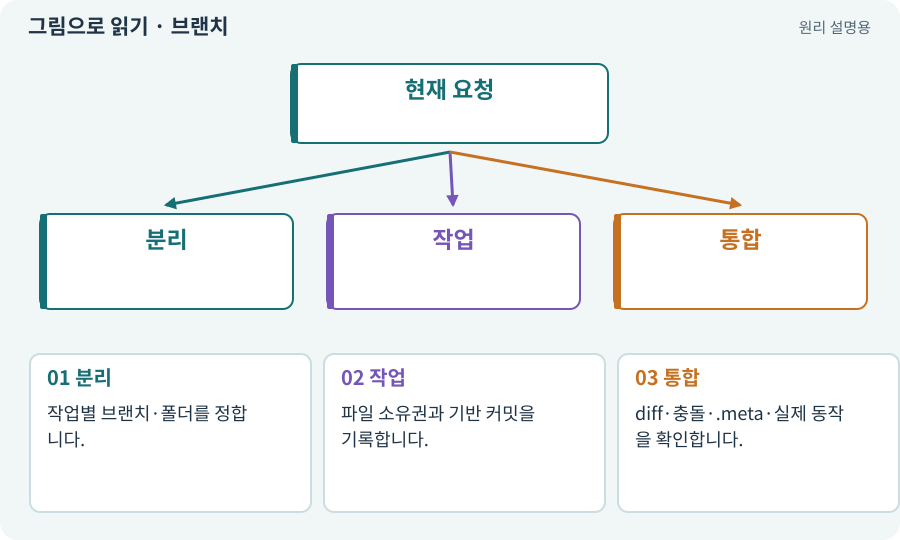

# 브랜치·병합·충돌·worktree

**분야:** 비동기·다운로드·빌드·버전 관리

브랜치는 서로 다른 작업 이력을 나누는 이름입니다. 병합은 변경을 합치는 것이고 충돌은 자동으로 결합하기 어려운 부분입니다. worktree는 한 저장소에서 별도 작업 디렉터리를 제공하는 기능입니다.

**찾아오는 이름:** 브랜치·병합·충돌·worktree, 브랜치, Branch, branch, merge, 병합, 충돌 해결, worktree, Git worktree

## 익숙한 것에 비유하면

같은 문서의 두 개정안을 따로 작성한 뒤 공통 원본과 대조해 합치는 과정입니다.



개념도입니다. 실제 Unity 화면이나 검사 결과가 아닙니다. 그림의 순서·색은 역할을 구분하며 실제 설정값은 프로젝트에서 확인합니다.

## 이렇게 작동합니다

### 1. 분리

작업별 브랜치·폴더를 정합니다.

### 2. 작업

파일 소유권과 기반 커밋을 기록합니다.

### 3. 통합

diff·충돌·.meta·실제 동작을 확인합니다.

## 우리 RPG에서는 이렇게 만나요

AI 워커가 서로 다른 코드 파일을 고쳐도 같은 프리팹 참조와 공개 인터페이스를 바꾸면 통합 문제가 생길 수 있습니다. 작업 디렉터리를 나눴다고 Editor 동시 사용까지 안전해지는 것은 아닙니다.

## 이것과 혼동하지 마세요

문자열 충돌이 없다는 것과 의미 충돌이 없다는 것은 다릅니다.

## 이해했는지 한 번 생각해 보기

자동 merge가 끝났다면 게임 테스트를 생략해도 될까요?

<details><summary>답과 이유</summary>

합친 상태에서 다시 컴파일·기능·회귀 검사를 해야 합니다.

</details>

## 내 프로젝트에서 확인하고 싶다면

아래 요청은 읽기 전용으로 실제 대상을 확인하는 선택 요청입니다. 코드나 설정을 직접 편집할 필요는 없습니다.

```text
현재 프로젝트에서 브랜치·병합·충돌·worktree 관련 요소가 어떻게 사용되는지 읽기 전용으로 확인해 줘. 실제 대상과 설정을 찾아 쉬운 말과 작은 예로 설명해 줘. 특히 다음 혼동을 구분해 줘: 문자열 충돌이 없다는 것과 의미 충돌이 없다는 것은 다릅니다. 아직 코드·설정·파일은 바꾸지 말고, 확인할 수 없는 내용은 따로 알려 줘.
```

## 이어지는 개념

[Git·저장소·커밋](git.md) · [의존성·DAG·위상 정렬](dependency.md) · [파일 소유권·읽기 범위·쓰기 범위](ownership.md) · [잠금·경합·경쟁 상태](lock.md)

## 이 개념을 사용하는 실습

[66 · 타일 경계와 랜덤맵 외형 연결하기](../index.html#lesson-066) · [81 · 2D 게임을 남기고 3D 작업 시작하기](../index.html#lesson-081) · [133 · 첫 기능의 실패를 고쳐 다음 기준 만들기](../index.html#lesson-133)

## 참고와 설명의 범위

기본 도구 동작은 아래 공식 자료를 참고했습니다. 비유·그림·RPG의 예시 수치와 정책은 이해를 위한 자체 예제입니다. 실제 API·지원 기능은 설치 버전과 계정에서 확인합니다.

- [Git · worktree](https://git-scm.com/docs/git-worktree)

그림·계산 예제·조작 모형은 자체 제작한 설명입니다. 실제 Unity 화면, 서비스 생성 결과, 성능 실측 또는 게임 테스트 결과가 아닙니다. 자료 확인: 2026년 9월 26일.
