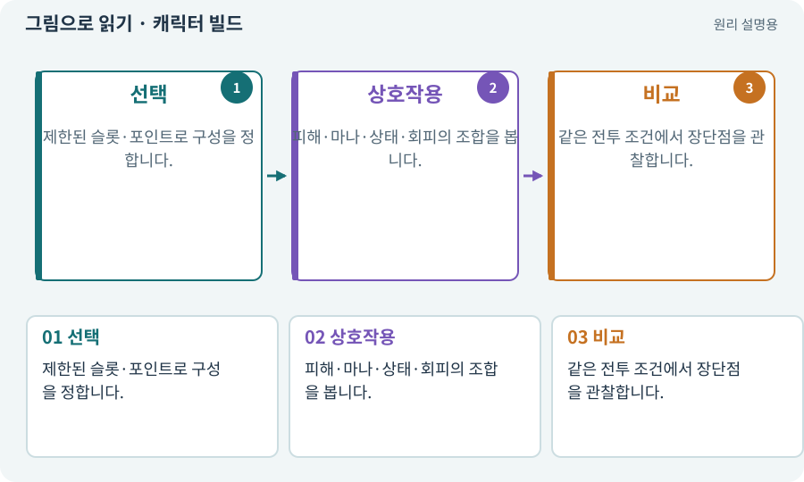

# 캐릭터 빌드·로드아웃

**분야:** 코드·데이터·저장·검사

캐릭터 빌드는 장비·스킬·룬 등의 조합으로 만든 전투 방식입니다. 로드아웃은 선택해 둔 구성입니다. 실행 파일을 생성하는 빌드와는 뜻이 다릅니다.

**찾아오는 이름:** 캐릭터 빌드·로드아웃, 캐릭터 빌드, 장비 빌드, 빌드를 바꾸, 로드아웃, loadout, 특성, 스킬 변형

## 익숙한 것에 비유하면

같은 요리사가 칼·도구·재료를 다르게 준비해 다른 요리를 잘하는 것과 같습니다.



개념도입니다. 실제 Unity 화면이나 검사 결과가 아닙니다. 그림의 순서·색은 역할을 구분하며 실제 설정값은 프로젝트에서 확인합니다.

## 이렇게 작동합니다

### 1. 선택

제한된 슬롯·포인트로 구성을 정합니다.

### 2. 상호작용

피해·마나·상태·회피의 조합을 봅니다.

### 3. 비교

같은 전투 조건에서 장단점을 관찰합니다.

## 우리 RPG에서는 이렇게 만나요

베기를 강화한 구성은 단일 적, 회전 공격 구성은 여러 적에 유리하도록 차이를 설계할 수 있습니다. 항상 한 조합만 최선이면 선택 이유가 약해집니다.

## 이것과 혼동하지 마세요

강해졌다는 인상만으로 밸런스를 확정하지 않습니다. 같은 조건에서 비교합니다.

## 이해했는지 한 번 생각해 보기

로드아웃 변경은 앱을 다시 빌드한다는 뜻인가요?

<details><summary>답과 이유</summary>

아닙니다. 게임 안의 선택 데이터를 바꾸는 것입니다.

</details>

## 내 프로젝트에서 확인하고 싶다면

아래 요청은 읽기 전용으로 실제 대상을 확인하는 선택 요청입니다. 코드나 설정을 직접 편집할 필요는 없습니다.

```text
현재 프로젝트에서 캐릭터 빌드·로드아웃 관련 요소가 어떻게 사용되는지 읽기 전용으로 확인해 줘. 실제 대상과 설정을 찾아 쉬운 말과 작은 예로 설명해 줘. 특히 다음 혼동을 구분해 줘: 강해졌다는 인상만으로 밸런스를 확정하지 않습니다. 같은 조건에서 비교합니다. 아직 코드·설정·파일은 바꾸지 말고, 확인할 수 없는 내용은 따로 알려 줘.
```

## 이어지는 개념

[스킬트리·노드·선행 조건](skill-tree.md) · [장비·슬롯·재계산](equipment.md) · [밸런스·위험과 보상·플레이테스트](balance.md) · [게임 빌드·개발 빌드·배포](build.md)

## 이 개념을 사용하는 실습

[43 · 빌드를 바꾸며 전투 비교하기](../index.html#lesson-043) · [145 · 지원 동료 하나 만들기](../index.html#lesson-145) · [147 · 용광로 감시자와 3단계 전투 만들기](../index.html#lesson-147) · [160 · 대장간 보스까지 완주하고 새 기능 맡기기](../index.html#lesson-160)

## 참고와 설명의 범위

이 항목의 비유·그림·RPG 수치·운영 규칙은 개념을 이해하기 위한 자체 설계 예제입니다. 특정 도구가 이 규칙을 자동으로 구현한다는 뜻은 아닙니다.


그림·계산 예제·조작 모형은 자체 제작한 설명입니다. 실제 Unity 화면, 서비스 생성 결과, 성능 실측 또는 게임 테스트 결과가 아닙니다. 자료 확인: 2026년 9월 26일.
