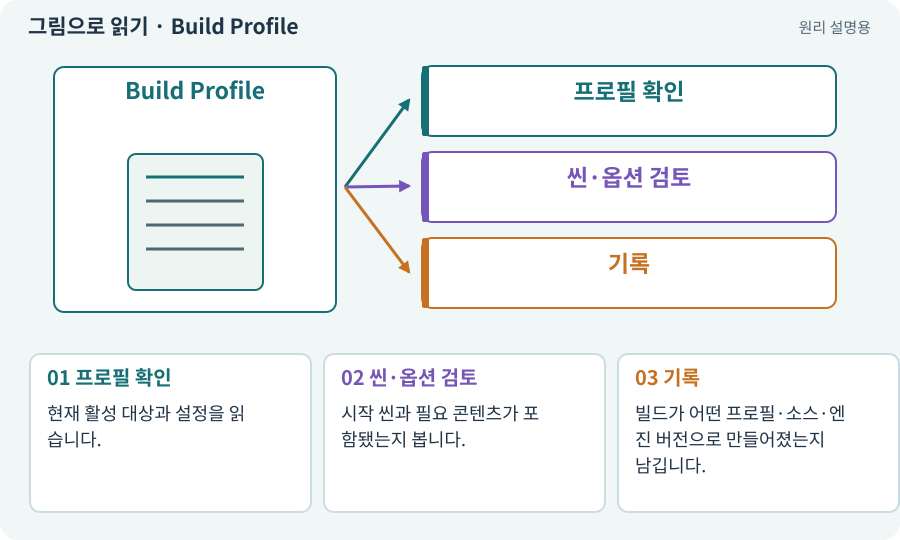

# Build Profile·플랫폼 설정

**분야:** 비동기·다운로드·빌드·버전 관리

빌드 프로필은 목표 플랫폼과 그에 맞는 빌드 설정을 관리하는 구성입니다. 포함 씬·품질·개발 옵션·스크립팅 백엔드 같은 항목을 실제 사용 설정과 연결해야 합니다.

**찾아오는 이름:** Build Profile·플랫폼 설정, Build Profile, Build Profiles, 빌드 프로필, 빌드 설정, 씬 목록

## 익숙한 것에 비유하면

같은 제품을 국내용과 해외용으로 포장할 때 규격·설명서·구성품을 구분한 주문서입니다.



개념도입니다. 실제 Unity 화면이나 검사 결과가 아닙니다. 그림의 순서·색은 역할을 구분하며 실제 설정값은 프로젝트에서 확인합니다.

## 이렇게 작동합니다

### 1. 프로필 확인

현재 활성 대상과 설정을 읽습니다.

### 2. 씬·옵션 검토

시작 씬과 필요 콘텐츠가 포함됐는지 봅니다.

### 3. 기록

빌드가 어떤 프로필·소스·엔진 버전으로 만들어졌는지 남깁니다.

## 우리 RPG에서는 이렇게 만나요

Editor에서 열려 있는 실습장과 앱의 첫 씬이 다를 수 있습니다. 빌드 후 메인 메뉴에서 새 게임을 시작해 마을과 던전으로 이동하는 경로를 검사합니다.

## 이것과 혼동하지 마세요

파일명에 Android라고 적었다고 실제 타깃·ABI가 맞는 것은 아닙니다.

## 이해했는지 한 번 생각해 보기

새 씬을 저장했는데 빌드에서 못 찾으면?

<details><summary>답과 이유</summary>

씬 포함 방식·주소·프로필과 실제 빌드 결과를 확인합니다.

</details>

## 내 프로젝트에서 확인하고 싶다면

아래 요청은 읽기 전용으로 실제 대상을 확인하는 선택 요청입니다. 코드나 설정을 직접 편집할 필요는 없습니다.

```text
현재 프로젝트에서 Build Profile·플랫폼 설정 관련 요소가 어떻게 사용되는지 읽기 전용으로 확인해 줘. 실제 대상과 설정을 찾아 쉬운 말과 작은 예로 설명해 줘. 특히 다음 혼동을 구분해 줘: 파일명에 Android라고 적었다고 실제 타깃·ABI가 맞는 것은 아닙니다. 아직 코드·설정·파일은 바꾸지 말고, 확인할 수 없는 내용은 따로 알려 줘.
```

## 이어지는 개념

[씬과 씬 전환](scene.md) · [Addressables·주소로 에셋 불러오기](addressables.md) · [게임 빌드·개발 빌드·배포](build.md) · [매니페스트·패키지 목록·빌드 기록](manifest.md)

## 이 개념을 사용하는 실습

[11 · PC와 휴대폰에서 처음 실행하기](../index.html#lesson-011) · [83 · 3D 카메라와 재질로 공간 보기](../index.html#lesson-083) · [102 · 네 배포물을 구분해 만들기](../index.html#lesson-102)

## 참고와 설명의 범위

기본 도구 동작은 아래 공식 자료를 참고했습니다. 비유·그림·RPG의 예시 수치와 정책은 이해를 위한 자체 예제입니다. 실제 API·지원 기능은 설치 버전과 계정에서 확인합니다.

- [Unity · Build Profiles](https://docs.unity3d.com/6000.3/Documentation/Manual/build-profiles.html)

그림·계산 예제·조작 모형은 자체 제작한 설명입니다. 실제 Unity 화면, 서비스 생성 결과, 성능 실측 또는 게임 테스트 결과가 아닙니다. 자료 확인: 2026년 9월 26일.
