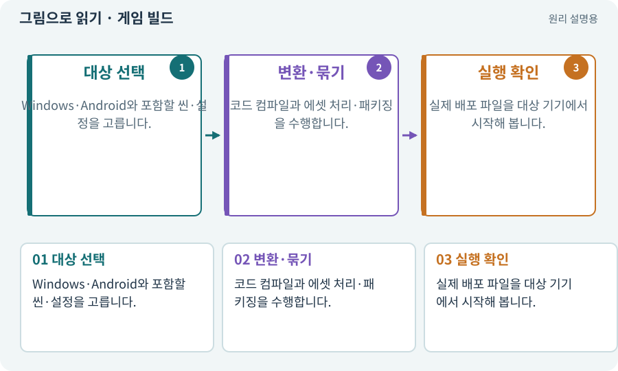

# 게임 빌드·개발 빌드·배포

**분야:** 비동기·다운로드·빌드·버전 관리

게임 빌드는 프로젝트의 코드와 자산을 목표 플랫폼에서 실행할 형태로 만드는 과정입니다. Editor에서 Play한 것과 다르고, 빌드 파일 생성과 외부 스토어 게시도 다릅니다.

**찾아오는 이름:** 게임 빌드·개발 빌드·배포, 빌드, Build, build, Development Build, Release Build, 배포물, 배포

## 익숙한 것에 비유하면

설계도와 작업실 시제품을 실제 손님이 사용할 제품으로 포장하는 단계입니다.



개념도입니다. 실제 Unity 화면이나 검사 결과가 아닙니다. 그림의 순서·색은 역할을 구분하며 실제 설정값은 프로젝트에서 확인합니다.

## 이렇게 작동합니다

### 1. 대상 선택

Windows·Android와 포함할 씬·설정을 고릅니다.

### 2. 변환·묶기

코드 컴파일과 에셋 처리·패키징을 수행합니다.

### 3. 실행 확인

실제 배포 파일을 대상 기기에서 시작해 봅니다.

## 우리 RPG에서는 이렇게 만나요

2D Windows, 2D Android, 3D Windows, 3D Android는 별개 결과물입니다. Development Build의 진단 비용이 일반 배포 빌드와 같다고 가정하지 않습니다.

## 이것과 혼동하지 마세요

스킬·장비 조합을 뜻하는 캐릭터 “빌드”와 프로그램을 만드는 “빌드”를 구분합니다.

## 이해했는지 한 번 생각해 보기

Editor에서 정상 동작하면 Android 빌드는 필요 없나요?

<details><summary>답과 이유</summary>

실제 입력·권한·성능·플랫폼 코드 차이가 있어 별도로 빌드하고 실행해야 합니다.

</details>

## 내 프로젝트에서 확인하고 싶다면

아래 요청은 읽기 전용으로 실제 대상을 확인하는 선택 요청입니다. 코드나 설정을 직접 편집할 필요는 없습니다.

```text
현재 프로젝트에서 게임 빌드·개발 빌드·배포 관련 요소가 어떻게 사용되는지 읽기 전용으로 확인해 줘. 실제 대상과 설정을 찾아 쉬운 말과 작은 예로 설명해 줘. 특히 다음 혼동을 구분해 줘: 스킬·장비 조합을 뜻하는 캐릭터 “빌드”와 프로그램을 만드는 “빌드”를 구분합니다. 아직 코드·설정·파일은 바꾸지 말고, 확인할 수 없는 내용은 따로 알려 줘.
```

## 이어지는 개념

[Build Profile·플랫폼 설정](build-profile.md) · [APK·Android 설치 파일](apk.md) · [ABI·ARM64·x86_64](abi.md) · [Mono·IL2CPP·AOT](il2cpp.md)

## 이 개념을 사용하는 실습

[01 · 빈 2D 프로젝트 만들기](../index.html#lesson-001) · [03 · AI와 실행 중인 Unity 연결하기](../index.html#lesson-003) · [04 · 되돌릴 수 있는 작업 습관 만들기](../index.html#lesson-004) · [11 · PC와 휴대폰에서 처음 실행하기](../index.html#lesson-011) · [19 · 누가 때렸는지 보이는 전투 만들기](../index.html#lesson-019) · [20 · 같은 검 두 자루를 다른 물건으로 다루기](../index.html#lesson-020) · [25 · 게임을 껐다 켜도 장비 유지하기](../index.html#lesson-025) · [32 · 길 안내와 처음 하는 사람의 동선 만들기](../index.html#lesson-032) · [36 · 휴대폰에서 두 손가락으로 전투하기](../index.html#lesson-036) · [37 · 느려지는 원인을 측정해 고치기](../index.html#lesson-037) · [39 · 다른 PC와 Android 에서 실행할 파일 만들기](../index.html#lesson-039) · [40 · 작은 RPG를 처음부터 끝까지 플레이하기](../index.html#lesson-040) · [43 · 빌드를 바꾸며 전투 비교하기](../index.html#lesson-043) · [54 · 느낌을 근거로 밸런스 고치기](../index.html#lesson-054) · [62 · OpenAI 이미지로 게임 자산 만들기](../index.html#lesson-062) · [63 · Grok 이미지로 같은 자산 시험하기](../index.html#lesson-063) · [73 · 주소로 에셋 불러오기](../index.html#lesson-073) · [74 · 추가 외형을 서버에서 받게 준비하기](../index.html#lesson-074) · [77 · 앱을 바꾸지 않고 외형 업데이트하기](../index.html#lesson-077) · [78 · 선택: Google Play 에셋 전달 사용하기](../index.html#lesson-078) · [79 · 추가 기능을 하나의 게임으로 합치기](../index.html#lesson-079) · [80 · 나만의 2D RPG 완성하기](../index.html#lesson-080) · [81 · 2D 게임을 남기고 3D 작업 시작하기](../index.html#lesson-081) · [97 · 선택: 3D 모델에서 2D 시트 만들기](../index.html#lesson-097) · [98 · 3D 팩을 2D 팩과 따로 내려받기](../index.html#lesson-098) · [101 · 3D Android 성능 다시 측정하기](../index.html#lesson-101) · [102 · 네 배포물을 구분해 만들기](../index.html#lesson-102) · [104 · 2D와 3D를 두 플랫폼에서 완주하기](../index.html#lesson-104) · [105 · 내 개발 도구를 빈 폴더에서 시작하기](../index.html#lesson-105) · [110 · 작업마다 필요한 자료만 준비하기](../index.html#lesson-110) · [116 · “어디까지 됐어?”에 근거로 답하기](../index.html#lesson-116) · [129 · 기존 2D 게임에서 확장팩 시작하기](../index.html#lesson-129) · [146 · 대장장이 구조 퀘스트 만들기](../index.html#lesson-146) · [153 · 대장간 고해상도팩 선택 다운로드하기](../index.html#lesson-153) · [154 · 확장 기능을 켠 휴대폰 성능 고치기](../index.html#lesson-154) · [159 · 최종 확장판 배포 후보 만들기](../index.html#lesson-159) · [160 · 대장간 보스까지 완주하고 새 기능 맡기기](../index.html#lesson-160)

## 참고와 설명의 범위

기본 도구 동작은 아래 공식 자료를 참고했습니다. 비유·그림·RPG의 예시 수치와 정책은 이해를 위한 자체 예제입니다. 실제 API·지원 기능은 설치 버전과 계정에서 확인합니다.

- [Unity · Android 빌드](https://docs.unity3d.com/6000.3/Documentation/Manual/android-BuildProcess.html)
- [Unity · Build Profiles](https://docs.unity3d.com/6000.3/Documentation/Manual/build-profiles.html)

그림·계산 예제·조작 모형은 자체 제작한 설명입니다. 실제 Unity 화면, 서비스 생성 결과, 성능 실측 또는 게임 테스트 결과가 아닙니다. 자료 확인: 2026년 9월 26일.
