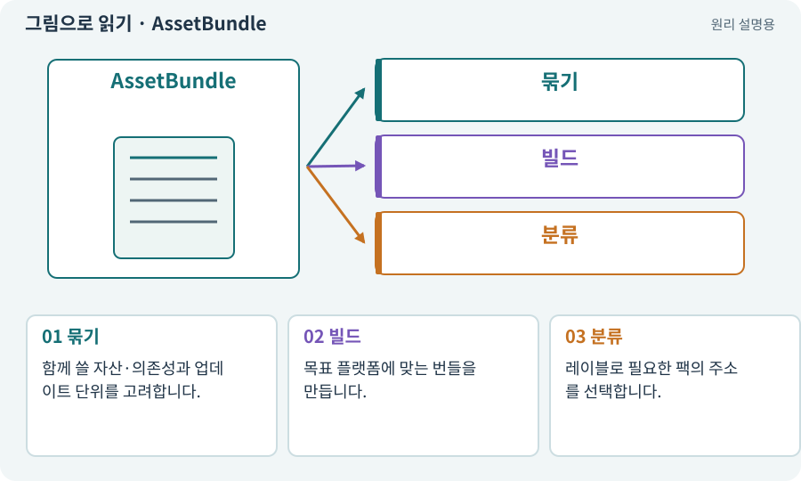

# AssetBundle·그룹·레이블

**분야:** 비동기·다운로드·빌드·버전 관리

AssetBundle은 플랫폼별로 빌드한 에셋 묶음입니다. Addressables 그룹은 빌드·로드 설정을 정하는 단위, 레이블은 여러 에셋을 검색·분류하는 표식입니다. 셋의 역할이 다릅니다.

**찾아오는 이름:** AssetBundle·그룹·레이블, AssetBundle, 에셋 번들, 번들, Bundle, Addressables 그룹, 레이블, label

## 익숙한 것에 비유하면

택배 상자가 번들, 배송 규칙이 그룹 설정, “겨울용” 스티커가 레이블에 가깝습니다.



개념도입니다. 실제 Unity 화면이나 검사 결과가 아닙니다. 그림의 순서·색은 역할을 구분하며 실제 설정값은 프로젝트에서 확인합니다.

## 이렇게 작동합니다

### 1. 묶기

함께 쓸 자산·의존성과 업데이트 단위를 고려합니다.

### 2. 빌드

목표 플랫폼에 맞는 번들을 만듭니다.

### 3. 분류

레이블로 필요한 팩의 주소를 선택합니다.

## 우리 RPG에서는 이렇게 만나요

보스 모델 하나 때문에 거대한 전체 지역 번들을 다시 받아야 한다면 묶음 구성을 검토합니다. 반대로 너무 잘게 나누면 요청·메타데이터 부담이 늘 수 있습니다.

## 이것과 혼동하지 마세요

그룹 하나가 언제나 번들 하나라는 고정 관계는 아닙니다. 실제 packing 설정을 확인합니다.

## 이해했는지 한 번 생각해 보기

레이블만 바꾸면 바이너리 크기도 반드시 줄어드나요?

<details><summary>답과 이유</summary>

아닙니다. 실제 의존성과 빌드 묶음 결과를 봐야 합니다.

</details>

## 내 프로젝트에서 확인하고 싶다면

아래 요청은 읽기 전용으로 실제 대상을 확인하는 선택 요청입니다. 코드나 설정을 직접 편집할 필요는 없습니다.

```text
현재 프로젝트에서 AssetBundle·그룹·레이블 관련 요소가 어떻게 사용되는지 읽기 전용으로 확인해 줘. 실제 대상과 설정을 찾아 쉬운 말과 작은 예로 설명해 줘. 특히 다음 혼동을 구분해 줘: 그룹 하나가 언제나 번들 하나라는 고정 관계는 아닙니다. 실제 packing 설정을 확인합니다. 아직 코드·설정·파일은 바꾸지 말고, 확인할 수 없는 내용은 따로 알려 줘.
```

## 이어지는 개념

[Addressables·주소로 에셋 불러오기](addressables.md) · [카탈로그·주소 목록·콘텐츠 버전](catalog.md) · [의존성·DAG·위상 정렬](dependency.md) · [게임 빌드·개발 빌드·배포](build.md)

## 이 개념을 사용하는 실습

[73 · 주소로 에셋 불러오기](../index.html#lesson-073) · [74 · 추가 외형을 서버에서 받게 준비하기](../index.html#lesson-074) · [75 · 다운로드 용량과 진행률 보여 주기](../index.html#lesson-075) · [76 · 연결이 끊겨도 게임 계속하기](../index.html#lesson-076) · [77 · 앱을 바꾸지 않고 외형 업데이트하기](../index.html#lesson-077) · [78 · 선택: Google Play 에셋 전달 사용하기](../index.html#lesson-078) · [79 · 추가 기능을 하나의 게임으로 합치기](../index.html#lesson-079) · [98 · 3D 팩을 2D 팩과 따로 내려받기](../index.html#lesson-098)

## 참고와 설명의 범위

기본 도구 동작은 아래 공식 자료를 참고했습니다. 비유·그림·RPG의 예시 수치와 정책은 이해를 위한 자체 예제입니다. 실제 API·지원 기능은 설치 버전과 계정에서 확인합니다.

- [Unity · Addressables 개요](https://docs.unity3d.com/Packages/com.unity.addressables@2.7/manual/index.html)

그림·계산 예제·조작 모형은 자체 제작한 설명입니다. 실제 Unity 화면, 서비스 생성 결과, 성능 실측 또는 게임 테스트 결과가 아닙니다. 자료 확인: 2026년 9월 26일.
