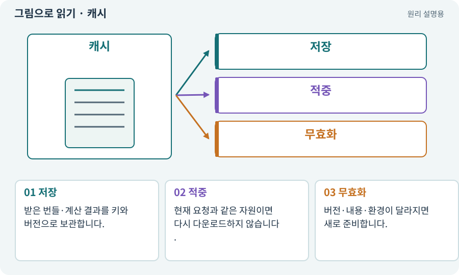

# 캐시·적중·무효화

**분야:** 비동기·다운로드·빌드·버전 관리

캐시는 다시 필요한 데이터를 빠르게 쓰기 위해 보관하는 사본입니다. 새 버전이 나왔을 때 어떤 사본을 재사용하고 버릴지 정하는 일이 중요합니다.

**찾아오는 이름:** 캐시·적중·무효화, 캐시, Cache, cache, 캐시 적중, cache hit, 무효화

## 익숙한 것에 비유하면

자주 보는 책을 책상 위에 두는 것입니다. 책상에 있다고 최신 판인 것은 아닙니다.



개념도입니다. 실제 Unity 화면이나 검사 결과가 아닙니다. 그림의 순서·색은 역할을 구분하며 실제 설정값은 프로젝트에서 확인합니다.

## 이렇게 작동합니다

### 1. 저장

받은 번들·계산 결과를 키와 버전으로 보관합니다.

### 2. 적중

현재 요청과 같은 자원이면 다시 다운로드하지 않습니다.

### 3. 무효화

버전·내용·환경이 달라지면 새로 준비합니다.

## 우리 RPG에서는 이렇게 만나요

팩 다운로드 필요량이 0바이트라도 아직 메모리에 로드되지 않았을 수 있습니다. 캐시 삭제 후 첫 다운로드, 기존 캐시 재사용, 새 콘텐츠 갱신을 따로 검사합니다.

## 이것과 혼동하지 마세요

디스크 캐시와 RAM에 올라온 에셋은 다릅니다. 둘의 수명과 용량을 구분합니다.

## 이해했는지 한 번 생각해 보기

캐시가 있으면 네트워크 오류 검사를 생략해도 될까요?

<details><summary>답과 이유</summary>

안 됩니다. 캐시 없는 최초 실행 경로도 확인해야 합니다.

</details>

## 내 프로젝트에서 확인하고 싶다면

아래 요청은 읽기 전용으로 실제 대상을 확인하는 선택 요청입니다. 코드나 설정을 직접 편집할 필요는 없습니다.

```text
현재 프로젝트에서 캐시·적중·무효화 관련 요소가 어떻게 사용되는지 읽기 전용으로 확인해 줘. 실제 대상과 설정을 찾아 쉬운 말과 작은 예로 설명해 줘. 특히 다음 혼동을 구분해 줘: 디스크 캐시와 RAM에 올라온 에셋은 다릅니다. 둘의 수명과 용량을 구분합니다. 아직 코드·설정·파일은 바꾸지 말고, 확인할 수 없는 내용은 따로 알려 줘.
```

## 이어지는 개념

[Addressables·주소로 에셋 불러오기](addressables.md) · [해시·SHA-256·체크섬](hash.md) · [오프라인·기본 자산·선택 팩](offline.md) · [다운로드 진행률·바이트·준비 상태](progress-download.md)

## 이 개념을 사용하는 실습

[09 · 클릭한 곳까지 벽을 돌아가기](../index.html#lesson-009) · [28 · 여덟 구역의 첫 던전 만들기](../index.html#lesson-028) · [37 · 느려지는 원인을 측정해 고치기](../index.html#lesson-037) · [46 · 랜덤 지도 위를 실제로 걷기](../index.html#lesson-046) · [75 · 다운로드 용량과 진행률 보여 주기](../index.html#lesson-075) · [76 · 연결이 끊겨도 게임 계속하기](../index.html#lesson-076) · [77 · 앱을 바꾸지 않고 외형 업데이트하기](../index.html#lesson-077) · [79 · 추가 기능을 하나의 게임으로 합치기](../index.html#lesson-079) · [98 · 3D 팩을 2D 팩과 따로 내려받기](../index.html#lesson-098) · [104 · 2D와 3D를 두 플랫폼에서 완주하기](../index.html#lesson-104) · [153 · 대장간 고해상도팩 선택 다운로드하기](../index.html#lesson-153) · [159 · 최종 확장판 배포 후보 만들기](../index.html#lesson-159)

## 참고와 설명의 범위

기본 도구 동작은 아래 공식 자료를 참고했습니다. 비유·그림·RPG의 예시 수치와 정책은 이해를 위한 자체 예제입니다. 실제 API·지원 기능은 설치 버전과 계정에서 확인합니다.

- [Unity Addressables · 사전 다운로드](https://docs.unity3d.com/Packages/com.unity.addressables@2.7/manual/remote-content-predownload.html)

그림·계산 예제·조작 모형은 자체 제작한 설명입니다. 실제 Unity 화면, 서비스 생성 결과, 성능 실측 또는 게임 테스트 결과가 아닙니다. 자료 확인: 2026년 9월 26일.
