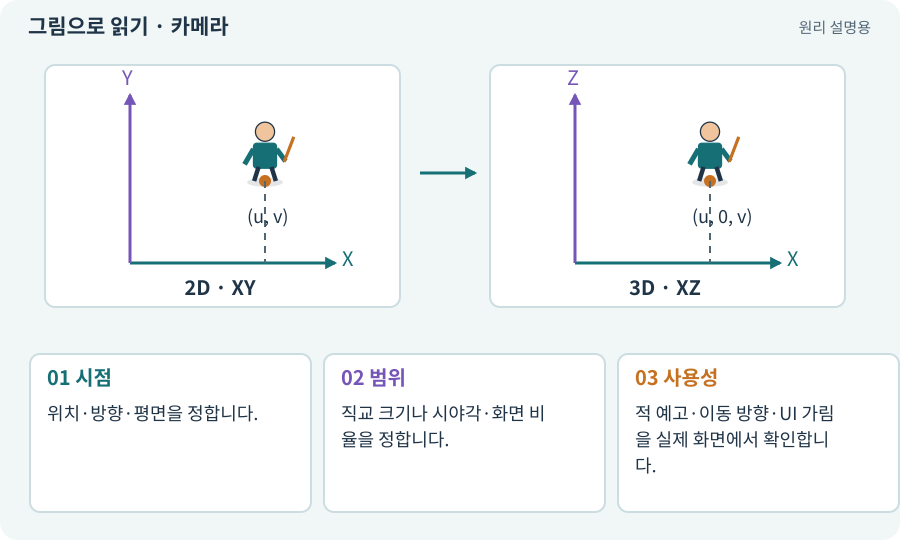

# 카메라·직교·원근

**분야:** 그림·애니메이션·화면 만들기

카메라는 게임 세계를 어떤 위치·방향·범위로 볼지 정합니다. 직교 투영은 거리에 따른 크기 감소가 없고, 원근 투영은 먼 물체가 작아 보이게 합니다.

**찾아오는 이름:** 카메라·직교·원근, 카메라, Camera, Orthographic, Perspective, 직교, 원근, orthographicSize, Orthographic Size

## 익숙한 것에 비유하면

도면처럼 크기를 일정하게 보는 것과 실제 눈의 원근감으로 보는 차이입니다.



개념도입니다. 실제 Unity 화면이나 검사 결과가 아닙니다. 그림의 순서·색은 역할을 구분하며 실제 설정값은 프로젝트에서 확인합니다.

## 이렇게 작동합니다

### 1. 시점

위치·방향·평면을 정합니다.

### 2. 범위

직교 크기나 시야각·화면 비율을 정합니다.

### 3. 사용성

적 예고·이동 방향·UI 가림을 실제 화면에서 확인합니다.

## 카메라는 규칙이 아니라 보이는 방식을 바꿔요

Orthographic 카메라에서는 거리가 멀어져도 같은 크기의 물체가 작아지지 않습니다. Perspective는 거리에 따른 크기 차이가 있어 깊이감을 줍니다. 둘 다 3D 공간을 볼 수 있으므로 직교 카메라라는 이유만으로 게임 물리가 2D가 되지는 않습니다.

직교 카메라의 orthographicSize는 보이는 세로 범위의 절반입니다. 값이 5라면 세로 약 10유닛이고 가로 범위는 종횡비에 따라 달라집니다. 줌과 해상도 축소는 다른 조절입니다.

2D 본편은 XY 평면을 정면으로 보고, 3D 추가편은 XZ 바닥을 사선으로 봅니다. 입력을 화면 좌표에서 실제 바닥 좌표로 변환하는 과정이 각기 필요합니다.

| 설정 | 변하는 것 | 그 자체로 바뀌지 않는 것 |
| --- | --- | --- |
| 해상도 | 표현 픽셀 수 | 세계의 크기 |
| 직교 크기 | 카메라가 보는 월드 범위 | 공격 사거리 |
| 카메라 각도 | 투영·가림 | 데이터의 논리 좌표 |

## 직접 값을 바꾸며 보기

[웹 해설의 조작 모형 열기](../index.html#tech-camera). 조작은 설명용 모형만 바꿉니다. 실제 프로젝트·AI·진행 체크·게임 테스트는 실행하거나 변경하지 않습니다.

## 우리 RPG에서는 이렇게 만나요

직교 카메라의 orthographicSize는 세로 절반 범위입니다. 값 5라면 세로 10월드 단위를 보며 가로 범위는 화면 비율에 따라 달라집니다.

## 이것과 혼동하지 마세요

카메라를 멀리 옮기는 것만으로 직교 화면의 캐릭터 크기가 줄지는 않습니다. 직교 크기를 봅니다.

## 이해했는지 한 번 생각해 보기

직교 카메라를 뒤로 빼도 크기가 같은 이유는?

<details><summary>답과 이유</summary>

거리로 확대·축소하는 투영이 아니기 때문입니다.

</details>

## 내 프로젝트에서 확인하고 싶다면

아래 요청은 읽기 전용으로 실제 대상을 확인하는 선택 요청입니다. 코드나 설정을 직접 편집할 필요는 없습니다.

```text
현재 프로젝트에서 카메라·직교·원근 관련 요소가 어떻게 사용되는지 읽기 전용으로 확인해 줘. 실제 대상과 설정을 찾아 쉬운 말과 작은 예로 설명해 줘. 특히 다음 혼동을 구분해 줘: 카메라를 멀리 옮기는 것만으로 직교 화면의 캐릭터 크기가 줄지는 않습니다. 직교 크기를 봅니다. 아직 코드·설정·파일은 바꾸지 말고, 확인할 수 없는 내용은 따로 알려 줘.
```

## 이어지는 개념

[화면 좌표에서 월드 좌표로](screen-world.md) · [XY·XZ 평면과 논리 좌표](coordinates.md) · [컬링·카메라 가림·LOD](culling.md) · [뷰포트·해상도·종횡비](viewport.md)

## 이 개념을 사용하는 실습

[01 · 빈 2D 프로젝트 만들기](../index.html#lesson-001) · [03 · AI와 실행 중인 Unity 연결하기](../index.html#lesson-003) · [07 · 캐릭터와 벽이 있는 공간 만들기](../index.html#lesson-007) · [09 · 클릭한 곳까지 벽을 돌아가기](../index.html#lesson-009) · [19 · 누가 때렸는지 보이는 전투 만들기](../index.html#lesson-019) · [26 · 새 게임·이어하기·마을 연결하기](../index.html#lesson-026) · [32 · 길 안내와 처음 하는 사람의 동선 만들기](../index.html#lesson-032) · [35 · 앞뒤 가림과 PC 조작 다듬기](../index.html#lesson-035) · [37 · 느려지는 원인을 측정해 고치기](../index.html#lesson-037) · [60 · Scenario로 스타일과 동작 유지하기](../index.html#lesson-060) · [66 · 타일 경계와 랜덤맵 외형 연결하기](../index.html#lesson-066) · [67 · 내 게임의 아트 제작 경로 선택하기](../index.html#lesson-067) · [71 · 카메라·소리·피해 숫자 맞추기](../index.html#lesson-071) · [72 · 모바일 효과를 줄여도 위험은 남기기](../index.html#lesson-072) · [81 · 2D 게임을 남기고 3D 작업 시작하기](../index.html#lesson-081) · [83 · 3D 카메라와 재질로 공간 보기](../index.html#lesson-083) · [85 · 3D 캐릭터를 한 모터로 움직이기](../index.html#lesson-085) · [86 · 3D에서도 클릭한 곳까지 돌아가기](../index.html#lesson-086) · [91 · 보스 예고를 3D 바닥에 맞추기](../index.html#lesson-091) · [93 · 3D 마을과 퀘스트 연결하기](../index.html#lesson-093) · [95 · 3D 조명과 환경을 읽기 좋게 만들기](../index.html#lesson-095) · [96 · 3D 카메라 가림과 터치 조작 다듬기](../index.html#lesson-096) · [97 · 선택: 3D 모델에서 2D 시트 만들기](../index.html#lesson-097) · [103 · 같은 전투를 2D와 3D로 플레이하기](../index.html#lesson-103) · [150 · 소리가 없어도 읽히는 전투 만들기](../index.html#lesson-150) · [154 · 확장 기능을 켠 휴대폰 성능 고치기](../index.html#lesson-154)

## 참고와 설명의 범위

기본 도구 동작은 아래 공식 자료를 참고했습니다. 비유·그림·RPG의 예시 수치와 정책은 이해를 위한 자체 예제입니다. 실제 API·지원 기능은 설치 버전과 계정에서 확인합니다.

- [Unity · 2D Renderer](https://docs.unity3d.com/6000.3/Documentation/Manual/urp/2DRendererData-overview.html)

그림·계산 예제·조작 모형은 자체 제작한 설명입니다. 실제 Unity 화면, 서비스 생성 결과, 성능 실측 또는 게임 테스트 결과가 아닙니다. 자료 확인: 2026년 9월 26일.
