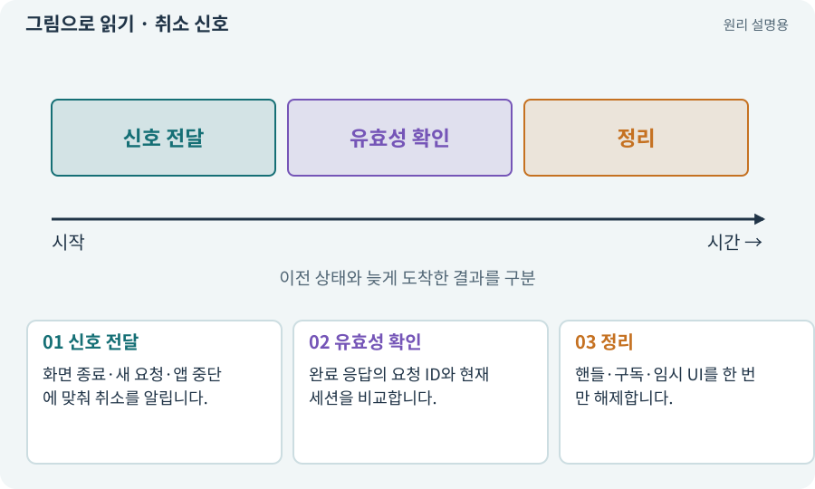

# 취소 신호·늦은 완료·정리

**분야:** 비동기·다운로드·빌드·버전 관리

취소 신호는 더 이상 작업 결과를 사용하지 않겠다는 의사를 전달합니다. 실제 내부 작업이 취소를 지원하는지, 사용 중인 자원은 누가 정리하는지 따로 정해야 합니다.

**찾아오는 이름:** 취소 신호·늦은 완료·정리, CancellationToken, 취소 토큰, 늦은 완료, late callback, 취소 신호

## 익숙한 것에 비유하면

취소한 택배가 이미 배송 중이라면 도착물을 잘못 새 주문에 배정하지 않고 반송·보관 규칙을 적용하는 것과 같습니다.



개념도입니다. 실제 Unity 화면이나 검사 결과가 아닙니다. 그림의 순서·색은 역할을 구분하며 실제 설정값은 프로젝트에서 확인합니다.

## 이렇게 작동합니다

### 1. 신호 전달

화면 종료·새 요청·앱 중단에 맞춰 취소를 알립니다.

### 2. 유효성 확인

완료 응답의 요청 ID와 현재 세션을 비교합니다.

### 3. 정리

핸들·구독·임시 UI를 한 번만 해제합니다.

## 우리 RPG에서는 이렇게 만나요

다운로드 버튼을 누른 뒤 취소하고 다른 지역을 선택했습니다. 첫 지역 응답이 나중에 와도 현재 지역 버튼을 바꾸지 않게 합니다. 일부 로더는 전송 자체를 멈추지 못해도 결과 적용을 막아야 합니다.

## 이것과 혼동하지 마세요

취소 토큰은 AI 글자 사용량 단위인 토큰이나 적 공격 권한과 다릅니다.

## 이해했는지 한 번 생각해 보기

취소 후에도 응답이 왔으면 무조건 오류인가요?

<details><summary>답과 이유</summary>

도구 특성상 가능하므로 오래된 결과를 적용하지 않고 자원을 정리해야 합니다.

</details>

## 내 프로젝트에서 확인하고 싶다면

아래 요청은 읽기 전용으로 실제 대상을 확인하는 선택 요청입니다. 코드나 설정을 직접 편집할 필요는 없습니다.

```text
현재 프로젝트에서 취소 신호·늦은 완료·정리 관련 요소가 어떻게 사용되는지 읽기 전용으로 확인해 줘. 실제 대상과 설정을 찾아 쉬운 말과 작은 예로 설명해 줘. 특히 다음 혼동을 구분해 줘: 취소 토큰은 AI 글자 사용량 단위인 토큰이나 적 공격 권한과 다릅니다. 아직 코드·설정·파일은 바꾸지 말고, 확인할 수 없는 내용은 따로 알려 줘.
```

## 이어지는 개념

[비동기·await·콜백](async.md) · [요청 ID·세대 ID·오래된 응답](request-id.md) · [핸들·참조 계수·Release](handle.md) · [타임아웃·중단·취소](timeout.md)

## 이 개념을 사용하는 실습

[46 · 랜덤 지도 위를 실제로 걷기](../index.html#lesson-046) · [94 · 같은 랜덤 던전을 3D로 생성하기](../index.html#lesson-094) · [153 · 대장간 고해상도팩 선택 다운로드하기](../index.html#lesson-153)

## 참고와 설명의 범위

기본 도구 동작은 아래 공식 자료를 참고했습니다. 비유·그림·RPG의 예시 수치와 정책은 이해를 위한 자체 예제입니다. 실제 API·지원 기능은 설치 버전과 계정에서 확인합니다.

- [Unity Addressables · 메모리 관리](https://docs.unity3d.com/Packages/com.unity.addressables@2.7/manual/MemoryManagement.html)

그림·계산 예제·조작 모형은 자체 제작한 설명입니다. 실제 Unity 화면, 서비스 생성 결과, 성능 실측 또는 게임 테스트 결과가 아닙니다. 자료 확인: 2026년 9월 26일.
