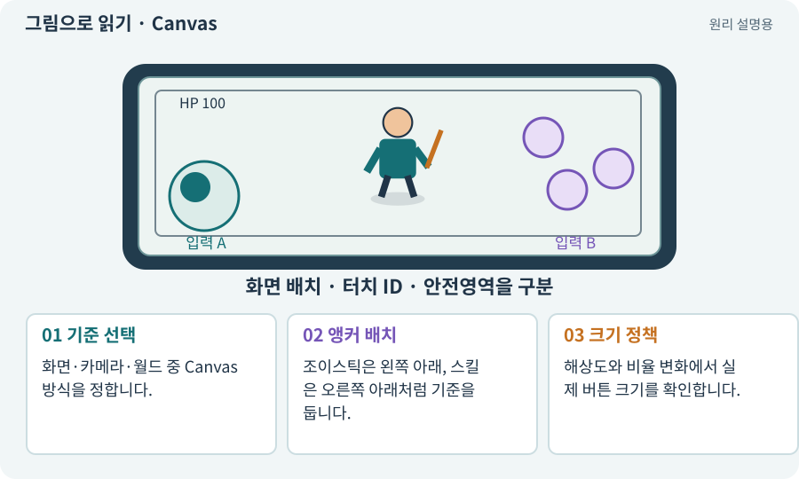

# Canvas·RectTransform·앵커

**분야:** 입력·UI·소리·성능

Canvas는 UGUI를 그리는 공간입니다. RectTransform은 사각 UI의 위치·크기를 다루고, 앵커는 부모의 어느 부분을 기준으로 배치할지 정합니다.

**찾아오는 이름:** Canvas·RectTransform·앵커, Canvas, RectTransform, Anchor, 앵커, CanvasScaler, Canvas Scaler

## 익숙한 것에 비유하면

종이를 창틀 모서리에 고정하는 집게입니다. 왼쪽 아래에 고정하면 창문 크기가 달라도 그 기준을 따라갑니다.



개념도입니다. 실제 Unity 화면이나 검사 결과가 아닙니다. 그림의 순서·색은 역할을 구분하며 실제 설정값은 프로젝트에서 확인합니다.

## 이렇게 작동합니다

### 1. 기준 선택

화면·카메라·월드 중 Canvas 방식을 정합니다.

### 2. 앵커 배치

조이스틱은 왼쪽 아래, 스킬은 오른쪽 아래처럼 기준을 둡니다.

### 3. 크기 정책

해상도와 비율 변화에서 실제 버튼 크기를 확인합니다.

## 우리 RPG에서는 이렇게 만나요

고정 픽셀 좌표만 쓰면 넓은 화면에서 버튼이 중앙에 떠다닐 수 있습니다. 앵커·기준 해상도·안전영역을 함께 확인합니다.

## 이것과 혼동하지 마세요

UI의 Pivot과 앵커는 같은 값이 아닙니다. Pivot은 사각형 자체의 기준점이고 앵커는 부모 기준입니다.

## 이해했는지 한 번 생각해 보기

휴대폰을 바꾸자 오른쪽 버튼이 잘리는 이유는?

<details><summary>답과 이유</summary>

앵커·CanvasScaler·안전영역·화면 비율을 확인합니다.

</details>

## 내 프로젝트에서 확인하고 싶다면

아래 요청은 읽기 전용으로 실제 대상을 확인하는 선택 요청입니다. 코드나 설정을 직접 편집할 필요는 없습니다.

```text
현재 프로젝트에서 Canvas·RectTransform·앵커 관련 요소가 어떻게 사용되는지 읽기 전용으로 확인해 줘. 실제 대상과 설정을 찾아 쉬운 말과 작은 예로 설명해 줘. 특히 다음 혼동을 구분해 줘: UI의 Pivot과 앵커는 같은 값이 아닙니다. Pivot은 사각형 자체의 기준점이고 앵커는 부모 기준입니다. 아직 코드·설정·파일은 바꾸지 말고, 확인할 수 없는 내용은 따로 알려 줘.
```

## 이어지는 개념

[UI·HUD·UGUI](ui.md) · [안전영역·화면 비율·Viewport](safe-area.md) · [뷰포트·해상도·종횡비](viewport.md) · [UI 레이아웃·스크롤·9슬라이스](layout-group.md)

## 이 개념을 사용하는 실습

[07 · 캐릭터와 벽이 있는 공간 만들기](../index.html#lesson-007) · [46 · 랜덤 지도 위를 실제로 걷기](../index.html#lesson-046) · [125 · 하네스로 작은 전리품 화면 만들기](../index.html#lesson-125)

## 참고와 설명의 범위

기본 도구 동작은 아래 공식 자료를 참고했습니다. 비유·그림·RPG의 예시 수치와 정책은 이해를 위한 자체 예제입니다. 실제 API·지원 기능은 설치 버전과 계정에서 확인합니다.

- [Unity Input System · UI 지원](https://docs.unity3d.com/Packages/com.unity.inputsystem@1.17/manual/UISupport.html)

그림·계산 예제·조작 모형은 자체 제작한 설명입니다. 실제 Unity 화면, 서비스 생성 결과, 성능 실측 또는 게임 테스트 결과가 아닙니다. 자료 확인: 2026년 9월 26일.
