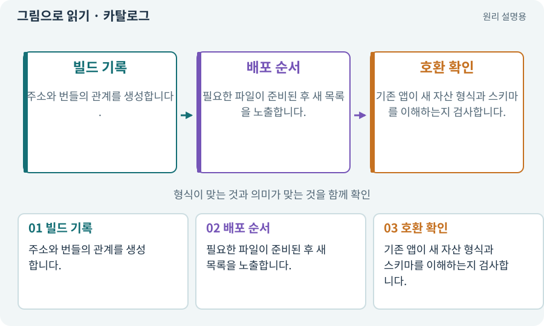

# 카탈로그·주소 목록·콘텐츠 버전

**분야:** 비동기·다운로드·빌드·버전 관리

카탈로그는 주소가 어떤 에셋·번들·의존성으로 이어지는지 설명하는 목록입니다. 파일 자체와 이를 찾는 목록의 버전을 함께 맞춰야 합니다.

**찾아오는 이름:** 카탈로그·주소 목록·콘텐츠 버전, 카탈로그, Catalog, catalog, 콘텐츠 버전

## 익숙한 것에 비유하면

도서관 검색 목록만 새것으로 바꾸고 실제 책을 창고에 보내지 않으면 찾았지만 빌릴 수 없는 상태가 됩니다.



개념도입니다. 실제 Unity 화면이나 검사 결과가 아닙니다. 그림의 순서·색은 역할을 구분하며 실제 설정값은 프로젝트에서 확인합니다.

## 이렇게 작동합니다

### 1. 빌드 기록

주소와 번들의 관계를 생성합니다.

### 2. 배포 순서

필요한 파일이 준비된 후 새 목록을 노출합니다.

### 3. 호환 확인

기존 앱이 새 자산 형식과 스키마를 이해하는지 검사합니다.

## 우리 RPG에서는 이렇게 만나요

2D 스프라이트와 3D 모델은 같은 게임 규칙을 사용해도 카탈로그와 플랫폼별 번들 경로를 분리합니다. 잘못된 카탈로그가 설치 앱을 다른 버전 자산에 연결하지 않게 합니다.

## 이것과 혼동하지 마세요

카탈로그 갱신만으로 앱의 새 C# 코드를 안전하게 추가할 수 있다는 뜻은 아닙니다.

## 이해했는지 한 번 생각해 보기

목록은 받았지만 번들 URL이 404이면?

<details><summary>답과 이유</summary>

콘텐츠가 준비된 상태가 아닙니다. 실패 처리와 이전 버전 복구가 필요합니다.

</details>

## 내 프로젝트에서 확인하고 싶다면

아래 요청은 읽기 전용으로 실제 대상을 확인하는 선택 요청입니다. 코드나 설정을 직접 편집할 필요는 없습니다.

```text
현재 프로젝트에서 카탈로그·주소 목록·콘텐츠 버전 관련 요소가 어떻게 사용되는지 읽기 전용으로 확인해 줘. 실제 대상과 설정을 찾아 쉬운 말과 작은 예로 설명해 줘. 특히 다음 혼동을 구분해 줘: 카탈로그 갱신만으로 앱의 새 C# 코드를 안전하게 추가할 수 있다는 뜻은 아닙니다. 아직 코드·설정·파일은 바꾸지 말고, 확인할 수 없는 내용은 따로 알려 줘.
```

## 이어지는 개념

[매니페스트·패키지 목록·빌드 기록](manifest.md) · [Addressables·주소로 에셋 불러오기](addressables.md) · [호환성·코드와 콘텐츠 계약](compatibility.md) · [롤백·핫픽스·이전 버전](rollback.md)

## 이 개념을 사용하는 실습

[38 · 테스트 결과와 실제 플레이 구분하기](../index.html#lesson-038) · [59 · Retro Diffusion으로 캐릭터와 타일 만들기](../index.html#lesson-059) · [73 · 주소로 에셋 불러오기](../index.html#lesson-073) · [74 · 추가 외형을 서버에서 받게 준비하기](../index.html#lesson-074) · [75 · 다운로드 용량과 진행률 보여 주기](../index.html#lesson-075) · [76 · 연결이 끊겨도 게임 계속하기](../index.html#lesson-076) · [77 · 앱을 바꾸지 않고 외형 업데이트하기](../index.html#lesson-077) · [98 · 3D 팩을 2D 팩과 따로 내려받기](../index.html#lesson-098) · [99 · 2D와 3D 사이에 진행 가져오기](../index.html#lesson-099) · [127 · 내 반복 업무에 맞게 도구 개조하기](../index.html#lesson-127) · [159 · 최종 확장판 배포 후보 만들기](../index.html#lesson-159)

## 참고와 설명의 범위

기본 도구 동작은 아래 공식 자료를 참고했습니다. 비유·그림·RPG의 예시 수치와 정책은 이해를 위한 자체 예제입니다. 실제 API·지원 기능은 설치 버전과 계정에서 확인합니다.

- [Unity Addressables · 콘텐츠 업데이트](https://docs.unity3d.com/Packages/com.unity.addressables@2.7/manual/builds-update-build.html)

그림·계산 예제·조작 모형은 자체 제작한 설명입니다. 실제 Unity 화면, 서비스 생성 결과, 성능 실측 또는 게임 테스트 결과가 아닙니다. 자료 확인: 2026년 9월 26일.
