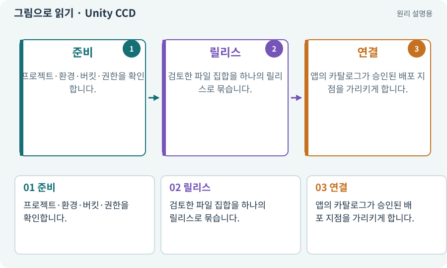

# Unity CCD·콘텐츠 배포 서비스

**분야:** 비동기·다운로드·빌드·버전 관리

이 다운로드 과정의 CCD는 Unity Cloud Content Delivery입니다. 빌드한 에셋 파일을 올리고 릴리스와 배포 지점을 관리하는 서비스입니다. 물리의 Continuous Collision Detection과 약어가 같지만 전혀 다른 의미입니다.

**찾아오는 이름:** Unity CCD·콘텐츠 배포 서비스, CCD, Cloud Content Delivery, 클라우드 콘텐츠 배포

## 익숙한 것에 비유하면

원격 에셋 창고에 올린 묶음을 “검사 중”과 “배포 중”으로 구분하는 운영 도구라고 볼 수 있습니다.



개념도입니다. 실제 Unity 화면이나 검사 결과가 아닙니다. 그림의 순서·색은 역할을 구분하며 실제 설정값은 프로젝트에서 확인합니다.

## 이렇게 작동합니다

### 1. 준비

프로젝트·환경·버킷·권한을 확인합니다.

### 2. 릴리스

검토한 파일 집합을 하나의 릴리스로 묶습니다.

### 3. 연결

앱의 카탈로그가 승인된 배포 지점을 가리키게 합니다.

## 우리 RPG에서는 이렇게 만나요

개발용 원격팩을 검사한 뒤 공개 배포 승인은 별도로 받습니다. 서비스 기능·용어·과금은 실제 계정과 현재 문서를 확인합니다.

## 이것과 혼동하지 마세요

CCD를 설치했다고 앱의 다운로드 UI·취소·오프라인 처리가 자동 완성되지는 않습니다.

## 이해했는지 한 번 생각해 보기

충돌 튀는 문제를 고치려고 이 CCD 설정을 바꾸나요?

<details><summary>답과 이유</summary>

아닙니다. 충돌의 CCD는 물리 설정이며 이 항목은 콘텐츠 배포입니다.

</details>

## 내 프로젝트에서 확인하고 싶다면

아래 요청은 읽기 전용으로 실제 대상을 확인하는 선택 요청입니다. 코드나 설정을 직접 편집할 필요는 없습니다.

```text
현재 프로젝트에서 Unity CCD·콘텐츠 배포 서비스 관련 요소가 어떻게 사용되는지 읽기 전용으로 확인해 줘. 실제 대상과 설정을 찾아 쉬운 말과 작은 예로 설명해 줘. 특히 다음 혼동을 구분해 줘: CCD를 설치했다고 앱의 다운로드 UI·취소·오프라인 처리가 자동 완성되지는 않습니다. 아직 코드·설정·파일은 바꾸지 말고, 확인할 수 없는 내용은 따로 알려 줘.
```

## 이어지는 개념

[CDN·원본 서버·HTTPS](cdn.md) · [Addressables·주소로 에셋 불러오기](addressables.md) · [롤백·핫픽스·이전 버전](rollback.md) · [권한·승인·최소 권한](permission.md)

## 이 개념을 사용하는 실습

[74 · 추가 외형을 서버에서 받게 준비하기](../index.html#lesson-074) · [77 · 앱을 바꾸지 않고 외형 업데이트하기](../index.html#lesson-077)

## 참고와 설명의 범위

기본 도구 동작은 아래 공식 자료를 참고했습니다. 비유·그림·RPG의 예시 수치와 정책은 이해를 위한 자체 예제입니다. 실제 API·지원 기능은 설치 버전과 계정에서 확인합니다.

- [Unity CCD · CLI 작업 흐름](https://docs.unity.com/en-us/ccd/cli-walkthrough)

그림·계산 예제·조작 모형은 자체 제작한 설명입니다. 실제 Unity 화면, 서비스 생성 결과, 성능 실측 또는 게임 테스트 결과가 아닙니다. 자료 확인: 2026년 9월 26일.
