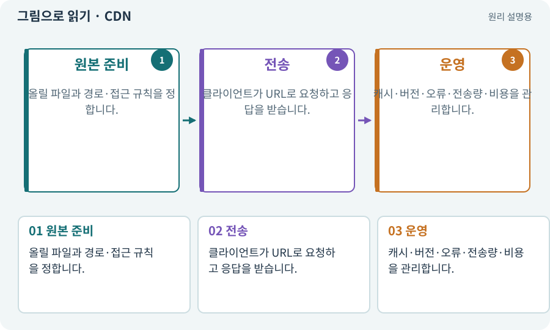

# CDN·원본 서버·HTTPS

**분야:** 비동기·다운로드·빌드·버전 관리

CDN은 사용자 가까운 서버 등에 콘텐츠 사본을 두어 파일을 전달하는 서비스입니다. HTTPS는 통신을 보호하는 방식이지 다운로드한 내용의 게임 호환성을 보장하는 기능은 아닙니다.

**찾아오는 이름:** CDN·원본 서버·HTTPS, CDN, 콘텐츠 전송, 원본 서버, HTTPS, HTTP, URL, 404, 네트워크

## 익숙한 것에 비유하면

여러 지역 창고에서 같은 상품을 보내는 배송망입니다. 창고 목록·재고·새 버전 반영이 일치해야 합니다.



개념도입니다. 실제 Unity 화면이나 검사 결과가 아닙니다. 그림의 순서·색은 역할을 구분하며 실제 설정값은 프로젝트에서 확인합니다.

## 이렇게 작동합니다

### 1. 원본 준비

올릴 파일과 경로·접근 규칙을 정합니다.

### 2. 전송

클라이언트가 URL로 요청하고 응답을 받습니다.

### 3. 운영

캐시·버전·오류·전송량·비용을 관리합니다.

## 우리 RPG에서는 이렇게 만나요

대장간 번들을 올린 뒤 카탈로그의 URL이 실제로 접근 가능한지 확인합니다. 게시용 비밀키를 APK에 넣지 않고, 다운로드 읽기 권한과 업로드 권한을 분리합니다.

## 이것과 혼동하지 마세요

서버가 200 응답을 보냈어도 파일이 올바른 번들인지 별도로 검사해야 합니다.

## 이해했는지 한 번 생각해 보기

404 응답인데 재시도만 반복하면 해결될까요?

<details><summary>답과 이유</summary>

경로·게시 상태·권한을 먼저 확인해야 합니다.

</details>

## 내 프로젝트에서 확인하고 싶다면

아래 요청은 읽기 전용으로 실제 대상을 확인하는 선택 요청입니다. 코드나 설정을 직접 편집할 필요는 없습니다.

```text
현재 프로젝트에서 CDN·원본 서버·HTTPS 관련 요소가 어떻게 사용되는지 읽기 전용으로 확인해 줘. 실제 대상과 설정을 찾아 쉬운 말과 작은 예로 설명해 줘. 특히 다음 혼동을 구분해 줘: 서버가 200 응답을 보냈어도 파일이 올바른 번들인지 별도로 검사해야 합니다. 아직 코드·설정·파일은 바꾸지 말고, 확인할 수 없는 내용은 따로 알려 줘.
```

## 이어지는 개념

[카탈로그·주소 목록·콘텐츠 버전](catalog.md) · [캐시·적중·무효화](cache.md) · [비용 한도·예약·실사용량](budget.md) · [앱 서명·키·자격 증명](signature.md)

## 이 개념을 사용하는 실습

[73 · 주소로 에셋 불러오기](../index.html#lesson-073) · [74 · 추가 외형을 서버에서 받게 준비하기](../index.html#lesson-074) · [75 · 다운로드 용량과 진행률 보여 주기](../index.html#lesson-075) · [76 · 연결이 끊겨도 게임 계속하기](../index.html#lesson-076) · [77 · 앱을 바꾸지 않고 외형 업데이트하기](../index.html#lesson-077) · [78 · 선택: Google Play 에셋 전달 사용하기](../index.html#lesson-078) · [79 · 추가 기능을 하나의 게임으로 합치기](../index.html#lesson-079) · [80 · 나만의 2D RPG 완성하기](../index.html#lesson-080) · [153 · 대장간 고해상도팩 선택 다운로드하기](../index.html#lesson-153) · [159 · 최종 확장판 배포 후보 만들기](../index.html#lesson-159)

## 참고와 설명의 범위

기본 도구 동작은 아래 공식 자료를 참고했습니다. 비유·그림·RPG의 예시 수치와 정책은 이해를 위한 자체 예제입니다. 실제 API·지원 기능은 설치 버전과 계정에서 확인합니다.

- [Unity CCD · CLI 작업 흐름](https://docs.unity.com/en-us/ccd/cli-walkthrough)

그림·계산 예제·조작 모형은 자체 제작한 설명입니다. 실제 Unity 화면, 서비스 생성 결과, 성능 실측 또는 게임 테스트 결과가 아닙니다. 자료 확인: 2026년 9월 26일.
