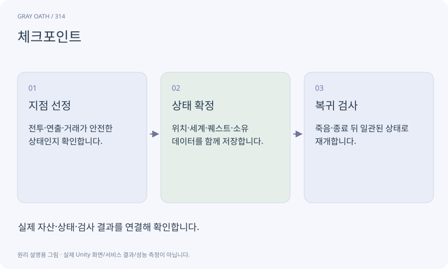

# 체크포인트

실패나 중단 뒤 재개할 수 있는 정해진 게임 상태의 저장 지점입니다. 자동 저장 슬롯·수동 저장·Editor 작업 기록과 역할이 다릅니다.

## 익숙한 비유

긴 여행에서 다시 출발할 안전한 중간 지점을 기록하는 것입니다.



## 작동 원리

### 1. 지점 선정

전투·연출·거래가 안전한 상태인지 확인합니다.

### 2. 상태 확정

위치·세계·퀘스트·소유 데이터를 함께 저장합니다.

### 3. 복귀 검사

죽음·종료 뒤 일관된 상태로 재개합니다.

## 게임 속 예

보스전 직전 checkpoint로 복귀해도 보상은 미지급 상태여야 합니다. 엔딩 확정 전 저장과 확정 후 상태를 별도로 보존합니다.

## 혼동하지 않기

좌표만 저장하면 퀘스트와 문 상태가 맞지 않아 벽 안이나 막힌 지역에서 시작할 수 있습니다.

## 확인 질문

체크포인트 저장은 언제나 안전한가요?

중간 거래·전환 상태를 피하거나 완전한 복원 정책을 구현해야 합니다.

## 내 프로젝트에서 확인하기

```text
현재 GrayOathRPG3D에서 체크포인트을 사용하는 실제 대상과 동작을 읽기 전용으로 확인해 줘. 쉬운 말과 작은 사례로 설명하고 좌표만 저장하면 퀘스트와 문 상태가 맞지 않아 벽 안이나 막힌 지역에서 시작할 수 있습니다. 이 문제를 어떻게 막는지 보여 줘. 코드·데이터·설정은 아직 수정하지 마.
```

## 관련 해설

[save](save.md) · [transaction](transaction.md) · [world-state](world-state.md)

## 공식 참고

- [Unity · AssetDatabase](https://docs.unity3d.com/6000.3/Documentation/ScriptReference/AssetDatabase.html)
