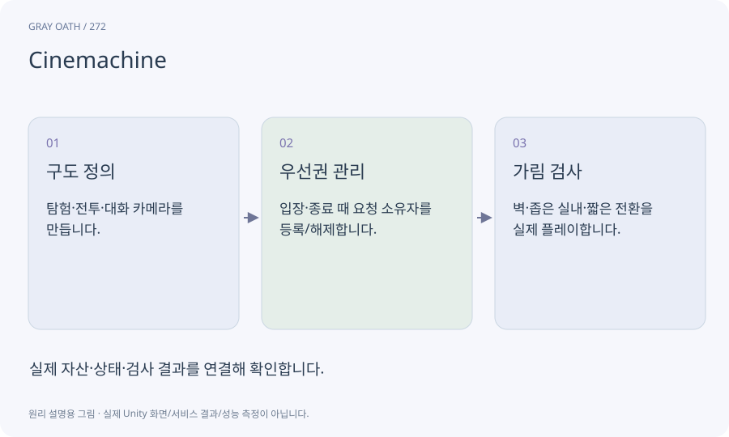

# Cinemachine

카메라의 추적·구도·전환을 구성하는 Unity 도구입니다. 실제 게임 카메라와 후보 구도의 소유 관계를 이해하고 UI·전투·대화가 다툴 때 우선순위를 정해야 합니다.

## 익숙한 비유

카메라 감독이 장면별 촬영 지시를 선택하는 장치입니다.



## 작동 원리

### 1. 구도 정의

탐험·전투·대화 카메라를 만듭니다.

### 2. 우선권 관리

입장·종료 때 요청 소유자를 등록/해제합니다.

### 3. 가림 검사

벽·좁은 실내·짧은 전환을 실제 플레이합니다.

## 게임 속 예

대화가 갑자기 취소되어도 카메라 token을 반환해 탐험 구도로 복귀합니다. 두 시스템이 계속 위치를 덮지 않게 합니다.

## 혼동하지 않기

카메라 전환을 잘 보이게 했다고 대화 입력 잠금·플레이어 모터까지 자동 정리되지는 않습니다.

## 확인 질문

대화가 끝나도 화면이 NPC를 보면?

종료·취소·씬 언로드에서 카메라 소유권을 반환하는지 확인합니다.

## 내 프로젝트에서 확인하기

```text
현재 GrayOathRPG3D에서 Cinemachine을 사용하는 실제 대상과 동작을 읽기 전용으로 확인해 줘. 쉬운 말과 작은 사례로 설명하고 카메라 전환을 잘 보이게 했다고 대화 입력 잠금·플레이어 모터까지 자동 정리되지는 않습니다. 이 문제를 어떻게 막는지 보여 줘. 코드·데이터·설정은 아직 수정하지 마.
```

## 관련 해설

[camera](camera.md) · [lock](lock.md) · [lifecycle](lifecycle.md)

## 공식 참고

- [Unity · Cinemachine 3](https://docs.unity3d.com/Packages/com.unity.cinemachine@3.1/manual/index.html)
