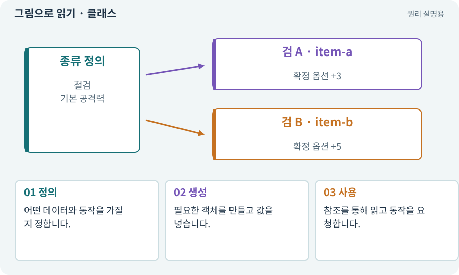

# 클래스·객체·인스턴스

**분야:** 설명을 읽기 위한 기초 언어

클래스는 데이터와 동작을 정의하는 틀이고 객체는 그 틀에 따라 만들어진 실제 대상입니다. Unity의 GameObject와 프로그래밍의 일반 객체는 범위가 다릅니다.

**찾아오는 이름:** 클래스·객체·인스턴스, 클래스, Class, class, 객체, Object, 객체 지향

## 익숙한 것에 비유하면

회원 카드의 양식이 클래스라면 각 회원의 실제 카드는 객체입니다. 형식은 같아도 번호와 내용이 다릅니다.



개념도입니다. 실제 Unity 화면이나 검사 결과가 아닙니다. 그림의 순서·색은 역할을 구분하며 실제 설정값은 프로젝트에서 확인합니다.

## 이렇게 작동합니다

### 1. 정의

어떤 데이터와 동작을 가질지 정합니다.

### 2. 생성

필요한 객체를 만들고 값을 넣습니다.

### 3. 사용

참조를 통해 읽고 동작을 요청합니다.

## 우리 RPG에서는 이렇게 만나요

ItemInstance 클래스의 객체 두 개가 각각 고유 ID와 옵션을 가집니다. 그 객체가 반드시 Hierarchy에 보이는 GameObject인 것은 아닙니다. 데이터 객체와 화면 오브젝트를 분리할 수 있습니다.

## 이것과 혼동하지 마세요

같은 클래스라고 같은 소유 아이템은 아닙니다. 인스턴스 ID를 확인합니다.

## 이해했는지 한 번 생각해 보기

GameObject가 아닌 객체도 게임에서 쓸 수 있나요?

<details><summary>답과 이유</summary>

예. 계산·저장·아이템 데이터 등을 일반 객체로 다룰 수 있습니다.

</details>

## 내 프로젝트에서 확인하고 싶다면

아래 요청은 읽기 전용으로 실제 대상을 확인하는 선택 요청입니다. 코드나 설정을 직접 편집할 필요는 없습니다.

```text
현재 프로젝트에서 클래스·객체·인스턴스 관련 요소가 어떻게 사용되는지 읽기 전용으로 확인해 줘. 실제 대상과 설정을 찾아 쉬운 말과 작은 예로 설명해 줘. 특히 다음 혼동을 구분해 줘: 같은 클래스라고 같은 소유 아이템은 아닙니다. 인스턴스 ID를 확인합니다. 아직 코드·설정·파일은 바꾸지 말고, 확인할 수 없는 내용은 따로 알려 줘.
```

## 이어지는 개념

[컴포넌트](component.md) · [아이템 인스턴스와 소유권](item-instance.md) · [참조·null·Missing Reference](reference.md) · [C#·Python·스크립트](csharp.md)

## 이 개념을 사용하는 실습

[06 · 시작 메뉴와 테스트 공간 연결하기](../index.html#lesson-006) · [25 · 게임을 껐다 켜도 장비 유지하기](../index.html#lesson-025) · [73 · 주소로 에셋 불러오기](../index.html#lesson-073) · [82 · 게임 규칙은 재사용하고 공간만 바꾸기](../index.html#lesson-082) · [120 · 자연어 요청을 계획으로 바꾸기](../index.html#lesson-120) · [123 · 기존 게임의 실제 파일 찾아 연결하기](../index.html#lesson-123) · [129 · 기존 2D 게임에서 확장팩 시작하기](../index.html#lesson-129) · [131 · 중요한 전리품만 표시하는 규칙 만들기](../index.html#lesson-131) · [140 · 개인 창고와 즐겨찾기 만들기](../index.html#lesson-140)

## 참고와 설명의 범위

기본 도구 동작은 아래 공식 자료를 참고했습니다. 비유·그림·RPG의 예시 수치와 정책은 이해를 위한 자체 예제입니다. 실제 API·지원 기능은 설치 버전과 계정에서 확인합니다.

- [Microsoft · C# 클래스](https://learn.microsoft.com/en-us/dotnet/csharp/fundamentals/types/classes)

그림·계산 예제·조작 모형은 자체 제작한 설명입니다. 실제 Unity 화면, 서비스 생성 결과, 성능 실측 또는 게임 테스트 결과가 아닙니다. 자료 확인: 2026년 9월 26일.
