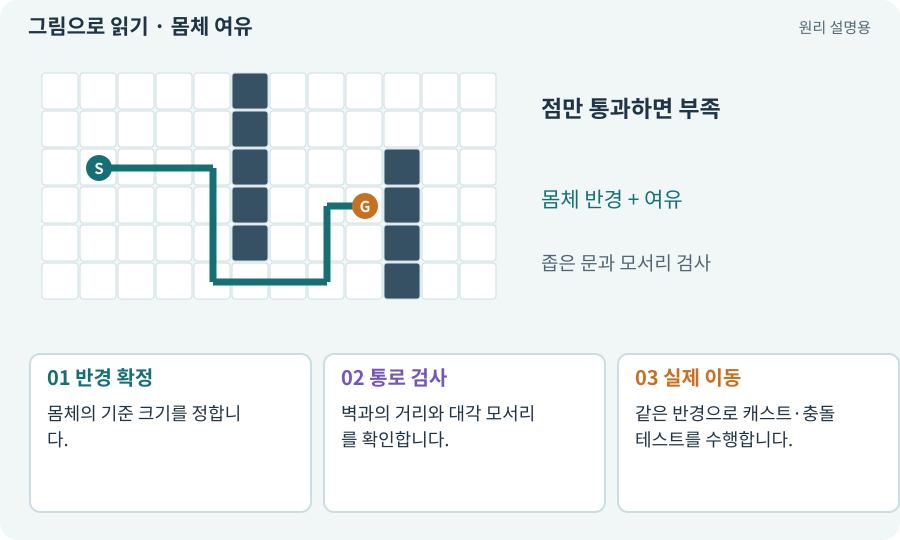

# 몸체 여유·모서리 통과

**분야:** 지도·적 AI·전투 규칙

길의 중심선뿐 아니라 몸체 전체가 지나갈 공간이 있는지 보는 조건입니다. 반경이 있는 캐릭터는 점 하나처럼 좁은 틈을 통과할 수 없습니다.

**찾아오는 이름:** 몸체 여유·모서리 통과, 몸체 여유, 여유 공간, 반경, clearance, 코너 커팅, corner cutting

## 익숙한 것에 비유하면

실 한 가닥이 지나가는 틈과 가방을 멘 사람이 지나는 문을 구분합니다.



개념도입니다. 실제 Unity 화면이나 검사 결과가 아닙니다. 그림의 순서·색은 역할을 구분하며 실제 설정값은 프로젝트에서 확인합니다.

## 이렇게 작동합니다

### 1. 반경 확정

몸체의 기준 크기를 정합니다.

### 2. 통로 검사

벽과의 거리와 대각 모서리를 확인합니다.

### 3. 실제 이동

같은 반경으로 캐스트·충돌 테스트를 수행합니다.

## 점이 지나가는 길과 몸체가 지나가는 길은 달라요

문 폭이 1유닛이고 캐릭터 지름이 0.8유닛이면 가운데를 정확히 지날 때 양쪽 합쳐 0.2유닛 여유가 있습니다. 지름이 1.2유닛이면 중앙점이 문 안에 있어도 몸체는 통과하지 못합니다.

장애물을 몸체 반경만큼 부풀린 뒤 중심점의 길을 찾거나, 이동 구간을 몸체 모양으로 Cast하는 방법을 생각할 수 있습니다. 수치 오차와 움직이는 장애물 때문에 안전 여유도 명시합니다.

대각선은 양옆이 막힌 모서리를 잘라 통과하지 않게 해야 합니다. 격자 연결성, 실제 몸체 통과, 목표 지점의 접촉 조건을 별도 검사합니다.

| 문 폭 | 몸체 지름 | 이 모형의 판정 |
| --- | --- | --- |
| 1.0 | 0.6 | 통과 가능 |
| 1.0 | 1.0 | 접촉 한계·여유 없음 |
| 1.0 | 1.2 | 통과 불가 |

## 직접 값을 바꾸며 보기

[웹 해설의 조작 모형 열기](../index.html#tech-clearance). 조작은 설명용 모형만 바꿉니다. 실제 프로젝트·AI·진행 체크·게임 테스트는 실행하거나 변경하지 않습니다.

## 우리 RPG에서는 이렇게 만나요

설명용 반경 0.3m의 몸체는 지름 0.6m입니다. 폭 0.5m 통로는 중심선이 있어도 통과시키지 않습니다. 실제 구현은 스킨·접촉 오차도 고려합니다.

## 이것과 혼동하지 마세요

그림 폭을 몸체 반경으로 자동 추정하면 무기·망토 때문에 통로 판정이 흔들립니다.

## 이해했는지 한 번 생각해 보기

폭 0.8m 통로에 반경 0.5m 몸체가 지나갈까요?

<details><summary>답과 이유</summary>

지름이 1m이므로 단순 폭 기준으로는 부족합니다.

</details>

## 내 프로젝트에서 확인하고 싶다면

아래 요청은 읽기 전용으로 실제 대상을 확인하는 선택 요청입니다. 코드나 설정을 직접 편집할 필요는 없습니다.

```text
현재 프로젝트에서 몸체 여유·모서리 통과 관련 요소가 어떻게 사용되는지 읽기 전용으로 확인해 줘. 실제 대상과 설정을 찾아 쉬운 말과 작은 예로 설명해 줘. 특히 다음 혼동을 구분해 줘: 그림 폭을 몸체 반경으로 자동 추정하면 무기·망토 때문에 통로 판정이 흔들립니다. 아직 코드·설정·파일은 바꾸지 말고, 확인할 수 없는 내용은 따로 알려 줘.
```

## 이어지는 개념

[Collider와 몸체 경계](collider.md) · [Raycast·Linecast·Cast](raycast.md) · [A* 길찾기](astar.md) · [NavMesh·Surface·Agent](navmesh.md)

## 이 개념을 사용하는 실습

[09 · 클릭한 곳까지 벽을 돌아가기](../index.html#lesson-009) · [46 · 랜덤 지도 위를 실제로 걷기](../index.html#lesson-046) · [49 · 여러 근접 적의 공격 나누기](../index.html#lesson-049) · [50 · 석궁수가 거리를 유지하게 만들기](../index.html#lesson-050) · [90 · 적의 판단을 3D 공간에 연결하기](../index.html#lesson-090)

## 참고와 설명의 범위

기본 도구 동작은 아래 공식 자료를 참고했습니다. 비유·그림·RPG의 예시 수치와 정책은 이해를 위한 자체 예제입니다. 실제 API·지원 기능은 설치 버전과 계정에서 확인합니다.

- [Unity · Physics2D.CircleCast](https://docs.unity3d.com/6000.3/Documentation/ScriptReference/Physics2D.CircleCast.html)

그림·계산 예제·조작 모형은 자체 제작한 설명입니다. 실제 Unity 화면, 서비스 생성 결과, 성능 실측 또는 게임 테스트 결과가 아닙니다. 자료 확인: 2026년 9월 26일.
