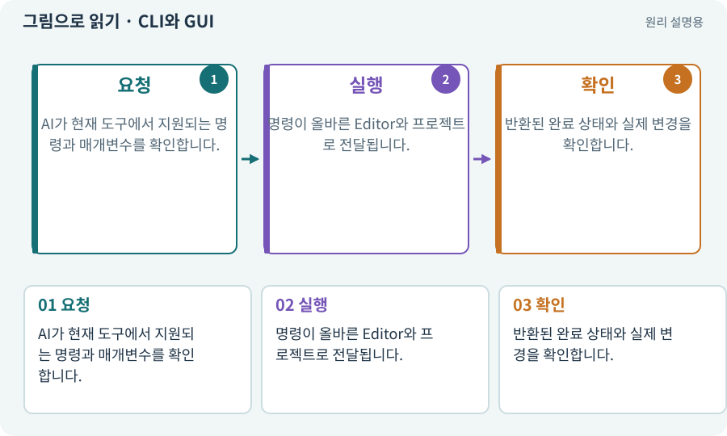

# CLI와 GUI

**분야:** 시작·도구·작업 공간

CLI는 텍스트 명령으로 기능을 요청하는 인터페이스이고, GUI는 버튼·창으로 요청하는 인터페이스입니다. 같은 작업을 다른 입구에서 부를 수 있습니다.

**찾아오는 이름:** CLI와 GUI, Unity CLI, CLI, GUI, 명령줄, 터미널, PowerShell

## 익숙한 것에 비유하면

엘리베이터 버튼을 누르거나 음성으로 층수를 지정하는 차이입니다. 요청 입구와 실제 움직이는 기계는 다릅니다.



개념도입니다. 실제 Unity 화면이나 검사 결과가 아닙니다. 그림의 순서·색은 역할을 구분하며 실제 설정값은 프로젝트에서 확인합니다.

## 이렇게 작동합니다

### 1. 요청

AI가 현재 도구에서 지원되는 명령과 매개변수를 확인합니다.

### 2. 실행

명령이 올바른 Editor와 프로젝트로 전달됩니다.

### 3. 확인

반환된 완료 상태와 실제 변경을 확인합니다.

## 우리 RPG에서는 이렇게 만나요

“씬을 저장해 줘”라는 자연어를 AI가 실제 CLI 호출로 바꿉니다. 명령을 직접 입력하지 않아도 대상 경로와 저장 결과는 확인할 수 있습니다.

## 이것과 혼동하지 마세요

명령이 접수됐다는 응답은 작업 완료가 아닐 수 있습니다. CLI 설치와 Editor 연결도 다릅니다.

## 이해했는지 한 번 생각해 보기

CLI를 설치하면 Editor가 필요 없어지나요?

<details><summary>답과 이유</summary>

아닙니다. 이 과정의 연결형 작업은 실제 Editor와 Pipeline을 통해 수행합니다.

</details>

## 내 프로젝트에서 확인하고 싶다면

아래 요청은 읽기 전용으로 실제 대상을 확인하는 선택 요청입니다. 코드나 설정을 직접 편집할 필요는 없습니다.

```text
현재 프로젝트에서 CLI와 GUI 관련 요소가 어떻게 사용되는지 읽기 전용으로 확인해 줘. 실제 대상과 설정을 찾아 쉬운 말과 작은 예로 설명해 줘. 특히 다음 혼동을 구분해 줘: 명령이 접수됐다는 응답은 작업 완료가 아닐 수 있습니다. CLI 설치와 Editor 연결도 다릅니다. 아직 코드·설정·파일은 바꾸지 말고, 확인할 수 없는 내용은 따로 알려 줘.
```

## 이어지는 개념

[Unity Pipeline과 제작 파이프라인](pipeline.md) · [API와 매개변수](api.md) · [프로세스·종료 코드·표준 출력](process.md) · [Unity Editor](editor.md)

## 이 개념을 사용하는 실습

[02 · 내 게임을 알아듣는 개발 스킬 만들기](../index.html#lesson-002) · [03 · AI와 실행 중인 Unity 연결하기](../index.html#lesson-003) · [38 · 테스트 결과와 실제 플레이 구분하기](../index.html#lesson-038) · [56 · Unity AI로 캐릭터 움직임 만들기](../index.html#lesson-056) · [65 · 스프라이트를 정리해 실제 캐릭터에 넣기](../index.html#lesson-065) · [74 · 추가 외형을 서버에서 받게 준비하기](../index.html#lesson-074) · [114 · 테스트를 실행하고 결과 읽기](../index.html#lesson-114) · [117 · Unity 작업을 한 창구로 모으기](../index.html#lesson-117) · [118 · 모의 응답 대신 실제 Claude 연결하기](../index.html#lesson-118) · [124 · 현재 컴퓨터의 Unity 명령 등록하기](../index.html#lesson-124) · [130 · 첫 확장 작업을 하네스에 연결하기](../index.html#lesson-130)

## 참고와 설명의 범위

기본 도구 동작은 아래 공식 자료를 참고했습니다. 비유·그림·RPG의 예시 수치와 정책은 이해를 위한 자체 예제입니다. 실제 API·지원 기능은 설치 버전과 계정에서 확인합니다.

- [Unity · 2D 게임 제작 흐름](https://docs.unity3d.com/6000.3/Documentation/Manual/2d-game-creation-wokflow.html)

그림·계산 예제·조작 모형은 자체 제작한 설명입니다. 실제 Unity 화면, 서비스 생성 결과, 성능 실측 또는 게임 테스트 결과가 아닙니다. 자료 확인: 2026년 9월 26일.
