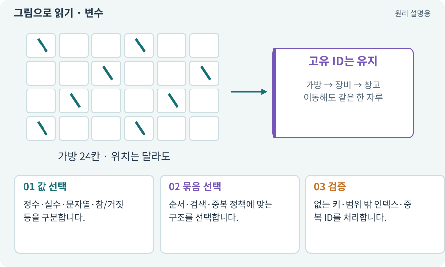

# 변수·자료형·리스트·딕셔너리

**분야:** 설명을 읽기 위한 기초 언어

변수는 값을 가리키거나 담는 이름이고 자료형은 값의 종류를 정합니다. 리스트·배열은 순서 있는 여러 값, 딕셔너리는 키로 값을 찾는 구조, 집합은 중복 없이 모은 구조입니다.

**찾아오는 이름:** 변수·자료형·리스트·딕셔너리, 변수, Variable, 자료형, 자료 구조, 리스트, List, Dictionary, 딕셔너리, HashSet, 배열, Array, 문자열, String, Boolean, 컬렉션

## 익숙한 것에 비유하면

서랍에 줄지어 넣은 물건, 이름표로 찾는 보관함, 중복 없이 모은 명단을 비교할 수 있습니다.



개념도입니다. 실제 Unity 화면이나 검사 결과가 아닙니다. 그림의 순서·색은 역할을 구분하며 실제 설정값은 프로젝트에서 확인합니다.

## 이렇게 작동합니다

### 1. 값 선택

정수·실수·문자열·참/거짓 등을 구분합니다.

### 2. 묶음 선택

순서·검색·중복 정책에 맞는 구조를 선택합니다.

### 3. 검증

없는 키·범위 밖 인덱스·중복 ID를 처리합니다.

## 우리 RPG에서는 이렇게 만나요

가방 슬롯은 순서가 중요하고 아이템 정의 목록은 contentId로 빠르게 찾는 것이 편합니다. 피해 받은 ActorID 집합은 한 공격에서 중복 피해를 막는 데 쓸 수 있습니다.

## 이것과 혼동하지 마세요

리스트 순서와 영구 ID를 혼동하면 정렬 후 다른 아이템을 참조할 수 있습니다.

## 이해했는지 한 번 생각해 보기

0번 슬롯의 아이템이 항상 같은 검인가요?

<details><summary>답과 이유</summary>

아닙니다. 이동·정렬 후 달라질 수 있으므로 고유 ID로 소유 대상을 확인합니다.

</details>

## 내 프로젝트에서 확인하고 싶다면

아래 요청은 읽기 전용으로 실제 대상을 확인하는 선택 요청입니다. 코드나 설정을 직접 편집할 필요는 없습니다.

```text
현재 프로젝트에서 변수·자료형·리스트·딕셔너리 관련 요소가 어떻게 사용되는지 읽기 전용으로 확인해 줘. 실제 대상과 설정을 찾아 쉬운 말과 작은 예로 설명해 줘. 특히 다음 혼동을 구분해 줘: 리스트 순서와 영구 ID를 혼동하면 정렬 후 다른 아이템을 참조할 수 있습니다. 아직 코드·설정·파일은 바꾸지 말고, 확인할 수 없는 내용은 따로 알려 줘.
```

## 이어지는 개념

[ID·고유 식별자·버전](identifier.md) · [인벤토리·슬롯·스택·창고](inventory.md) · [JSON·객체·배열·필드](json.md) · [공격 ID·사건 ID·중복 피해 방지](event-id.md)

## 이 개념을 사용하는 실습

[25 · 게임을 껐다 켜도 장비 유지하기](../index.html#lesson-025) · [28 · 여덟 구역의 첫 던전 만들기](../index.html#lesson-028) · [44 · 시드로 같은 던전 다시 만들기](../index.html#lesson-044) · [52 · 전투에서 선택할 이유 만들기](../index.html#lesson-052) · [54 · 느낌을 근거로 밸런스 고치기](../index.html#lesson-054) · [69 · 베기와 폭발을 시트 애니메이션으로 만들기](../index.html#lesson-069) · [73 · 주소로 에셋 불러오기](../index.html#lesson-073) · [103 · 같은 전투를 2D와 3D로 플레이하기](../index.html#lesson-103) · [107 · 원본을 보호하고 허용 경로 정하기](../index.html#lesson-107) · [114 · 테스트를 실행하고 결과 읽기](../index.html#lesson-114) · [117 · Unity 작업을 한 창구로 모으기](../index.html#lesson-117) · [122 · 내 게임에 맞는 검사기 추가하기](../index.html#lesson-122) · [125 · 하네스로 작은 전리품 화면 만들기](../index.html#lesson-125) · [155 · 기록을 보고 제작 경제와 전투 조정하기](../index.html#lesson-155)

## 참고와 설명의 범위

기본 도구 동작은 아래 공식 자료를 참고했습니다. 비유·그림·RPG의 예시 수치와 정책은 이해를 위한 자체 예제입니다. 실제 API·지원 기능은 설치 버전과 계정에서 확인합니다.

- [Microsoft · C# 컬렉션](https://learn.microsoft.com/en-us/dotnet/csharp/language-reference/builtin-types/collections)

그림·계산 예제·조작 모형은 자체 제작한 설명입니다. 실제 Unity 화면, 서비스 생성 결과, 성능 실측 또는 게임 테스트 결과가 아닙니다. 자료 확인: 2026년 9월 26일.
