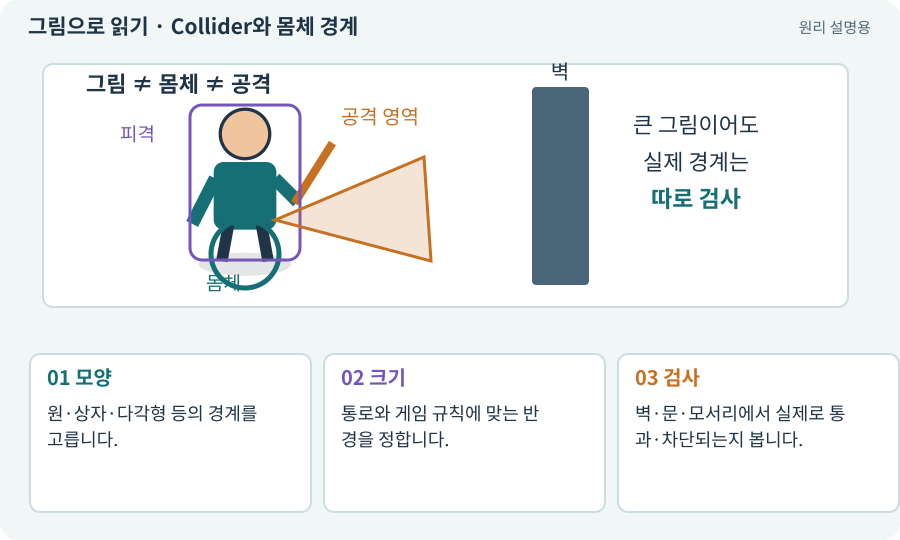

# Collider와 몸체 경계

**분야:** 오브젝트·좌표·움직임

Collider는 물리 검사에 사용하는 경계입니다. 보이는 그림과 같을 필요는 없습니다. 탑다운 캐릭터는 보통 발 주변에 작은 몸체 경계를 둡니다.

**찾아오는 이름:** Collider와 몸체 경계, Collider2D, Collider, 콜라이더, 충돌체, CircleCollider2D, BoxCollider2D, PolygonCollider2D

## 익숙한 것에 비유하면

사람이 넓은 망토를 입어도 문을 통과할 때 필요한 몸통 폭은 별도인 것과 같습니다.



개념도입니다. 실제 Unity 화면이나 검사 결과가 아닙니다. 그림의 순서·색은 역할을 구분하며 실제 설정값은 프로젝트에서 확인합니다.

## 이렇게 작동합니다

### 1. 모양

원·상자·다각형 등의 경계를 고릅니다.

### 2. 크기

통로와 게임 규칙에 맞는 반경을 정합니다.

### 3. 검사

벽·문·모서리에서 실제로 통과·차단되는지 봅니다.

## 보이는 그림, 걷는 몸체, 맞는 영역을 분리하세요

큰 망토가 있는 캐릭터를 상상해 보세요. 망토 끝까지 Body로 잡으면 문을 통과하지 못할 수 있습니다. 반대로 Hurtbox를 너무 작게 잡으면 분명 그림에 맞은 공격이 빗나간 것처럼 느껴집니다. 충돌과 피격의 목적을 따로 정해야 합니다.

Body는 이동과 벽 충돌, Hurtbox는 피해를 받을 영역, Hitbox는 공격이 닿는 영역입니다. 이들은 같은 오브젝트 아래에 있어도 다른 Layer·Trigger 설정과 처리 규칙을 가질 수 있습니다.

아래 모형에서 그림 폭을 바꿔도 원형 몸체의 반경은 유지됩니다. 실제 게임에서는 Transform의 부모 배율이 자식 Collider에 미치는 영향까지 확인해야 하므로 VisualRoot만 조절하는 설계를 사용합니다.

| 경계 | 사용 목적 | 중복 주의 |
| --- | --- | --- |
| Body | 이동·문·벽 충돌 | 이동 모터 하나만 위치 처리 |
| Hurtbox | 피해 받을 부위 | 같은 Actor의 여러 부위 중복 피해 방지 |
| Hitbox | 타격 영역 | 하나의 attackId로 적중 관리 |

## 직접 값을 바꾸며 보기

[웹 해설의 조작 모형 열기](../index.html#tech-collider). 조작은 설명용 모형만 바꿉니다. 실제 프로젝트·AI·진행 체크·게임 테스트는 실행하거나 변경하지 않습니다.

## 우리 RPG에서는 이렇게 만나요

머리와 검 전체를 몸체 경계로 잡으면 좁은 문에 비정상적으로 걸립니다. 몸체 Body와 피해를 받는 Hurtbox를 목적에 따라 분리할 수 있습니다.

## 이것과 혼동하지 마세요

스프라이트를 크게 바꿨다고 몸체·사거리도 자동으로 키우지 않습니다.

## 이해했는지 한 번 생각해 보기

캐릭터 그림이 벽과 조금 겹쳐도 오류인가요?

<details><summary>답과 이유</summary>

발 기준 몸체가 벽을 넘지 않고 의도한 가림이라면 정상일 수 있습니다.

</details>

## 내 프로젝트에서 확인하고 싶다면

아래 요청은 읽기 전용으로 실제 대상을 확인하는 선택 요청입니다. 코드나 설정을 직접 편집할 필요는 없습니다.

```text
현재 프로젝트에서 Collider와 몸체 경계 관련 요소가 어떻게 사용되는지 읽기 전용으로 확인해 줘. 실제 대상과 설정을 찾아 쉬운 말과 작은 예로 설명해 줘. 특히 다음 혼동을 구분해 줘: 스프라이트를 크게 바꿨다고 몸체·사거리도 자동으로 키우지 않습니다. 아직 코드·설정·파일은 바꾸지 말고, 확인할 수 없는 내용은 따로 알려 줘.
```

## 이어지는 개념

[Hitbox·Hurtbox·Body](hitbox.md) · [Trigger와 충돌 반응](trigger.md) · [Rigidbody2D와 물리 몸체](rigidbody.md) · [Pivot과 발 기준점](pivot.md)

## 이 개념을 사용하는 실습

[07 · 캐릭터와 벽이 있는 공간 만들기](../index.html#lesson-007) · [08 · WASD로 벽에 부딪히며 이동하기](../index.html#lesson-008) · [09 · 클릭한 곳까지 벽을 돌아가기](../index.html#lesson-009) · [13 · 적을 클릭해 접근하고 공격하기](../index.html#lesson-013) · [21 · 몬스터가 장비를 떨어뜨리게 하기](../index.html#lesson-021) · [28 · 여덟 구역의 첫 던전 만들기](../index.html#lesson-028) · [30 · 예고를 보고 피하는 보스 만들기](../index.html#lesson-030) · [34 · 걷기·공격·피격·사망 움직임 연결하기](../index.html#lesson-034) · [35 · 앞뒤 가림과 PC 조작 다듬기](../index.html#lesson-035) · [38 · 테스트 결과와 실제 플레이 구분하기](../index.html#lesson-038) · [45 · 무작위 방과 통로 만들기](../index.html#lesson-045) · [46 · 랜덤 지도 위를 실제로 걷기](../index.html#lesson-046) · [47 · 실패하는 시드를 찾고 복구하기](../index.html#lesson-047) · [49 · 여러 근접 적의 공격 나누기](../index.html#lesson-049) · [57 · Unity AI로 바닥과 벽 타일 만들기](../index.html#lesson-057) · [66 · 타일 경계와 랜덤맵 외형 연결하기](../index.html#lesson-066) · [79 · 추가 기능을 하나의 게임으로 합치기](../index.html#lesson-079) · [84 · 같은 지도를 3D 바닥과 벽으로 만들기](../index.html#lesson-084) · [86 · 3D에서도 클릭한 곳까지 돌아가기](../index.html#lesson-086) · [89 · 같은 전투 규칙을 3D에 연결하기](../index.html#lesson-089) · [94 · 같은 랜덤 던전을 3D로 생성하기](../index.html#lesson-094) · [95 · 3D 조명과 환경을 읽기 좋게 만들기](../index.html#lesson-095) · [96 · 3D 카메라 가림과 터치 조작 다듬기](../index.html#lesson-096) · [125 · 하네스로 작은 전리품 화면 만들기](../index.html#lesson-125) · [126 · 한 요청으로 필터 기능 끝내기](../index.html#lesson-126) · [131 · 중요한 전리품만 표시하는 규칙 만들기](../index.html#lesson-131) · [135 · 벽을 통과하지 않는 회피 만들기](../index.html#lesson-135) · [136 · 방패병과 화염술사 정예 추가하기](../index.html#lesson-136) · [141 · 소켓 한 칸에 룬 장착하기](../index.html#lesson-141) · [148 · 아트 역할로 새 지역 외형 완성하기](../index.html#lesson-148)

## 참고와 설명의 범위

기본 도구 동작은 아래 공식 자료를 참고했습니다. 비유·그림·RPG의 예시 수치와 정책은 이해를 위한 자체 예제입니다. 실제 API·지원 기능은 설치 버전과 계정에서 확인합니다.

- [Unity · Rigidbody2D](https://docs.unity3d.com/6000.3/Documentation/Manual/2d-physics/rigidbody/introduction-to-rigidbody-2d.html)
- [Unity · Physics2D.CircleCast](https://docs.unity3d.com/6000.3/Documentation/ScriptReference/Physics2D.CircleCast.html)

그림·계산 예제·조작 모형은 자체 제작한 설명입니다. 실제 Unity 화면, 서비스 생성 결과, 성능 실측 또는 게임 테스트 결과가 아닙니다. 자료 확인: 2026년 9월 26일.
