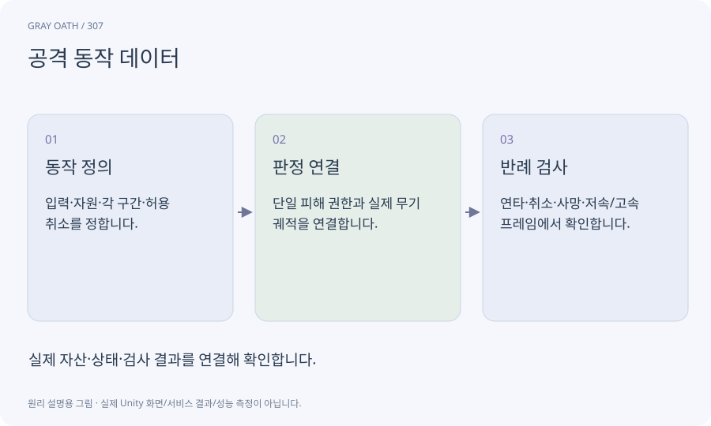

# 공격 동작 데이터

공격의 예비·타격 활성·회복 시간과 이동·취소·피해·범위를 데이터로 정의한 묶음입니다. 애니메이션 클립의 길이와 실제 공격 규칙을 함께 맞춥니다.

## 익숙한 비유

검도 동작을 준비·타격·다음 자세로 돌아가기 순서로 나눈 것입니다.



## 작동 원리

### 1. 동작 정의

입력·자원·각 구간·허용 취소를 정합니다.

### 2. 판정 연결

단일 피해 권한과 실제 무기 궤적을 연결합니다.

### 3. 반례 검사

연타·취소·사망·저속/고속 프레임에서 확인합니다.

## 게임 속 예

가벼운 공격3단과 강공격을 같은 도구에서 구성합니다. 검 그림을 길게 바꿔도 데이터 사거리는 임의로 증가하지 않습니다.

## 혼동하지 않기

애니메이션 이벤트와 타이머가 각각 피해를 주면 한 번의 휘두름이 두 번 적중할 수 있습니다.

## 확인 질문

타격감 때문에 타이밍을 바꾸면 무엇을 함께 보나요?

예고·실제 hit window·취소 규칙·자원·효과·툴팁을 함께 검사합니다.

## 내 프로젝트에서 확인하기

```text
현재 GrayOathRPG3D에서 공격 동작 데이터을 사용하는 실제 대상과 동작을 읽기 전용으로 확인해 줘. 쉬운 말과 작은 사례로 설명하고 애니메이션 이벤트와 타이머가 각각 피해를 주면 한 번의 휘두름이 두 번 적중할 수 있습니다. 이 문제를 어떻게 막는지 보여 줘. 코드·데이터·설정은 아직 수정하지 마.
```

## 관련 해설

[damage](damage.md) · [animation-event](animation-event.md) · [input-buffer](input-buffer.md)

## 공식 참고

- [Unity · Animation Rigging](https://docs.unity3d.com/Packages/com.unity.animation.rigging@1.3/manual/index.html)
