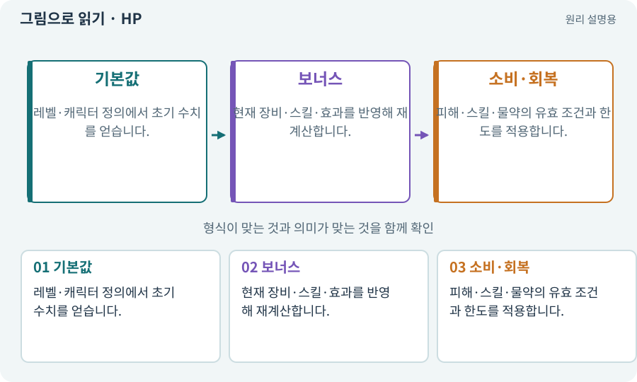

# HP·MP·ATK·DEF·XP

**분야:** 설명을 읽기 위한 기초 언어

HP는 체력, MP는 마나 같은 스킬 자원, ATK는 공격력, DEF는 방어력, XP는 경험치를 뜻하는 관용 표기입니다. 실제 피해 공식과 성장 규칙은 게임마다 다릅니다.

**찾아오는 이름:** HP·MP·ATK·DEF·XP, HP, MP, ATK, DEF, XP, 경험치, 체력, 방어력, 공격력, 마나

## 익숙한 것에 비유하면

체력은 남은 생존 여유, 마나는 쓸 수 있는 기술의 자원, 경험치는 성장 누적 기록으로 구분할 수 있습니다.



개념도입니다. 실제 Unity 화면이나 검사 결과가 아닙니다. 그림의 순서·색은 역할을 구분하며 실제 설정값은 프로젝트에서 확인합니다.

## 이렇게 작동합니다

### 1. 기본값

레벨·캐릭터 정의에서 초기 수치를 얻습니다.

### 2. 보너스

현재 장비·스킬·효과를 반영해 재계산합니다.

### 3. 소비·회복

피해·스킬·물약의 유효 조건과 한도를 적용합니다.

## 우리 RPG에서는 이렇게 만나요

최대 체력 100에서 현재 체력이 40일 때 최대 체력을 80으로 줄이면 현재 값을 어떻게 처리할지 정책이 필요합니다. 스킬트리 초기화가 공짜 회복으로 쓰이지 않게 검사합니다.

## 이것과 혼동하지 마세요

방어력 10이 언제나 피해를 10 줄인다는 보편 규칙은 없습니다. 승인한 공식을 확인합니다.

## 이해했는지 한 번 생각해 보기

장비를 100번 교체하면 공격력도 올라가나요?

<details><summary>답과 이유</summary>

정상 재계산에서는 같은 장비 상태면 같은 능력치여야 합니다.

</details>

## 내 프로젝트에서 확인하고 싶다면

아래 요청은 읽기 전용으로 실제 대상을 확인하는 선택 요청입니다. 코드나 설정을 직접 편집할 필요는 없습니다.

```text
현재 프로젝트에서 HP·MP·ATK·DEF·XP 관련 요소가 어떻게 사용되는지 읽기 전용으로 확인해 줘. 실제 대상과 설정을 찾아 쉬운 말과 작은 예로 설명해 줘. 특히 다음 혼동을 구분해 줘: 방어력 10이 언제나 피해를 10 줄인다는 보편 규칙은 없습니다. 승인한 공식을 확인합니다. 아직 코드·설정·파일은 바꾸지 말고, 확인할 수 없는 내용은 따로 알려 줘.
```

## 이어지는 개념

[능력치·클램프·정수·부동소수점](stats.md) · [피해 계산·스냅샷·피해 사건](damage.md) · [쿨다운·마나·자원 소비](cooldown.md) · [장비·슬롯·재계산](equipment.md)

## 이 개념을 사용하는 실습

[12 · 체력과 피해를 눈으로 확인하기](../index.html#lesson-012) · [13 · 적을 클릭해 접근하고 공격하기](../index.html#lesson-013) · [14 · 나를 발견하고 공격하는 적 만들기](../index.html#lesson-014) · [15 · 다른 방식으로 싸우는 적 추가하기](../index.html#lesson-015) · [16 · 물약을 쓰고 죽은 뒤 다시 시작하기](../index.html#lesson-016) · [17 · 적을 잡아 레벨 올리기](../index.html#lesson-017) · [18 · 베기·마력탄·회전 공격 만들기](../index.html#lesson-018) · [19 · 누가 때렸는지 보이는 전투 만들기](../index.html#lesson-019) · [20 · 같은 검 두 자루를 다른 물건으로 다루기](../index.html#lesson-020) · [21 · 몬스터가 장비를 떨어뜨리게 하기](../index.html#lesson-021) · [23 · 장비를 바꾸고 능력치 확인하기](../index.html#lesson-023) · [24 · 보기 편한 인벤토리 화면 만들기](../index.html#lesson-024) · [25 · 게임을 껐다 켜도 장비 유지하기](../index.html#lesson-025) · [26 · 새 게임·이어하기·마을 연결하기](../index.html#lesson-026) · [27 · 회복하고 물약을 사는 마을 만들기](../index.html#lesson-027) · [30 · 예고를 보고 피하는 보스 만들기](../index.html#lesson-030) · [32 · 길 안내와 처음 하는 사람의 동선 만들기](../index.html#lesson-032) · [38 · 테스트 결과와 실제 플레이 구분하기](../index.html#lesson-038) · [41 · 선택할 수 있는9노드 스킬트리 만들기](../index.html#lesson-041) · [42 · 트리에서 투자하고 저장하기](../index.html#lesson-042) · [43 · 빌드를 바꾸며 전투 비교하기](../index.html#lesson-043) · [48 · 적이 나를 보고 놓치게 만들기](../index.html#lesson-048) · [52 · 전투에서 선택할 이유 만들기](../index.html#lesson-052) · [53 · 입력은 빠르게, 취소 규칙은 명확하게](../index.html#lesson-053) · [54 · 느낌을 근거로 밸런스 고치기](../index.html#lesson-054) · [71 · 카메라·소리·피해 숫자 맞추기](../index.html#lesson-071) · [79 · 추가 기능을 하나의 게임으로 합치기](../index.html#lesson-079) · [82 · 게임 규칙은 재사용하고 공간만 바꾸기](../index.html#lesson-082) · [87 · 같은 캐릭터를 실제 3D 모델로 만들기](../index.html#lesson-087) · [89 · 같은 전투 규칙을 3D에 연결하기](../index.html#lesson-089) · [92 · 무기를 손에 쥐고 전리품 표시하기](../index.html#lesson-092) · [100 · 두 버전이 같은 게임인지 비교하기](../index.html#lesson-100) · [134 · 화상·냉기·표식으로 전투 확장하기](../index.html#lesson-134) · [136 · 방패병과 화염술사 정예 추가하기](../index.html#lesson-136) · [137 · 기름·폭발통·밸브로 공간 활용하기](../index.html#lesson-137) · [139 · 재료로 장비 제작하기](../index.html#lesson-139) · [141 · 소켓 한 칸에 룬 장착하기](../index.html#lesson-141) · [142 · 배운 스킬의 변형 선택하기](../index.html#lesson-142) · [144 · 이번 탐험에만 남는 유물 고르기](../index.html#lesson-144) · [145 · 지원 동료 하나 만들기](../index.html#lesson-145) · [147 · 용광로 감시자와 3단계 전투 만들기](../index.html#lesson-147) · [153 · 대장간 고해상도팩 선택 다운로드하기](../index.html#lesson-153) · [158 · 룬 교체 버그를 역할로 수정하기](../index.html#lesson-158)

## 참고와 설명의 범위

이 항목의 비유·그림·RPG 수치·운영 규칙은 개념을 이해하기 위한 자체 설계 예제입니다. 특정 도구가 이 규칙을 자동으로 구현한다는 뜻은 아닙니다.


그림·계산 예제·조작 모형은 자체 제작한 설명입니다. 실제 Unity 화면, 서비스 생성 결과, 성능 실측 또는 게임 테스트 결과가 아닙니다. 자료 확인: 2026년 9월 26일.
