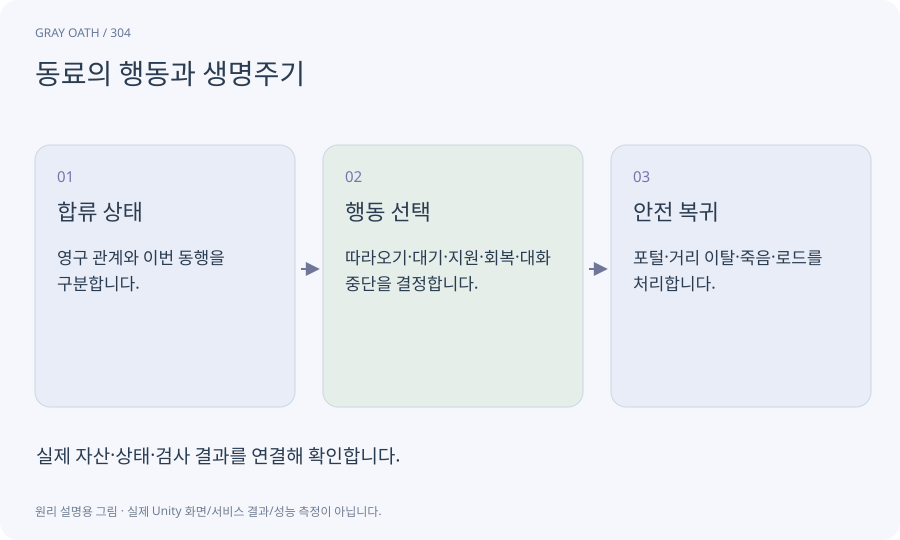

# 동료의 행동과 생명주기

플레이어를 따라다니며 전투·대화에 참여하는 캐릭터의 판단·이동·진행 상태입니다. 단순히 일정 거리를 따라오는 것보다 소유권과 복구가 중요합니다.

## 익숙한 비유

함께 여행하는 사람이 길을 비켜 주고 대화 중에는 기다리며 떨어지면 다시 합류하는 것입니다.



## 작동 원리

### 1. 합류 상태

영구 관계와 이번 동행을 구분합니다.

### 2. 행동 선택

따라오기·대기·지원·회복·대화 중단을 결정합니다.

### 3. 안전 복귀

포털·거리 이탈·죽음·로드를 처리합니다.

## 게임 속 예

루아가 문을 막으면 회피 위치를 찾고, 다음 셀로 넘어가면 유효한 근처 위치로 합류합니다. 동료 처치도 의뢰의 허용 credit 정책을 따릅니다.

## 혼동하지 않기

동료가 플레이어 룬·보상을 자기 공격마다 복제 적용하지 않도록 공격 출처를 구분합니다.

## 확인 질문

동료가 없는 저장에서도 메인 진행되나요?

필수 장면에는 대체 화자나 접근 경로를 두고 부재 상태도 검사합니다.

## 내 프로젝트에서 확인하기

```text
현재 GrayOathRPG3D에서 동료의 행동과 생명주기을 사용하는 실제 대상과 동작을 읽기 전용으로 확인해 줘. 쉬운 말과 작은 사례로 설명하고 동료가 플레이어 룬·보상을 자기 공격마다 복제 적용하지 않도록 공격 출처를 구분합니다. 이 문제를 어떻게 막는지 보여 줘. 코드·데이터·설정은 아직 수정하지 마.
```

## 관련 해설

[navigation](navigation.md) · [world-state](world-state.md) · [lifecycle](lifecycle.md)

## 공식 참고

- [Unity · NavMeshLink](https://docs.unity3d.com/Packages/com.unity.ai.navigation@2.0/manual/NavMeshLink.html)
