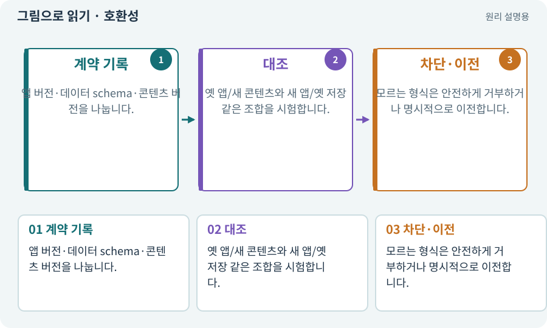

# 호환성·코드와 콘텐츠 계약

**분야:** 비동기·다운로드·빌드·버전 관리

호환성은 서로 다른 버전의 앱·데이터·자산이 같은 계약으로 동작할 수 있는지의 문제입니다. 숫자가 높은 버전이라는 이유만으로 옛 앱에서 안전하게 읽히지는 않습니다.

**찾아오는 이름:** 호환성·코드와 콘텐츠 계약, 호환성, Compatibility, 앱 호환, 콘텐츠 호환, 호환 표

## 익숙한 것에 비유하면

새 규격 전구가 기존 소켓에 맞는지 확인하는 것과 같습니다. 같은 회사 제품이어도 규격이 다르면 맞지 않습니다.



개념도입니다. 실제 Unity 화면이나 검사 결과가 아닙니다. 그림의 순서·색은 역할을 구분하며 실제 설정값은 프로젝트에서 확인합니다.

## 이렇게 작동합니다

### 1. 계약 기록

앱 버전·데이터 schema·콘텐츠 버전을 나눕니다.

### 2. 대조

옛 앱/새 콘텐츠와 새 앱/옛 저장 같은 조합을 시험합니다.

### 3. 차단·이전

모르는 형식은 안전하게 거부하거나 명시적으로 이전합니다.

## 우리 RPG에서는 이렇게 만나요

원격 몬스터 프리팹이 앱에 없는 새 컴포넌트를 요구하면 외형팩만 올려 해결되지 않을 수 있습니다. 기본 앱 코드가 이해하는 계약 안에서 콘텐츠를 배포합니다.

## 이것과 혼동하지 마세요

주소가 같다는 것과 데이터 의미가 같다는 것은 다릅니다.

## 이해했는지 한 번 생각해 보기

새 팩만 올리면 새 C# 규칙도 생기나요?

<details><summary>답과 이유</summary>

아닙니다. 콘텐츠와 앱 코드 배포를 구분해야 합니다.

</details>

## 내 프로젝트에서 확인하고 싶다면

아래 요청은 읽기 전용으로 실제 대상을 확인하는 선택 요청입니다. 코드나 설정을 직접 편집할 필요는 없습니다.

```text
현재 프로젝트에서 호환성·코드와 콘텐츠 계약 관련 요소가 어떻게 사용되는지 읽기 전용으로 확인해 줘. 실제 대상과 설정을 찾아 쉬운 말과 작은 예로 설명해 줘. 특히 다음 혼동을 구분해 줘: 주소가 같다는 것과 데이터 의미가 같다는 것은 다릅니다. 아직 코드·설정·파일은 바꾸지 말고, 확인할 수 없는 내용은 따로 알려 줘.
```

## 이어지는 개념

[스키마·JSON Schema·계약](schema.md) · [저장 이전·마이그레이션](migration.md) · [카탈로그·주소 목록·콘텐츠 버전](catalog.md) · [게임 빌드·개발 빌드·배포](build.md)

## 이 개념을 사용하는 실습

[77 · 앱을 바꾸지 않고 외형 업데이트하기](../index.html#lesson-077) · [98 · 3D 팩을 2D 팩과 따로 내려받기](../index.html#lesson-098) · [141 · 소켓 한 칸에 룬 장착하기](../index.html#lesson-141) · [152 · 이전 저장을 새 확장판으로 가져오기](../index.html#lesson-152)

## 참고와 설명의 범위

기본 도구 동작은 아래 공식 자료를 참고했습니다. 비유·그림·RPG의 예시 수치와 정책은 이해를 위한 자체 예제입니다. 실제 API·지원 기능은 설치 버전과 계정에서 확인합니다.

- [Unity Addressables · 콘텐츠 업데이트](https://docs.unity3d.com/Packages/com.unity.addressables@2.7/manual/builds-update-build.html)

그림·계산 예제·조작 모형은 자체 제작한 설명입니다. 실제 Unity 화면, 서비스 생성 결과, 성능 실측 또는 게임 테스트 결과가 아닙니다. 자료 확인: 2026년 9월 26일.
