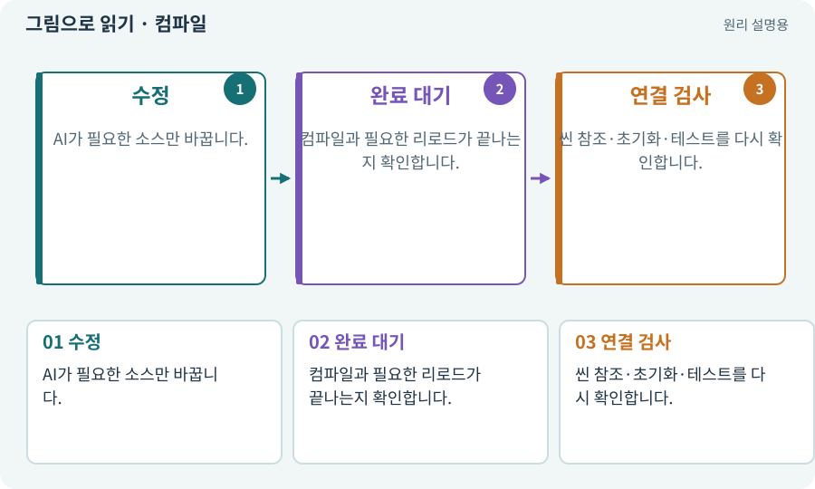

# 컴파일·어셈블리·도메인 리로드

**분야:** 시작·도구·작업 공간

컴파일은 작성한 코드를 실행 가능한 형태로 변환하며 문법·타입 등의 문제를 검사하는 과정입니다. 어셈블리는 코드 묶음이고, 도메인 리로드는 스크립트 실행 환경을 다시 준비하는 과정입니다.

**찾아오는 이름:** 컴파일·어셈블리·도메인 리로드, 컴파일, compile, 어셈블리, Assembly, asmdef, 도메인 리로드, Domain Reload

## 익숙한 것에 비유하면

대본을 배우에게 배포하기 전에 형식을 확인하고 출연진을 다시 무대로 부르는 과정에 가깝습니다. 대본 형식이 맞아도 연기가 재미있다는 뜻은 아닙니다.



개념도입니다. 실제 Unity 화면이나 검사 결과가 아닙니다. 그림의 순서·색은 역할을 구분하며 실제 설정값은 프로젝트에서 확인합니다.

## 이렇게 작동합니다

### 1. 수정

AI가 필요한 소스만 바꿉니다.

### 2. 완료 대기

컴파일과 필요한 리로드가 끝나는지 확인합니다.

### 3. 연결 검사

씬 참조·초기화·테스트를 다시 확인합니다.

## 우리 RPG에서는 이렇게 만나요

AI가 스크립트를 작성하자마자 새 기능을 호출하면 Editor가 아직 예전 상태이거나 컴파일 중일 수 있습니다. 준비 신호를 확인한 뒤 다음 명령을 실행합니다.

## 이것과 혼동하지 마세요

컴파일 성공은 모든 로직·참조·플랫폼 검사 성공이 아닙니다. 리로드 비활성 설정에서는 정적 상태 정리에 더 주의합니다.

## 이해했는지 한 번 생각해 보기

컴파일 통과 후에도 NullReferenceException이 가능한가요?

<details><summary>답과 이유</summary>

가능합니다. 코드 타입은 맞지만 실행할 때 필요한 객체 참조가 없을 수 있습니다.

</details>

## 내 프로젝트에서 확인하고 싶다면

아래 요청은 읽기 전용으로 실제 대상을 확인하는 선택 요청입니다. 코드나 설정을 직접 편집할 필요는 없습니다.

```text
현재 프로젝트에서 컴파일·어셈블리·도메인 리로드 관련 요소가 어떻게 사용되는지 읽기 전용으로 확인해 줘. 실제 대상과 설정을 찾아 쉬운 말과 작은 예로 설명해 줘. 특히 다음 혼동을 구분해 줘: 컴파일 성공은 모든 로직·참조·플랫폼 검사 성공이 아닙니다. 리로드 비활성 설정에서는 정적 상태 정리에 더 주의합니다. 아직 코드·설정·파일은 바꾸지 말고, 확인할 수 없는 내용은 따로 알려 줘.
```

## 이어지는 개념

[C#·Python·스크립트](csharp.md) · [참조·null·Missing Reference](reference.md) · [수명주기·초기화·정리](lifecycle.md) · [단위·통합·회귀 테스트](test.md)

## 이 개념을 사용하는 실습

[03 · AI와 실행 중인 Unity 연결하기](../index.html#lesson-003) · [06 · 시작 메뉴와 테스트 공간 연결하기](../index.html#lesson-006) · [115 · 지금 코드의 검사만 인정하기](../index.html#lesson-115) · [117 · Unity 작업을 한 창구로 모으기](../index.html#lesson-117) · [125 · 하네스로 작은 전리품 화면 만들기](../index.html#lesson-125) · [126 · 한 요청으로 필터 기능 끝내기](../index.html#lesson-126)

## 참고와 설명의 범위

기본 도구 동작은 아래 공식 자료를 참고했습니다. 비유·그림·RPG의 예시 수치와 정책은 이해를 위한 자체 예제입니다. 실제 API·지원 기능은 설치 버전과 계정에서 확인합니다.

- [Microsoft · C# 클래스](https://learn.microsoft.com/en-us/dotnet/csharp/fundamentals/types/classes)
- [Unity · IL2CPP](https://docs.unity3d.com/6000.3/Documentation/Manual/scripting-backends-il2cpp.html)

그림·계산 예제·조작 모형은 자체 제작한 설명입니다. 실제 Unity 화면, 서비스 생성 결과, 성능 실측 또는 게임 테스트 결과가 아닙니다. 자료 확인: 2026년 9월 26일.
