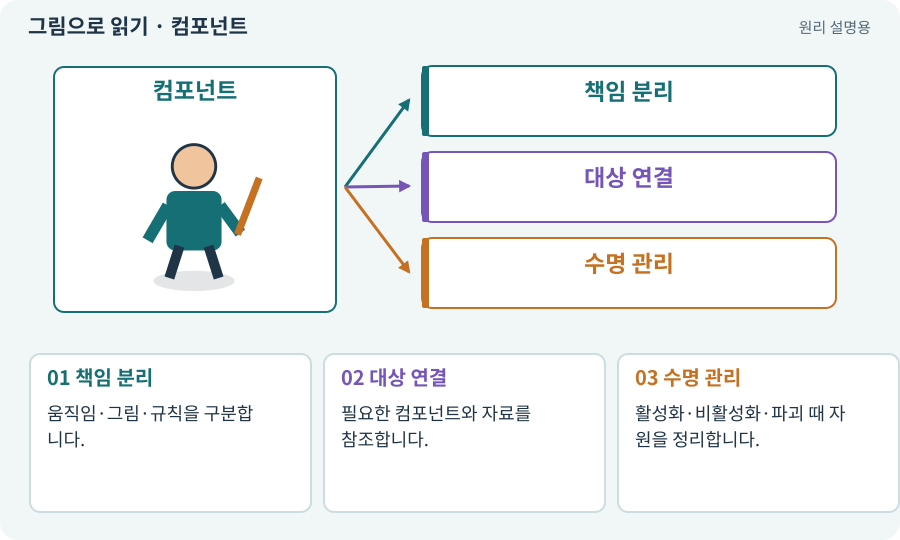

# 컴포넌트

**분야:** 오브젝트·좌표·움직임

컴포넌트는 GameObject에 붙이는 기능 단위입니다. 위치를 담당하는 Transform, 그림을 담당하는 Renderer, 몸체를 담당하는 Collider처럼 역할을 나눕니다.

**찾아오는 이름:** 컴포넌트, Component

## 익숙한 것에 비유하면

자동차의 엔진·바퀴·전조등입니다. 차 한 대를 이루지만 전조등을 바꿨다고 브레이크 성능이 바뀌어서는 안 됩니다.



개념도입니다. 실제 Unity 화면이나 검사 결과가 아닙니다. 그림의 순서·색은 역할을 구분하며 실제 설정값은 프로젝트에서 확인합니다.

## 이렇게 작동합니다

### 1. 책임 분리

움직임·그림·규칙을 구분합니다.

### 2. 대상 연결

필요한 컴포넌트와 자료를 참조합니다.

### 3. 수명 관리

활성화·비활성화·파괴 때 자원을 정리합니다.

## 우리 RPG에서는 이렇게 만나요

체력 감소는 Health가 맡고 빨갛게 번쩍이는 효과는 다른 컴포넌트가 맡게 하면 효과를 꺼도 피해 규칙은 유지됩니다.

## 이것과 혼동하지 마세요

컴포넌트를 여러 개 붙이면 자동으로 잘 협력하는 것은 아닙니다. 위치를 동시에 바꾸는 두 모터는 충돌할 수 있습니다.

## 이해했는지 한 번 생각해 보기

움직임 스크립트 두 개가 같은 위치를 바꾸면?

<details><summary>답과 이유</summary>

호출 순서에 따라 떨림·덮어쓰기가 생길 수 있습니다. 실제 이동 담당을 하나로 정합니다.

</details>

## 내 프로젝트에서 확인하고 싶다면

아래 요청은 읽기 전용으로 실제 대상을 확인하는 선택 요청입니다. 코드나 설정을 직접 편집할 필요는 없습니다.

```text
현재 프로젝트에서 컴포넌트 관련 요소가 어떻게 사용되는지 읽기 전용으로 확인해 줘. 실제 대상과 설정을 찾아 쉬운 말과 작은 예로 설명해 줘. 특히 다음 혼동을 구분해 줘: 컴포넌트를 여러 개 붙이면 자동으로 잘 협력하는 것은 아닙니다. 위치를 동시에 바꾸는 두 모터는 충돌할 수 있습니다. 아직 코드·설정·파일은 바꾸지 말고, 확인할 수 없는 내용은 따로 알려 줘.
```

## 이어지는 개념

[GameObject](gameobject.md) · [MonoBehaviour와 컴포넌트 스크립트](mono.md) · [이동 모터와 단일 위치 책임](motor.md) · [참조·null·Missing Reference](reference.md)

## 이 개념을 사용하는 실습

[12 · 체력과 피해를 눈으로 확인하기](../index.html#lesson-012) · [71 · 카메라·소리·피해 숫자 맞추기](../index.html#lesson-071) · [90 · 적의 판단을 3D 공간에 연결하기](../index.html#lesson-090) · [123 · 기존 게임의 실제 파일 찾아 연결하기](../index.html#lesson-123) · [129 · 기존 2D 게임에서 확장팩 시작하기](../index.html#lesson-129)

## 참고와 설명의 범위

기본 도구 동작은 아래 공식 자료를 참고했습니다. 비유·그림·RPG의 예시 수치와 정책은 이해를 위한 자체 예제입니다. 실제 API·지원 기능은 설치 버전과 계정에서 확인합니다.

- [Unity · 컴포넌트](https://docs.unity3d.com/6000.3/Documentation/Manual/Components.html)

그림·계산 예제·조작 모형은 자체 제작한 설명입니다. 실제 Unity 화면, 서비스 생성 결과, 성능 실측 또는 게임 테스트 결과가 아닙니다. 자료 확인: 2026년 9월 26일.
