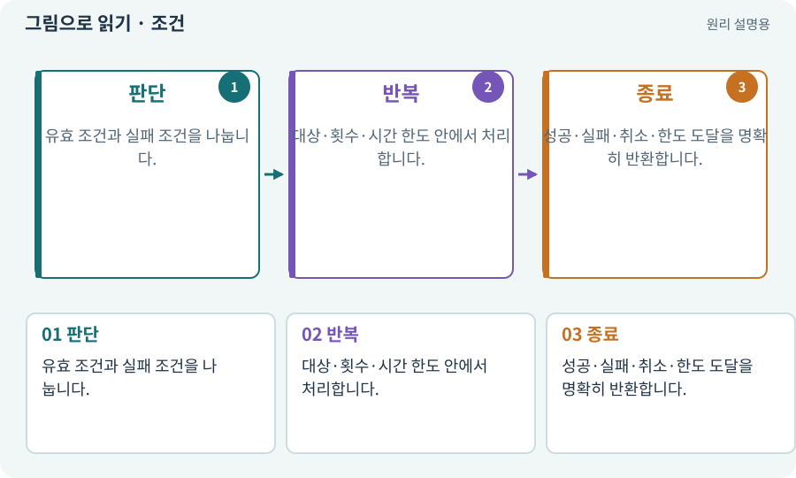

# 조건·반복·분기·경계값

**분야:** 설명을 읽기 위한 기초 언어

조건은 현재 값에 따라 다른 처리를 선택하고, 반복은 같은 규칙을 여러 대상이나 단계에 적용합니다. 종료 조건과 경계값을 정해야 무한 반복·한 번 더 실행되는 오류를 막습니다.

**찾아오는 이름:** 조건·반복·분기·경계값, 조건문, 반복문, 분기, Loop, loop, if 문, for 문, while 문

## 익숙한 것에 비유하면

재고가 있으면 주문을 받고, 장바구니의 각 물건을 계산한 뒤 모두 끝나면 결제하는 순서입니다.



개념도입니다. 실제 Unity 화면이나 검사 결과가 아닙니다. 그림의 순서·색은 역할을 구분하며 실제 설정값은 프로젝트에서 확인합니다.

## 이렇게 작동합니다

### 1. 판단

유효 조건과 실패 조건을 나눕니다.

### 2. 반복

대상·횟수·시간 한도 안에서 처리합니다.

### 3. 종료

성공·실패·취소·한도 도달을 명확히 반환합니다.

## 우리 RPG에서는 이렇게 만나요

100개 시드를 검사할 때 일부 시드가 무한 생성에 빠지지 않게 각 시도 한도를 둡니다. 체력이 0일 때 죽는지, 1일 때 살아 있는지도 따로 검사합니다.

## 이것과 혼동하지 마세요

반복 횟수를 늘리는 것으로 논리 오류를 해결하지 않습니다.

## 이해했는지 한 번 생각해 보기

최대 3회 재시도를 0부터 세면 어떤 점을 조심하나요?

<details><summary>답과 이유</summary>

총 시도 수와 재시도 수가 다르므로 경계 조건을 명시해야 합니다.

</details>

## 내 프로젝트에서 확인하고 싶다면

아래 요청은 읽기 전용으로 실제 대상을 확인하는 선택 요청입니다. 코드나 설정을 직접 편집할 필요는 없습니다.

```text
현재 프로젝트에서 조건·반복·분기·경계값 관련 요소가 어떻게 사용되는지 읽기 전용으로 확인해 줘. 실제 대상과 설정을 찾아 쉬운 말과 작은 예로 설명해 줘. 특히 다음 혼동을 구분해 줘: 반복 횟수를 늘리는 것으로 논리 오류를 해결하지 않습니다. 아직 코드·설정·파일은 바꾸지 말고, 확인할 수 없는 내용은 따로 알려 줘.
```

## 이어지는 개념

[알고리즘·입력·출력](algorithm.md) · [재시도·백오프·복구](retry.md) · [불변 조건·경계값·속성 검사](invariant.md) · [능력치·클램프·정수·부동소수점](stats.md)

## 이 개념을 사용하는 실습

[14 · 나를 발견하고 공격하는 적 만들기](../index.html#lesson-014) · [28 · 여덟 구역의 첫 던전 만들기](../index.html#lesson-028) · [68 · 피격 불꽃과 먼지 만들기](../index.html#lesson-068) · [69 · 베기와 폭발을 시트 애니메이션으로 만들기](../index.html#lesson-069) · [146 · 대장장이 구조 퀘스트 만들기](../index.html#lesson-146)

## 참고와 설명의 범위

기본 도구 동작은 아래 공식 자료를 참고했습니다. 비유·그림·RPG의 예시 수치와 정책은 이해를 위한 자체 예제입니다. 실제 API·지원 기능은 설치 버전과 계정에서 확인합니다.

- [Microsoft · C# 클래스](https://learn.microsoft.com/en-us/dotnet/csharp/fundamentals/types/classes)

그림·계산 예제·조작 모형은 자체 제작한 설명입니다. 실제 Unity 화면, 서비스 생성 결과, 성능 실측 또는 게임 테스트 결과가 아닙니다. 자료 확인: 2026년 9월 26일.
