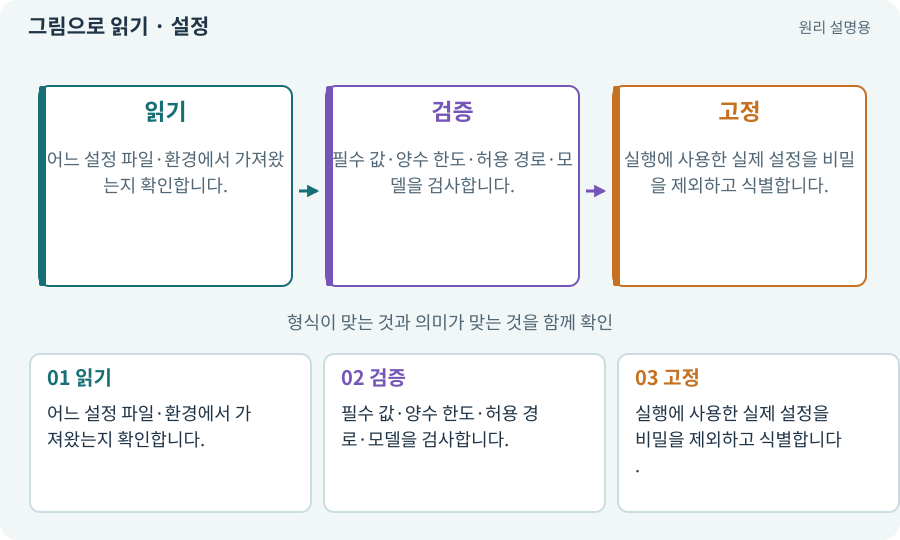

# 설정·기본값·검증·환경 변수

**분야:** 설명을 읽기 위한 기초 언어

설정은 프로그램의 동작을 바꾸는 입력입니다. 코드와 분리할 수 있지만 잘못된 값은 위험하므로 형식·범위·경로·권한을 검증해야 합니다. 환경 변수는 실행 환경에서 전달하는 이름과 값입니다.

**찾아오는 이름:** 설정·기본값·검증·환경 변수, 설정 파일, Config, config, 기본값, Default, 환경 변수, Environment Variable, 설정값

## 익숙한 것에 비유하면

기계의 조절판입니다. 다이얼이 있다고 아무 숫자나 허용해도 되는 것은 아닙니다.



개념도입니다. 실제 Unity 화면이나 검사 결과가 아닙니다. 그림의 순서·색은 역할을 구분하며 실제 설정값은 프로젝트에서 확인합니다.

## 이렇게 작동합니다

### 1. 읽기

어느 설정 파일·환경에서 가져왔는지 확인합니다.

### 2. 검증

필수 값·양수 한도·허용 경로·모델을 검사합니다.

### 3. 고정

실행에 사용한 실제 설정을 비밀을 제외하고 식별합니다.

## 우리 RPG에서는 이렇게 만나요

최소 테스트 수를 0으로 두면 빈 결과가 통과하는 문제가 생길 수 있어 양의 정수로 제한합니다. API 키를 기록 파일에 그대로 덤프하지 않습니다.

## 이것과 혼동하지 마세요

설정을 바꾸는 것도 게임·하네스의 동작 변경입니다. 코드가 그대로라고 재검사가 필요 없지는 않습니다.

## 이해했는지 한 번 생각해 보기

모르는 비용 한도면 무제한 기본값을 넣어도 될까요?

<details><summary>답과 이유</summary>

아닙니다. 명시적 승인과 보수적인 실패 처리가 필요합니다.

</details>

## 내 프로젝트에서 확인하고 싶다면

아래 요청은 읽기 전용으로 실제 대상을 확인하는 선택 요청입니다. 코드나 설정을 직접 편집할 필요는 없습니다.

```text
현재 프로젝트에서 설정·기본값·검증·환경 변수 관련 요소가 어떻게 사용되는지 읽기 전용으로 확인해 줘. 실제 대상과 설정을 찾아 쉬운 말과 작은 예로 설명해 줘. 특히 다음 혼동을 구분해 줘: 설정을 바꾸는 것도 게임·하네스의 동작 변경입니다. 코드가 그대로라고 재검사가 필요 없지는 않습니다. 아직 코드·설정·파일은 바꾸지 말고, 확인할 수 없는 내용은 따로 알려 줘.
```

## 이어지는 개념

[스키마·JSON Schema·계약](schema.md) · [권한·승인·최소 권한](permission.md) · [비용 한도·예약·실사용량](budget.md) · [매니페스트·패키지 목록·빌드 기록](manifest.md)

## 이 개념을 사용하는 실습

[12 · 체력과 피해를 눈으로 확인하기](../index.html#lesson-012) · [18 · 베기·마력탄·회전 공격 만들기](../index.html#lesson-018) · [23 · 장비를 바꾸고 능력치 확인하기](../index.html#lesson-023) · [43 · 빌드를 바꾸며 전투 비교하기](../index.html#lesson-043) · [70 · 피격 강조와 보스 예고 셰이더 만들기](../index.html#lesson-070) · [71 · 카메라·소리·피해 숫자 맞추기](../index.html#lesson-071) · [100 · 두 버전이 같은 게임인지 비교하기](../index.html#lesson-100) · [130 · 첫 확장 작업을 하네스에 연결하기](../index.html#lesson-130) · [131 · 중요한 전리품만 표시하는 규칙 만들기](../index.html#lesson-131) · [133 · 첫 기능의 실패를 고쳐 다음 기준 만들기](../index.html#lesson-133) · [138 · 장비를 분해해 재료 얻기](../index.html#lesson-138) · [152 · 이전 저장을 새 확장판으로 가져오기](../index.html#lesson-152)

## 참고와 설명의 범위

기본 도구 동작은 아래 공식 자료를 참고했습니다. 비유·그림·RPG의 예시 수치와 정책은 이해를 위한 자체 예제입니다. 실제 API·지원 기능은 설치 버전과 계정에서 확인합니다.

- [Python · JSON](https://docs.python.org/3/library/json.html)

그림·계산 예제·조작 모형은 자체 제작한 설명입니다. 실제 Unity 화면, 서비스 생성 결과, 성능 실측 또는 게임 테스트 결과가 아닙니다. 자료 확인: 2026년 9월 26일.
