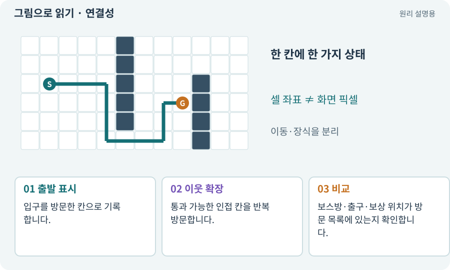

# 연결성·BFS·도달 가능성

**분야:** 지도·적 AI·전투 규칙

연결성 검사는 출발점에서 허용된 통로를 따라 목표에 도달할 수 있는지 확인합니다. BFS는 가까운 단계부터 이웃을 넓혀 가는 탐색 방법입니다.

**찾아오는 이름:** 연결성·BFS·도달 가능성, 연결성, BFS, Flood Fill, 도달 가능성, 연결 검사

## 익숙한 것에 비유하면

문이 열린 방들만 따라가며 방문 표시를 붙이는 것입니다. 색칠된 모든 방이 입구와 이어졌는지 볼 수 있습니다.



개념도입니다. 실제 Unity 화면이나 검사 결과가 아닙니다. 그림의 순서·색은 역할을 구분하며 실제 설정값은 프로젝트에서 확인합니다.

## 이렇게 작동합니다

### 1. 출발 표시

입구를 방문한 칸으로 기록합니다.

### 2. 이웃 확장

통과 가능한 인접 칸을 반복 방문합니다.

### 3. 비교

보스방·출구·보상 위치가 방문 목록에 있는지 확인합니다.

## 우리 RPG에서는 이렇게 만나요

논리 격자 BFS를 통과해도 실제 Collider가 통로를 막을 수 있습니다. 논리 연결과 실제 몸체 이동 검사를 모두 합니다.

## 이것과 혼동하지 마세요

BFS는 같은 간선 비용에서 최단 단계 수를 구할 수 있지만 가중치가 다른 길의 최소 비용 문제는 별도입니다.

## 이해했는지 한 번 생각해 보기

보스방이 화면에 보이면 갈 수 있다는 뜻일까요?

<details><summary>답과 이유</summary>

아닙니다. 입구에서의 연결과 실제 경로를 확인해야 합니다.

</details>

## 내 프로젝트에서 확인하고 싶다면

아래 요청은 읽기 전용으로 실제 대상을 확인하는 선택 요청입니다. 코드나 설정을 직접 편집할 필요는 없습니다.

```text
현재 프로젝트에서 연결성·BFS·도달 가능성 관련 요소가 어떻게 사용되는지 읽기 전용으로 확인해 줘. 실제 대상과 설정을 찾아 쉬운 말과 작은 예로 설명해 줘. 특히 다음 혼동을 구분해 줘: BFS는 같은 간선 비용에서 최단 단계 수를 구할 수 있지만 가중치가 다른 길의 최소 비용 문제는 별도입니다. 아직 코드·설정·파일은 바꾸지 말고, 확인할 수 없는 내용은 따로 알려 줘.
```

## 이어지는 개념

[Grid·셀·격자 좌표](grid.md) · [절차적·무작위 지형 생성](generation.md) · [몸체 여유·모서리 통과](clearance.md) · [NavMesh·Surface·Agent](navmesh.md)

## 이 개념을 사용하는 실습

[94 · 같은 랜덤 던전을 3D로 생성하기](../index.html#lesson-094)

## 참고와 설명의 범위

기본 도구 동작은 아래 공식 자료를 참고했습니다. 비유·그림·RPG의 예시 수치와 정책은 이해를 위한 자체 예제입니다. 실제 API·지원 기능은 설치 버전과 계정에서 확인합니다.

- [Hart·Nilsson·Raphael · A* 원 논문(1968)](https://ieeexplore.ieee.org/document/4082128/)

그림·계산 예제·조작 모형은 자체 제작한 설명입니다. 실제 Unity 화면, 서비스 생성 결과, 성능 실측 또는 게임 테스트 결과가 아닙니다. 자료 확인: 2026년 9월 26일.
