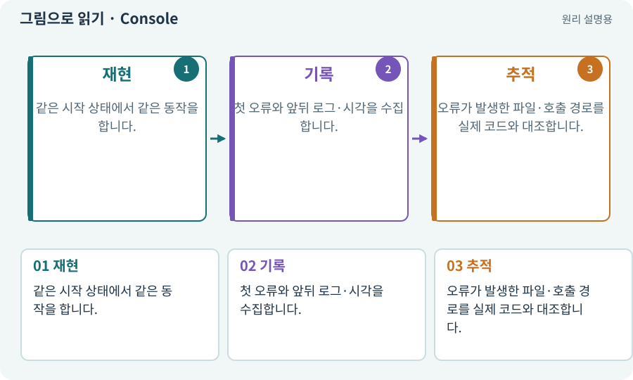

# Console·로그·스택 추적

**분야:** 시작·도구·작업 공간

로그는 프로그램이 남긴 사건 기록이고 Console은 이를 보여 주는 창입니다. 스택 추적은 오류가 생길 때 어떤 호출 경로를 거쳤는지 알려 줍니다.

**찾아오는 이름:** Console·로그·스택 추적, Console, 콘솔, log, stack trace, 오류 전문

## 익숙한 것에 비유하면

차의 블랙박스입니다. 마지막 “고장” 한 줄보다 직전에 무엇을 했고 어디서 시작됐는지가 원인 조사에 중요합니다.



개념도입니다. 실제 Unity 화면이나 검사 결과가 아닙니다. 그림의 순서·색은 역할을 구분하며 실제 설정값은 프로젝트에서 확인합니다.

## 이렇게 작동합니다

### 1. 재현

같은 시작 상태에서 같은 동작을 합니다.

### 2. 기록

첫 오류와 앞뒤 로그·시각을 수집합니다.

### 3. 추적

오류가 발생한 파일·호출 경로를 실제 코드와 대조합니다.

## 우리 RPG에서는 이렇게 만나요

NullReferenceException이 뜨면 “오류가 있어” 대신 AI가 실제 로그 전체와 연결되지 않은 대상을 읽게 합니다. 비밀번호나 인증 토큰은 로그에 남기지 않습니다.

## 이것과 혼동하지 마세요

마지막 오류만 고치면 앞선 초기화 실패가 남을 수 있습니다. 경고를 모두 숨기는 것은 해결이 아닙니다.

## 이해했는지 한 번 생각해 보기

에러 창을 지우면 버그도 없어지나요?

<details><summary>답과 이유</summary>

아닙니다. 표시 기록만 지운 것입니다. 같은 재현으로 오류가 다시 발생하는지 확인해야 합니다.

</details>

## 내 프로젝트에서 확인하고 싶다면

아래 요청은 읽기 전용으로 실제 대상을 확인하는 선택 요청입니다. 코드나 설정을 직접 편집할 필요는 없습니다.

```text
현재 프로젝트에서 Console·로그·스택 추적 관련 요소가 어떻게 사용되는지 읽기 전용으로 확인해 줘. 실제 대상과 설정을 찾아 쉬운 말과 작은 예로 설명해 줘. 특히 다음 혼동을 구분해 줘: 마지막 오류만 고치면 앞선 초기화 실패가 남을 수 있습니다. 경고를 모두 숨기는 것은 해결이 아닙니다. 아직 코드·설정·파일은 바꾸지 말고, 확인할 수 없는 내용은 따로 알려 줘.
```

## 이어지는 개념

[디버깅·로그·중단점](debug.md) · [참조·null·Missing Reference](reference.md) · [예외·null·오류 처리](exception.md) · [버그 재현·최소 재현·디버깅](repro.md)

## 이 개념을 사용하는 실습

[78 · 선택: Google Play 에셋 전달 사용하기](../index.html#lesson-078) · [159 · 최종 확장판 배포 후보 만들기](../index.html#lesson-159)

## 참고와 설명의 범위

기본 도구 동작은 아래 공식 자료를 참고했습니다. 비유·그림·RPG의 예시 수치와 정책은 이해를 위한 자체 예제입니다. 실제 API·지원 기능은 설치 버전과 계정에서 확인합니다.

- [Unity · 테스트 실행과 결과](https://docs.unity3d.com/Packages/com.unity.test-framework@1.4/manual/reference-command-line.html)

그림·계산 예제·조작 모형은 자체 제작한 설명입니다. 실제 Unity 화면, 서비스 생성 결과, 성능 실측 또는 게임 테스트 결과가 아닙니다. 자료 확인: 2026년 9월 26일.
