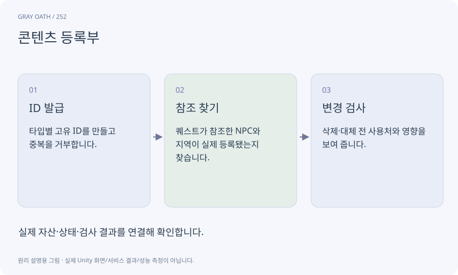

# 콘텐츠 등록부

퀘스트·NPC·아이템·지역이 어떤 ID로 존재하는지 찾는 목록입니다. 표시 이름과 영구 ID를 구분하고 참조의 유효성을 검사합니다.

## 익숙한 비유

책 제목이 바뀌어도 같은 책을 찾는 도서관 관리 번호입니다.



## 작동 원리

### 1. ID 발급

타입별 고유 ID를 만들고 중복을 거부합니다.

### 2. 참조 찾기

퀘스트가 참조한 NPC와 지역이 실제 등록됐는지 찾습니다.

### 3. 변경 검사

삭제·대체 전 사용처와 영향을 보여 줍니다.

## 게임 속 예

약초상 다온의 표시 이름을 번역해도 npc_daon ID는 유지됩니다. 퀘스트와 지도는 이름 대신 ID를 사용합니다.

## 혼동하지 않기

Hierarchy 이름이나 파일 경로만 영구 ID로 쓰면 이름 변경과 씬 이동이 저장을 깨뜨릴 수 있습니다.

## 확인 질문

등록부에 제목이 있으면 실제 플레이 가능한가요?

아닙니다. 자산과 참조 존재를 확인한 뒤 런타임 연결·플레이도 검사해야 합니다.

## 내 프로젝트에서 확인하기

```text
현재 GrayOathRPG3D에서 콘텐츠 등록부을 사용하는 실제 대상과 동작을 읽기 전용으로 확인해 줘. 쉬운 말과 작은 사례로 설명하고 Hierarchy 이름이나 파일 경로만 영구 ID로 쓰면 이름 변경과 씬 이동이 저장을 깨뜨릴 수 있습니다. 이 문제를 어떻게 막는지 보여 줘. 코드·데이터·설정은 아직 수정하지 마.
```

## 관련 해설

[identifier](identifier.md) · [reference](reference.md) · [assetdatabase](assetdatabase.md) · [quest-editor](quest-editor.md)

## 공식 참고

- [Unity · AssetDatabase](https://docs.unity3d.com/6000.3/Documentation/ScriptReference/AssetDatabase.html)
