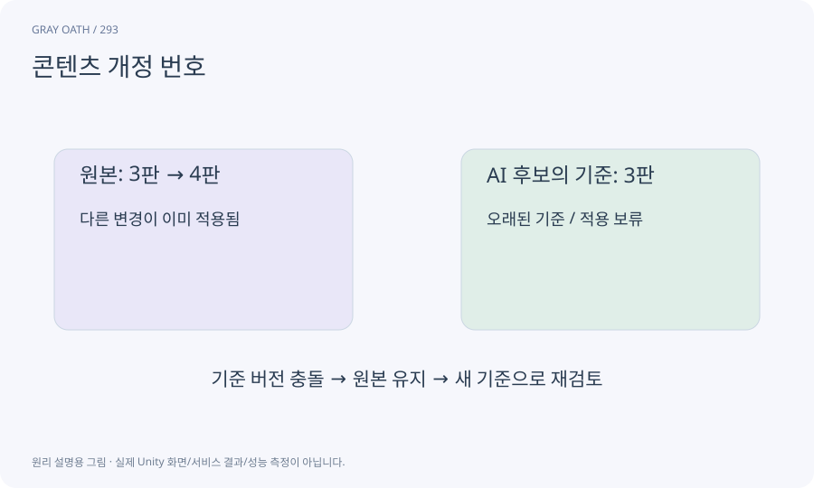

# 콘텐츠 개정 번호

퀘스트나 아이템 정의가 어떤 의미의 버전인지 나타내는 값입니다. 파일 내용 해시와 저장 schema는 각각 다른 질문에 답합니다.

## 익숙한 비유

책의2판·3판입니다. 책을 넣는 상자의 규격(schema)과 책 자체의 판본은 다릅니다.



## 작동 원리

### 1. 정의 변경

목표·조건·보상 변경을 새 revision으로 만듭니다.

### 2. 진행 연결

활성 인스턴스가 어떤 정의를 사용했는지 기록합니다.

### 3. 이전 결정

원래 snapshot 유지 또는 명시 migration을 적용합니다.

## 게임 속 예

아이템3개 수집을5개로 바꿨을 때 이미 진행 중인 플레이어에게 어떤 정책을 적용할지 정합니다. 새 정의로 조용히 덮지 않습니다.

## 혼동하지 않기

편집기 노드 위치만 바꾼 경우까지 게임 규칙 revision을 올릴 필요는 없습니다.

## 확인 질문

파일 hash가 같다는 것과 의미 version이 같다는 것은?

해시는 바이트 동일성, revision은 의도된 의미 이력입니다. 각각의 목적대로 함께 관리합니다.

## 내 프로젝트에서 확인하기

```text
현재 GrayOathRPG3D에서 콘텐츠 개정 번호을 사용하는 실제 대상과 동작을 읽기 전용으로 확인해 줘. 쉬운 말과 작은 사례로 설명하고 편집기 노드 위치만 바꾼 경우까지 게임 규칙 revision을 올릴 필요는 없습니다. 이 문제를 어떻게 막는지 보여 줘. 코드·데이터·설정은 아직 수정하지 마.
```

## 관련 해설

[hash](hash.md) · [schema](schema.md) · [migration](migration.md)

## 공식 참고

- [Unity · AssetDatabase](https://docs.unity3d.com/6000.3/Documentation/ScriptReference/AssetDatabase.html)
