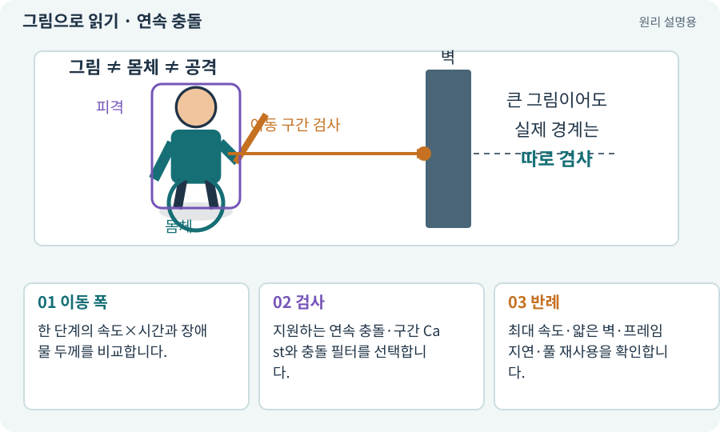

# 연속 충돌·터널링·빠른 투사체

**분야:** 설명을 읽기 위한 기초 언어

터널링은 빠른 물체가 한 물리 단계 사이에서 얇은 벽을 지나가 충돌을 놓치는 현상입니다. 연속 충돌이나 이동 구간 Cast는 이를 줄이기 위한 방법이며 실제 지원과 비용을 확인해야 합니다.

**찾아오는 이름:** 연속 충돌·터널링·빠른 투사체, 연속 충돌, Continuous Collision Detection, 터널링, Tunneling, discrete collision

## 익숙한 것에 비유하면

사진 두 장에서 공이 벽의 앞과 뒤에만 찍혀 중간의 접촉이 기록되지 않는 상황입니다.



개념도입니다. 실제 Unity 화면이나 검사 결과가 아닙니다. 그림의 순서·색은 역할을 구분하며 실제 설정값은 프로젝트에서 확인합니다.

## 이렇게 작동합니다

### 1. 이동 폭

한 단계의 속도×시간과 장애물 두께를 비교합니다.

### 2. 검사

지원하는 연속 충돌·구간 Cast와 충돌 필터를 선택합니다.

### 3. 반례

최대 속도·얇은 벽·프레임 지연·풀 재사용을 확인합니다.

## 우리 RPG에서는 이렇게 만나요

마력탄을 Transform 순간 이동만으로 움직이면 얇은 벽을 뚫을 수 있습니다. 이전 위치부터 새 위치까지 해당 반경으로 Cast하는 방법을 검토합니다.

## 이것과 혼동하지 마세요

이 항목의 CCD는 콘텐츠 배포 서비스 Unity CCD와 다른 약어입니다.

## 이해했는지 한 번 생각해 보기

투사체 크기를 크게 만들면 모든 터널링이 해결될까요?

<details><summary>답과 이유</summary>

공격 판정도 변하므로 이동·충돌 방식과 실제 최대 속도를 검사해야 합니다.

</details>

## 내 프로젝트에서 확인하고 싶다면

아래 요청은 읽기 전용으로 실제 대상을 확인하는 선택 요청입니다. 코드나 설정을 직접 편집할 필요는 없습니다.

```text
현재 프로젝트에서 연속 충돌·터널링·빠른 투사체 관련 요소가 어떻게 사용되는지 읽기 전용으로 확인해 줘. 실제 대상과 설정을 찾아 쉬운 말과 작은 예로 설명해 줘. 특히 다음 혼동을 구분해 줘: 이 항목의 CCD는 콘텐츠 배포 서비스 Unity CCD와 다른 약어입니다. 아직 코드·설정·파일은 바꾸지 말고, 확인할 수 없는 내용은 따로 알려 줘.
```

## 이어지는 개념

[Raycast·Linecast·Cast](raycast.md) · [Collider와 몸체 경계](collider.md) · [Update·FixedUpdate·LateUpdate](fixed-update.md) · [Unity CCD·콘텐츠 배포 서비스](ccd.md)

## 이 개념을 사용하는 실습

[15 · 다른 방식으로 싸우는 적 추가하기](../index.html#lesson-015)

## 참고와 설명의 범위

기본 도구 동작은 아래 공식 자료를 참고했습니다. 비유·그림·RPG의 예시 수치와 정책은 이해를 위한 자체 예제입니다. 실제 API·지원 기능은 설치 버전과 계정에서 확인합니다.

- [Unity · Physics2D.CircleCast](https://docs.unity3d.com/6000.3/Documentation/ScriptReference/Physics2D.CircleCast.html)
- [Unity · Rigidbody2D.MovePosition](https://docs.unity3d.com/6000.3/Documentation/ScriptReference/Rigidbody2D.MovePosition.html)

그림·계산 예제·조작 모형은 자체 제작한 설명입니다. 실제 Unity 화면, 서비스 생성 결과, 성능 실측 또는 게임 테스트 결과가 아닙니다. 자료 확인: 2026년 9월 26일.
