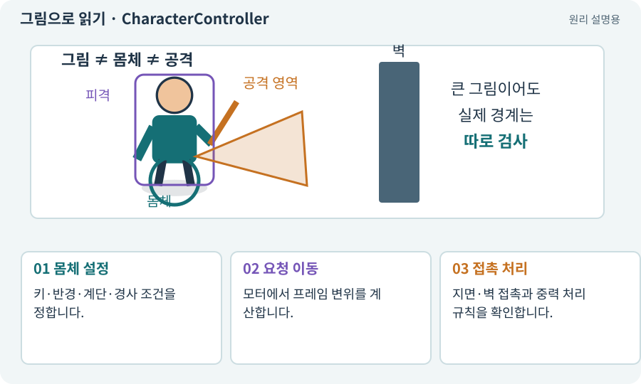

# CharacterController

**분야:** 오브젝트·좌표·움직임

CharacterController는 3D 캐릭터의 이동을 충돌과 함께 처리하기 위한 컴포넌트입니다. Move는 이동량을 받으며 중력을 자동으로 적용하는 함수가 아닙니다.

**찾아오는 이름:** CharacterController, 캐릭터 컨트롤러

## 익숙한 것에 비유하면

몸통 크기가 있는 운반 로봇에 “이만큼 이동해”라고 요청하면 벽에 걸리는 부분을 고려하는 장치입니다.



개념도입니다. 실제 Unity 화면이나 검사 결과가 아닙니다. 그림의 순서·색은 역할을 구분하며 실제 설정값은 프로젝트에서 확인합니다.

## 이렇게 작동합니다

### 1. 몸체 설정

키·반경·계단·경사 조건을 정합니다.

### 2. 요청 이동

모터에서 프레임 변위를 계산합니다.

### 3. 접촉 처리

지면·벽 접촉과 중력 처리 규칙을 확인합니다.

## 우리 RPG에서는 이렇게 만나요

3D 추가편은 직접 이동과 클릭 경로가 모두 같은 CharacterController 모터를 사용하게 합니다. NavMeshAgent의 자동 위치 갱신과 중복시키지 않습니다.

## 이것과 혼동하지 마세요

Rigidbody처럼 힘을 넣으면 똑같이 반응하는 몸체라고 가정하지 않습니다.

## 이해했는지 한 번 생각해 보기

Move에 초당 속도 3을 그대로 넣으면 되나요?

<details><summary>답과 이유</summary>

Move는 변위를 받으므로 경과 시간을 고려한 이동량인지 확인해야 합니다.

</details>

## 내 프로젝트에서 확인하고 싶다면

아래 요청은 읽기 전용으로 실제 대상을 확인하는 선택 요청입니다. 코드나 설정을 직접 편집할 필요는 없습니다.

```text
현재 프로젝트에서 CharacterController 관련 요소가 어떻게 사용되는지 읽기 전용으로 확인해 줘. 실제 대상과 설정을 찾아 쉬운 말과 작은 예로 설명해 줘. 특히 다음 혼동을 구분해 줘: Rigidbody처럼 힘을 넣으면 똑같이 반응하는 몸체라고 가정하지 않습니다. 아직 코드·설정·파일은 바꾸지 말고, 확인할 수 없는 내용은 따로 알려 줘.
```

## 이어지는 개념

[이동 모터와 단일 위치 책임](motor.md) · [deltaTime과 초당 속도](delta-time.md) · [NavMesh·Surface·Agent](navmesh.md) · [Collider와 몸체 경계](collider.md)

## 이 개념을 사용하는 실습

[07 · 캐릭터와 벽이 있는 공간 만들기](../index.html#lesson-007) · [85 · 3D 캐릭터를 한 모터로 움직이기](../index.html#lesson-085) · [86 · 3D에서도 클릭한 곳까지 돌아가기](../index.html#lesson-086)

## 참고와 설명의 범위

기본 도구 동작은 아래 공식 자료를 참고했습니다. 비유·그림·RPG의 예시 수치와 정책은 이해를 위한 자체 예제입니다. 실제 API·지원 기능은 설치 버전과 계정에서 확인합니다.

- [Unity · CharacterController](https://docs.unity3d.com/6000.3/Documentation/Manual/class-CharacterController.html)

그림·계산 예제·조작 모형은 자체 제작한 설명입니다. 실제 Unity 화면, 서비스 생성 결과, 성능 실측 또는 게임 테스트 결과가 아닙니다. 자료 확인: 2026년 9월 26일.
