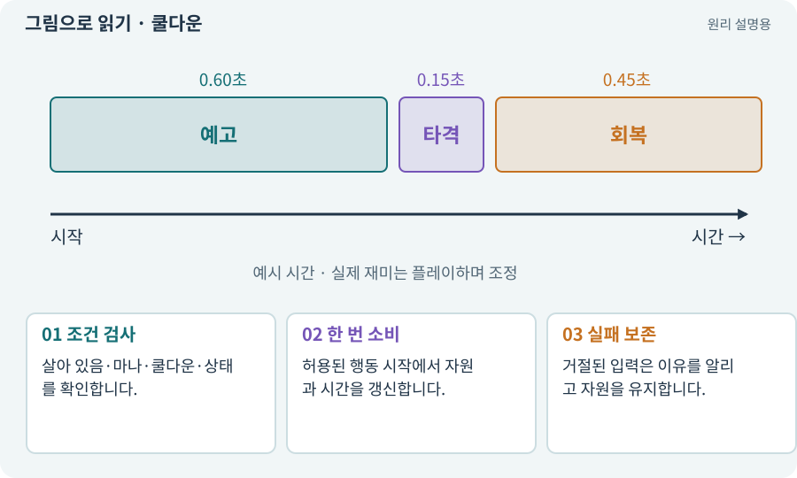

# 쿨다운·마나·자원 소비

**분야:** 지도·적 AI·전투 규칙

쿨다운은 다시 사용할 수 있을 때까지 기다리는 시간입니다. 마나·물약 같은 자원은 사용 조건을 만족해 행동이 실제 시작될 때 정해진 방식으로 소비합니다.

**찾아오는 이름:** 쿨다운·마나·자원 소비, 쿨다운, 재사용 대기시간, Cooldown, 마나, MP, HP, 체력

## 익숙한 것에 비유하면

자판기에 돈이 있는지와 기계가 다음 상품을 내줄 준비가 됐는지 둘 다 확인하는 것입니다.



개념도입니다. 실제 Unity 화면이나 검사 결과가 아닙니다. 그림의 순서·색은 역할을 구분하며 실제 설정값은 프로젝트에서 확인합니다.

## 이렇게 작동합니다

### 1. 조건 검사

살아 있음·마나·쿨다운·상태를 확인합니다.

### 2. 한 번 소비

허용된 행동 시작에서 자원과 시간을 갱신합니다.

### 3. 실패 보존

거절된 입력은 이유를 알리고 자원을 유지합니다.

## 우리 RPG에서는 이렇게 만나요

마나가 부족하거나 가방 UI 위를 잘못 눌렀을 때 스킬이 나가지 않는데 마나만 사라지면 오류입니다. 초기화 버튼이 쿨다운을 무료 회복하는지 검사합니다.

## 이것과 혼동하지 마세요

UI 숫자를 바꾼 것이 실제 전투 쿨다운을 바꾼 것과 같지 않습니다.

## 이해했는지 한 번 생각해 보기

쿨다운 중 버튼을 연타하면 마나가 줄어도 되나요?

<details><summary>답과 이유</summary>

스킬이 거절된 입력이라면 보통 줄지 않아야 합니다. 승인한 규칙을 일관되게 적용합니다.

</details>

## 내 프로젝트에서 확인하고 싶다면

아래 요청은 읽기 전용으로 실제 대상을 확인하는 선택 요청입니다. 코드나 설정을 직접 편집할 필요는 없습니다.

```text
현재 프로젝트에서 쿨다운·마나·자원 소비 관련 요소가 어떻게 사용되는지 읽기 전용으로 확인해 줘. 실제 대상과 설정을 찾아 쉬운 말과 작은 예로 설명해 줘. 특히 다음 혼동을 구분해 줘: UI 숫자를 바꾼 것이 실제 전투 쿨다운을 바꾼 것과 같지 않습니다. 아직 코드·설정·파일은 바꾸지 말고, 확인할 수 없는 내용은 따로 알려 줘.
```

## 이어지는 개념

[입력 버퍼·취소·우선순위](input-buffer.md) · [게임 시간·실시간·일시정지](time-scale.md) · [트랜잭션·거래의 한 번 적용](transaction.md) · [상태 기계·FSM](state-machine.md)

## 이 개념을 사용하는 실습

[16 · 물약을 쓰고 죽은 뒤 다시 시작하기](../index.html#lesson-016) · [18 · 베기·마력탄·회전 공격 만들기](../index.html#lesson-018) · [43 · 빌드를 바꾸며 전투 비교하기](../index.html#lesson-043) · [48 · 적이 나를 보고 놓치게 만들기](../index.html#lesson-048) · [51 · 전투 전체의 압박 조절하기](../index.html#lesson-051) · [53 · 입력은 빠르게, 취소 규칙은 명확하게](../index.html#lesson-053) · [54 · 느낌을 근거로 밸런스 고치기](../index.html#lesson-054) · [71 · 카메라·소리·피해 숫자 맞추기](../index.html#lesson-071) · [82 · 게임 규칙은 재사용하고 공간만 바꾸기](../index.html#lesson-082) · [89 · 같은 전투 규칙을 3D에 연결하기](../index.html#lesson-089) · [100 · 두 버전이 같은 게임인지 비교하기](../index.html#lesson-100) · [135 · 벽을 통과하지 않는 회피 만들기](../index.html#lesson-135) · [142 · 배운 스킬의 변형 선택하기](../index.html#lesson-142) · [144 · 이번 탐험에만 남는 유물 고르기](../index.html#lesson-144) · [151 · 도감과 장비 비교로 새 기능 찾기](../index.html#lesson-151)

## 참고와 설명의 범위

이 항목의 비유·그림·RPG 수치·운영 규칙은 개념을 이해하기 위한 자체 설계 예제입니다. 특정 도구가 이 규칙을 자동으로 구현한다는 뜻은 아닙니다.


그림·계산 예제·조작 모형은 자체 제작한 설명입니다. 실제 Unity 화면, 서비스 생성 결과, 성능 실측 또는 게임 테스트 결과가 아닙니다. 자료 확인: 2026년 9월 26일.
