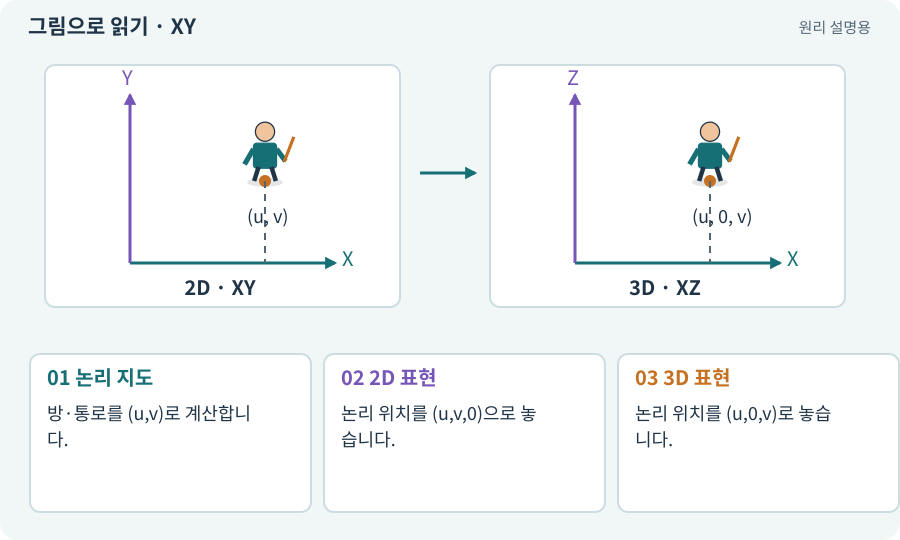

# XY·XZ 평면과 논리 좌표

**분야:** 오브젝트·좌표·움직임

좌표계는 방향과 위치를 숫자로 표현하는 규칙입니다. 본편은 XY가 바닥이고, 3D 추가편은 XZ가 바닥이며 Y가 높이입니다. 공통 지도는 별도의 (u,v) 논리 좌표로 보존합니다.

**찾아오는 이름:** XY·XZ 평면과 논리 좌표, XY, XZ, 논리 좌표, 좌표계, Vector2Int, cell coordinate

## 익숙한 것에 비유하면

같은 좌석 배치를 종이 지도와 입체 모형에 옮기는 것입니다. 좌석 번호는 같고 표시 방식만 다릅니다.



개념도입니다. 실제 Unity 화면이나 검사 결과가 아닙니다. 그림의 순서·색은 역할을 구분하며 실제 설정값은 프로젝트에서 확인합니다.

## 이렇게 작동합니다

### 1. 논리 지도

방·통로를 (u,v)로 계산합니다.

### 2. 2D 표현

논리 위치를 (u,v,0)으로 놓습니다.

### 3. 3D 표현

논리 위치를 (u,0,v)로 놓습니다.

## 우리 RPG에서는 이렇게 만나요

입구가 논리 (3,4)이면 두 버전에서 같은 입구를 가리킵니다. 3D에서 Y=4로 놓으면 높이 4에 떠 버리므로 축 변환을 한 곳에서 관리합니다.

## 이것과 혼동하지 마세요

쿼터뷰처럼 그린 스프라이트를 쓴다고 물리 평면이 XZ가 되는 것은 아닙니다.

## 이해했는지 한 번 생각해 보기

논리 지도를 공유하면 2D·3D 충돌 검사도 같나요?

<details><summary>답과 이유</summary>

논리 연결은 같을 수 있지만 실제 몸체·물리 엔진·경로 결과는 각각 검증해야 합니다.

</details>

## 내 프로젝트에서 확인하고 싶다면

아래 요청은 읽기 전용으로 실제 대상을 확인하는 선택 요청입니다. 코드나 설정을 직접 편집할 필요는 없습니다.

```text
현재 프로젝트에서 XY·XZ 평면과 논리 좌표 관련 요소가 어떻게 사용되는지 읽기 전용으로 확인해 줘. 실제 대상과 설정을 찾아 쉬운 말과 작은 예로 설명해 줘. 특히 다음 혼동을 구분해 줘: 쿼터뷰처럼 그린 스프라이트를 쓴다고 물리 평면이 XZ가 되는 것은 아닙니다. 아직 코드·설정·파일은 바꾸지 말고, 확인할 수 없는 내용은 따로 알려 줘.
```

## 이어지는 개념

[Transform: 위치·회전·크기](transform.md) · [Grid·셀·격자 좌표](grid.md) · [어댑터·인터페이스·의존성 분리](adapter.md) · [NavMesh·Surface·Agent](navmesh.md)

## 이 개념을 사용하는 실습

[01 · 빈 2D 프로젝트 만들기](../index.html#lesson-001) · [03 · AI와 실행 중인 Unity 연결하기](../index.html#lesson-003) · [04 · 되돌릴 수 있는 작업 습관 만들기](../index.html#lesson-004) · [07 · 캐릭터와 벽이 있는 공간 만들기](../index.html#lesson-007) · [09 · 클릭한 곳까지 벽을 돌아가기](../index.html#lesson-009) · [13 · 적을 클릭해 접근하고 공격하기](../index.html#lesson-013) · [28 · 여덟 구역의 첫 던전 만들기](../index.html#lesson-028) · [44 · 시드로 같은 던전 다시 만들기](../index.html#lesson-044) · [55 · 어떤 그림도 맞춰 넣는 아트 규격 정하기](../index.html#lesson-055) · [68 · 피격 불꽃과 먼지 만들기](../index.html#lesson-068) · [69 · 베기와 폭발을 시트 애니메이션으로 만들기](../index.html#lesson-069) · [70 · 피격 강조와 보스 예고 셰이더 만들기](../index.html#lesson-070) · [79 · 추가 기능을 하나의 게임으로 합치기](../index.html#lesson-079) · [82 · 게임 규칙은 재사용하고 공간만 바꾸기](../index.html#lesson-082) · [83 · 3D 카메라와 재질로 공간 보기](../index.html#lesson-083) · [84 · 같은 지도를 3D 바닥과 벽으로 만들기](../index.html#lesson-084) · [85 · 3D 캐릭터를 한 모터로 움직이기](../index.html#lesson-085) · [86 · 3D에서도 클릭한 곳까지 돌아가기](../index.html#lesson-086) · [89 · 같은 전투 규칙을 3D에 연결하기](../index.html#lesson-089) · [90 · 적의 판단을 3D 공간에 연결하기](../index.html#lesson-090) · [91 · 보스 예고를 3D 바닥에 맞추기](../index.html#lesson-091) · [92 · 무기를 손에 쥐고 전리품 표시하기](../index.html#lesson-092) · [93 · 3D 마을과 퀘스트 연결하기](../index.html#lesson-093) · [96 · 3D 카메라 가림과 터치 조작 다듬기](../index.html#lesson-096)

## 참고와 설명의 범위

기본 도구 동작은 아래 공식 자료를 참고했습니다. 비유·그림·RPG의 예시 수치와 정책은 이해를 위한 자체 예제입니다. 실제 API·지원 기능은 설치 버전과 계정에서 확인합니다.

- [Unity · Transform](https://docs.unity3d.com/6000.3/Documentation/Manual/class-Transform.html)

그림·계산 예제·조작 모형은 자체 제작한 설명입니다. 실제 Unity 화면, 서비스 생성 결과, 성능 실측 또는 게임 테스트 결과가 아닙니다. 자료 확인: 2026년 9월 26일.
