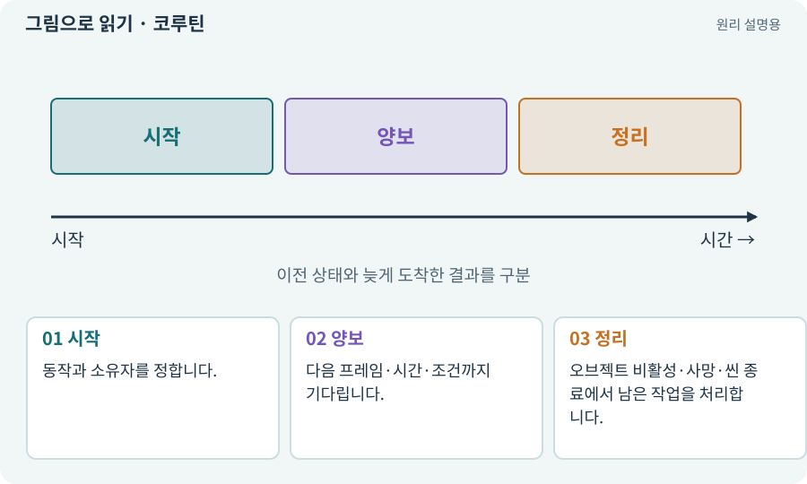

# 코루틴·여러 프레임에 걸친 작업

**분야:** 설명을 읽기 위한 기초 언어

Unity 코루틴은 실행을 잠시 멈추고 이후 프레임 등에 이어서 진행하는 방식입니다. 보통 메인 스레드에서 이어지며 별도의 병렬 스레드가 자동 생성되는 것은 아닙니다.

**찾아오는 이름:** 코루틴·여러 프레임에 걸친 작업, 코루틴, Coroutine, coroutine, yield, WaitForSeconds

## 익숙한 것에 비유하면

책갈피를 넣어 같은 일을 다음 차례에 이어가는 것과 같습니다.



개념도입니다. 실제 Unity 화면이나 검사 결과가 아닙니다. 그림의 순서·색은 역할을 구분하며 실제 설정값은 프로젝트에서 확인합니다.

## 이렇게 작동합니다

### 1. 시작

동작과 소유자를 정합니다.

### 2. 양보

다음 프레임·시간·조건까지 기다립니다.

### 3. 정리

오브젝트 비활성·사망·씬 종료에서 남은 작업을 처리합니다.

## 우리 RPG에서는 이렇게 만나요

보스의 공격 예고를 기다렸다가 타격하는 코루틴이 있을 때 보스가 죽으면 예정 타격을 취소해야 합니다. 기다리는 시간이 timeScale 영향을 받는지도 확인합니다.

## 이것과 혼동하지 마세요

코루틴 안에 무거운 반복 계산을 그대로 넣으면 프레임을 막을 수 있습니다.

## 이해했는지 한 번 생각해 보기

yield가 있다고 항상 앱이 멈추지 않나요?

<details><summary>답과 이유</summary>

양보하기 전 수행하는 계산이 무거우면 여전히 메인 스레드가 막힐 수 있습니다.

</details>

## 내 프로젝트에서 확인하고 싶다면

아래 요청은 읽기 전용으로 실제 대상을 확인하는 선택 요청입니다. 코드나 설정을 직접 편집할 필요는 없습니다.

```text
현재 프로젝트에서 코루틴·여러 프레임에 걸친 작업 관련 요소가 어떻게 사용되는지 읽기 전용으로 확인해 줘. 실제 대상과 설정을 찾아 쉬운 말과 작은 예로 설명해 줘. 특히 다음 혼동을 구분해 줘: 코루틴 안에 무거운 반복 계산을 그대로 넣으면 프레임을 막을 수 있습니다. 아직 코드·설정·파일은 바꾸지 말고, 확인할 수 없는 내용은 따로 알려 줘.
```

## 이어지는 개념

[비동기·await·콜백](async.md) · [수명주기·초기화·정리](lifecycle.md) · [게임 시간·실시간·일시정지](time-scale.md) · [메인 스레드·작업 스레드](thread.md)

## 이 개념을 사용하는 실습

[16 · 물약을 쓰고 죽은 뒤 다시 시작하기](../index.html#lesson-016)

## 참고와 설명의 범위

기본 도구 동작은 아래 공식 자료를 참고했습니다. 비유·그림·RPG의 예시 수치와 정책은 이해를 위한 자체 예제입니다. 실제 API·지원 기능은 설치 버전과 계정에서 확인합니다.

- [Unity · 코루틴](https://docs.unity3d.com/6000.3/Documentation/Manual/Coroutines.html)

그림·계산 예제·조작 모형은 자체 제작한 설명입니다. 실제 Unity 화면, 서비스 생성 결과, 성능 실측 또는 게임 테스트 결과가 아닙니다. 자료 확인: 2026년 9월 26일.
