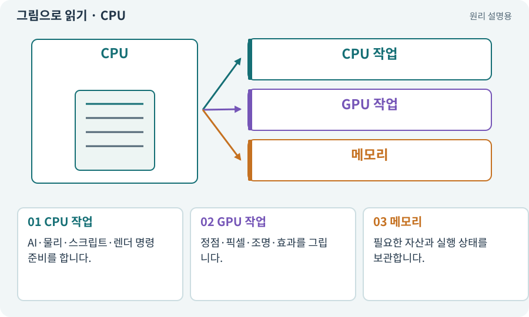

# CPU·GPU·RAM·VRAM

**분야:** 입력·UI·소리·성능

CPU는 주로 게임 로직·작업 조정, GPU는 대량의 화면 계산을 맡습니다. RAM은 작업용 메모리이고, GPU가 쓰는 메모리 구조는 기기에 따라 전용 또는 공유일 수 있습니다.

**찾아오는 이름:** CPU·GPU·RAM·VRAM, CPU, GPU, RAM, VRAM, 메모리, 그래픽 메모리

## 익숙한 것에 비유하면

주방장과 여러 조리대, 각 재료 보관 공간을 떠올리면 됩니다. 한쪽이 바쁘면 다른 쪽이 기다릴 수 있습니다.



개념도입니다. 실제 Unity 화면이나 검사 결과가 아닙니다. 그림의 순서·색은 역할을 구분하며 실제 설정값은 프로젝트에서 확인합니다.

## 이렇게 작동합니다

### 1. CPU 작업

AI·물리·스크립트·렌더 명령 준비를 합니다.

### 2. GPU 작업

정점·픽셀·조명·효과를 그립니다.

### 3. 메모리

필요한 자산과 실행 상태를 보관합니다.

## 우리 RPG에서는 이렇게 만나요

적 100마리의 A*는 CPU, 화면 가득 반투명 불꽃은 GPU 비용을 높일 수 있습니다. 큰 텍스처 묶음은 메모리를 압박할 수 있습니다.

## 이것과 혼동하지 마세요

모든 모바일이 PC처럼 별도 VRAM을 갖는다고 가정하지 않습니다. 실제 기기에서 봅니다.

## 이해했는지 한 번 생각해 보기

GPU 병목인데 경로 계산만 줄이면?

<details><summary>답과 이유</summary>

도움이 제한적일 수 있습니다. 실제 병목을 먼저 확인합니다.

</details>

## 내 프로젝트에서 확인하고 싶다면

아래 요청은 읽기 전용으로 실제 대상을 확인하는 선택 요청입니다. 코드나 설정을 직접 편집할 필요는 없습니다.

```text
현재 프로젝트에서 CPU·GPU·RAM·VRAM 관련 요소가 어떻게 사용되는지 읽기 전용으로 확인해 줘. 실제 대상과 설정을 찾아 쉬운 말과 작은 예로 설명해 줘. 특히 다음 혼동을 구분해 줘: 모든 모바일이 PC처럼 별도 VRAM을 갖는다고 가정하지 않습니다. 실제 기기에서 봅니다. 아직 코드·설정·파일은 바꾸지 말고, 확인할 수 없는 내용은 따로 알려 줘.
```

## 이어지는 개념

[Profiler·병목·실기기 측정](profiler.md) · [FPS·프레임 시간·ms](frame-time.md) · [파일 용량과 실행 메모리](texture-compression.md) · [오버드로·투명 효과 비용](overdraw.md)

## 이 개념을 사용하는 실습

[37 · 느려지는 원인을 측정해 고치기](../index.html#lesson-037) · [42 · 트리에서 투자하고 저장하기](../index.html#lesson-042) · [44 · 시드로 같은 던전 다시 만들기](../index.html#lesson-044) · [47 · 실패하는 시드를 찾고 복구하기](../index.html#lesson-047) · [72 · 모바일 효과를 줄여도 위험은 남기기](../index.html#lesson-072) · [75 · 다운로드 용량과 진행률 보여 주기](../index.html#lesson-075) · [77 · 앱을 바꾸지 않고 외형 업데이트하기](../index.html#lesson-077) · [101 · 3D Android 성능 다시 측정하기](../index.html#lesson-101) · [104 · 2D와 3D를 두 플랫폼에서 완주하기](../index.html#lesson-104) · [154 · 확장 기능을 켠 휴대폰 성능 고치기](../index.html#lesson-154)

## 참고와 설명의 범위

기본 도구 동작은 아래 공식 자료를 참고했습니다. 비유·그림·RPG의 예시 수치와 정책은 이해를 위한 자체 예제입니다. 실제 API·지원 기능은 설치 버전과 계정에서 확인합니다.

- [Unity · 타깃 기기 프로파일링](https://docs.unity3d.com/6000.3/Documentation/Manual/profiling-target-device.html)

그림·계산 예제·조작 모형은 자체 제작한 설명입니다. 실제 Unity 화면, 서비스 생성 결과, 성능 실측 또는 게임 테스트 결과가 아닙니다. 자료 확인: 2026년 9월 26일.
