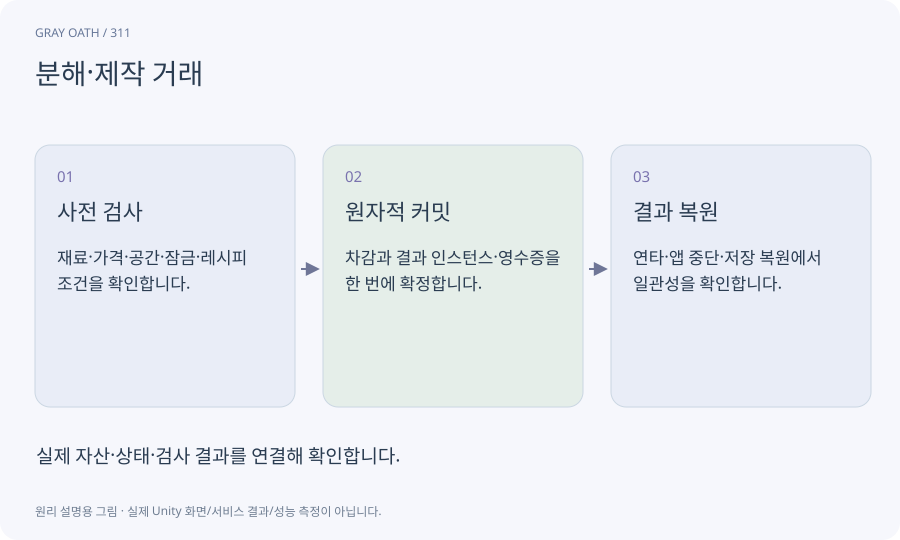

# 분해·제작 거래

재료와 화폐를 소비하고 아이템을 생성하는 거래입니다. 미리보기·실제 차감·결과 지급·저장이 한 규칙을 사용해야 합니다.

## 익숙한 비유

재료를 계산하고 결제한 뒤 주문한 제품을 받는 과정입니다.



## 작동 원리

### 1. 사전 검사

재료·가격·공간·잠금·레시피 조건을 확인합니다.

### 2. 원자적 커밋

차감과 결과 인스턴스·영수증을 한 번에 확정합니다.

### 3. 결과 복원

연타·앱 중단·저장 복원에서 일관성을 확인합니다.

## 게임 속 예

가방이 꽉 찼다면 재료부터 차감하지 않습니다. 같은 requestId가 다시 와도 같은 결과를 돌려주고 새 검을 만들지 않습니다.

## 혼동하지 않기

UI에서 버튼을 잠그는 것만으로 중복 거래를 막지 못합니다.

## 확인 질문

제작과 판매를 반복해서 공짜 돈을 얻으면?

레시피 원가·분해 반환·판매가의 순환을 데이터 검사로 확인합니다.

## 내 프로젝트에서 확인하기

```text
현재 GrayOathRPG3D에서 분해·제작 거래을 사용하는 실제 대상과 동작을 읽기 전용으로 확인해 줘. 쉬운 말과 작은 사례로 설명하고 UI에서 버튼을 잠그는 것만으로 중복 거래를 막지 못합니다. 이 문제를 어떻게 막는지 보여 줘. 코드·데이터·설정은 아직 수정하지 마.
```

## 관련 해설

[transaction](transaction.md) · [idempotency](idempotency.md) · [item-instance](item-instance.md)

## 공식 참고

- [Unity · AssetDatabase](https://docs.unity3d.com/6000.3/Documentation/ScriptReference/AssetDatabase.html)
